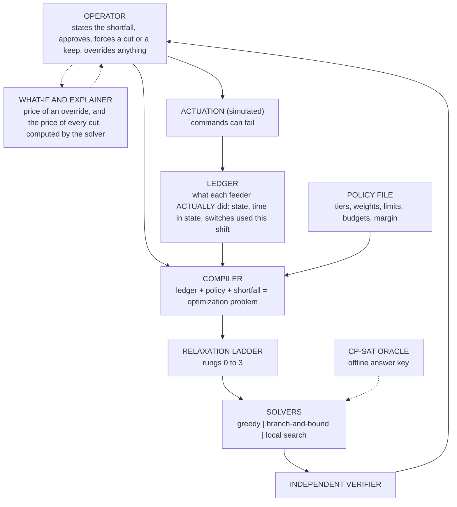

# Urja Niyam: Project Guide

**A load-shedding decision-support system, built as a constraint optimization project for an Artificial Intelligence course.**

| | |
|---|---|
| **What this file is** | The one place that explains *what* we are building, *why* each decision was made, and *how* each part works, in words that a team member, a professor or an examiner can follow. |
| **Last updated** | 2 November 2026 (version 0.10) |
| **State of the project** | Built and run: the model, the verifier, the simulator, two baselines, an exact solver, a local-search solver, their hybrid, a CP-SAT answer key, the relaxation ladder, the rolling-horizon loop, the scale sweep, the ladder statistics, the robustness experiments (10 seeds), the stability experiment (10 seeds), the forecast-error test, the sensitivity run, the operator what-if and the first version of the explainer. 371 automated tests are expected (369 earlier plus 2 for the what-if and the explainer). The new tests pass; the full suite has not been re-run since the latest changes. Still to do: the rest of the sensitivity run, an optional tighter bound, the reason codes and the text-rewrite layer of the explainer, the rest of the calibration, field validation, and the report. |
| **Honesty rule** | Every number here comes from something we built and ran. Assumptions and placeholders are labelled as such. Nothing is claimed about the real Indian grid that we have not marked "needs validation". |

Sections marked **[LIVE]** change as results arrive.

**How this guide is meant to be read.** Start with "The project in 60 seconds" and "In plain words". Every later section starts with a plain statement of what it is for. Every results section ends with one sentence you can say out loud. Section 12 collects the questions an examiner is likely to ask, with short answers, and a glossary closes the file. If you cannot explain a part of the project in a few sentences using this guide, the guide is wrong and should be fixed.

---

## The project in 60 seconds

When a power grid cannot supply everything people want, someone must decide which areas lose power for a while. Today that is mostly done by hand, under pressure. Our tool recommends the choice. It follows every rule it is given (never cut a hospital without approval, do not flick a switch every few minutes, do not leave one area dark for hours). It gives every outage a "pain score" and looks for the plan with the least total pain. A separate small checker confirms that every plan obeys the rules before anyone sees it. A person always makes the final decision, and the tool can show the price of any order the person gives. Everything it recommends can be traced to a rule and a number.

We built several solvers and compared them, because comparing them is how we learn how good the answers are. We tested the tool when its inputs are wrong (bad load readings, wrong forecasts, failing breakers) and we checked our own results seed by seed, which corrected several of our early claims. All feeders are synthetic, so we make no claim about the real grid yet.

---

## In plain words

**What are we doing?** When there is not enough electricity, someone has to choose which areas lose power for a while. We are building a helper that suggests the choice, checks that the suggestion follows every rule, and explains it. A person always makes the final call.

**How does it decide?** We write the rules down. We also give every outage a "pain score" that grows the longer people sit without power. Then we look for the plan with the smallest total pain that breaks no rule.

**Why build several solvers?** Because comparing them is how we learn how good our answers are.
- **Simple rules** (greedy) are what a person might do by habit. They are our yardstick for "is this even worth building?".
- **Exact search** (branch-and-bound) tries every sensible option and skips the hopeless ones, so it can *prove* it found the best plan. It only works on small grids.
- **Local search** starts from a plan and keeps making small improvements. It cannot prove anything, but it keeps working on big grids.
- **Hybrid**: local search first, then exact search that starts from the plan local search found, so the exact search wastes no time on bad plans.
- **CP-SAT** is a strong professional solver from Google. We use it only as a judge.

**Why test with 10, 50, 200 and 500 feeders?** A real area has anything from dozens to hundreds of feeders. We need to know where each method stops working.

**What did we find?** (medians over two instances per case; "extra pain" means how much worse than the best plan anyone found)
1. **10 feeders:** local search and CP-SAT find the best plan in every tier. Our exact search does too, except on one hard crisis instance. The simple rule wastes 20-41% extra pain.
2. **50 feeders:** nobody can prove which plan is best. CP-SAT with 60 seconds is slightly ahead of our local search with 21 seconds (within 0-1% against 3-7% of the best plan found). The simple rule wastes 56-140%.
3. **200 and 500 feeders:** local search gives the best plans at both sizes. CP-SAT with 60 seconds finds plans at 200 feeders that are 28-61% worse than local search. The simple rule wastes 59-90% in mild and moderate shortfalls, but only 8-29% in a crisis, where almost everything has to be cut anyway.
4. **How close to the best possible?** At 10 feeders, where we can check, local search found the best plan every time. At bigger sizes we cannot prove it, but we can say its plan is at most 17-48% above the best possible.
5. **Exact search runs out of steam at about 20 feeders**, even when it starts from a good plan. The hybrid never does worse than either solver alone, but it does not move that wall.
6. **The relaxation ladder** (the part that bends the rules when it must) never had to act for realistic shortfalls: up to 30% of demand every plan satisfied every rule. It starts to act at 40-50% of demand.
7. **What decides whether the ladder is ever needed: the maximum downtime.** If a feeder may be dark for 3 hours, the ladder stays idle up to 30% of demand. At 2 hours half of our 50-feeder cases already need a relaxation at 30%, and at 1 hours all of them do at 20%. The switching limit matters less, and the restoration surge did not matter in the range we tried. Real limits have no public source, so this is the first thing to ask an operator.
8. **Robustness (10 seeds).** The first run used 3 seeds and several headline numbers were wrong. The corrected picture:
   - **A bigger safety margin is expensive and only partly protective.** At a 20% load error, a 15% margin raised the median harm by 65% and a 30% margin by 166%, and shortfall was still left in 3 and 2 episodes out of 10.
   - **Learning loads from meters beats a big margin, but only with good meters.** With exact meters the harm was about half that of the 30% margin (mean 61k against 124k) with a similar shortfall. With 10% meter noise most of the advantage disappears. An early version let the tool read meters of switched-off feeders, which a real tool cannot do. We fixed that.
   - **Operator orders are costly.** Forcing one feeder to stay on multiplied the median harm by 4.7, forcing two by 11.1. Forcing a cut of one idle feeder by 5.4, two by 8.9. Individual cases ranged from 1.9 to 240 times. This is why the tool shows the price of an order before it is applied.
   - **Failed breakers leave shortfall unserved.** The mean unserved shortfall rose from 0 to 236, 486 and 617 kW-slots at failure chances of 10%, 20% and 30%.
   - **Wrong shortfall forecasts hurt in two ways.** With a 20% forecast error, harm rose by 73% and shortfall was left unserved in 3 of 10 episodes. At 40% error, 6 of 10. A bigger margin helps only a little.
   - **Re-planning with the previous plan as a starting point makes the committed actions steadier.** Commit surprise was 0.2-0.3% with it and 0.7-1.7% without. It has no consistent effect on harm.
9. **A caution on harm numbers in the loop.** Each replan gets only about one second per solve. On hard instances that is not enough to find the best plan, and harm can be 15-30% higher than a longer search finds. So the loop's harm numbers are upper bounds, and we rest our conclusions on unserved shortfall and on comparisons of the same seed.

**What does this change?**
- Local search is the main solver for big grids. Exact search is for small grids and for proofs. CP-SAT stays a judge, used only up to about 50 feeders.
- Our lower bound is the measuring stick at every size, because it is cheap.
- Because operator orders are so costly, the tool shows their price first (the what-if). The same calculation gives the first explanation we can show for every cut: what it would cost to keep that feeder on instead.
- What remains: finish the sensitivity items, extend the explainer, finish calibration, field validation, the report.

---

## 1. The problem, and the slice of it we solve

*Purpose of this section: say exactly which problem we solve, for whom, and what we leave out.*

### 1.1 The problem

When a power grid cannot supply everything people want to use, the utility switches off some areas on purpose for a while. This is **load shedding**. Without it, the grid can collapse entirely.

The person in the control room has to decide *which feeders to cut, in what order, and for how long*. In India this is mostly done by hand, under time pressure. Four things have to be balanced at once: protect critical services (hospitals, water pumping), keep any one area from suffering long outages, respect the limits of the field staff who flip the switches, and keep total disruption low.

**Our tool recommends that decision.** The dispatcher gives it the shortfall ("we are short by X kW for the next hours"). It returns a plan that obeys every rule, with the reasons. The human can always override.

### 1.2 Which layer of power-system operation this is

| Layer | Time scale | Ours? |
|---|---|---|
| Demand and shortfall **forecasting** | days to hours | **No.** A separate, well-studied machine-learning problem. We take the shortfall as an *input*. |
| **Rotational load shedding** | **hours, in 15-minute steps** | **Yes.** Given a shortfall, which feeders do we cut and when? |
| Emergency under-frequency shedding | seconds | No. Automatic relays do this. |
| Network physics (line flows, voltage) | milliseconds to seconds | No. We do not model the network. |

**Why this layer.** Forecasting asks "how short will we be?". Nobody has to *decide* anything from a forecast until the shortfall is known. The decision step is the harder half, it can be formulated precisely, and it is exactly where constraint-solving techniques apply. Staying out of forecasting also keeps this a search-and-optimization project rather than a machine-learning one. (We do test what happens when the shortfall we are given is *wrong*, see 8.8.)

### 1.3 Who the tool is for

The **dispatcher** (control-room engineer) is the primary user, because the dispatcher's judgment is the hard part and the field operator only executes it. The tool must still produce plans a field operator can carry out, so the operators' limits are inside the model. Automating the field step comes later, only if the recommendations prove good, and it would keep a human confirmation.

### 1.4 What real-world practice forces into the model

> **Source note.** This is general background plus public material. We could not reach grid staff, so every item is listed in `docs/field_constraints.md` as "needs validation by an operator". Treat these as plausible, not confirmed.

| Real-world fact | How the model handles it | Why |
|---|---|---|
| Shedding is a last resort; operators first buy power, back down generation, or ask interruptible industry to cut | The tool takes the **remaining** shortfall after those steps; industry-like feeders are the cheapest tier | Buying 50 MW for two hours may be kinder than cutting homes |
| Hospitals and water pumping should be shed last | **Critical tier**: shed last, and only with explicit operator approval | Matches practice and keeps the human in charge |
| Farm feeders get promised supply hours | **Promised supply windows** are a hard rule | Cutting them breaks a commitment |
| A feeder restored after a long cut pulls extra load (motors, ACs, pumps start together) | **Restoration surge** is added to the required relief | Without it, "shortfall covered" is false in the slot after a restore |
| Breakers cannot flip every 15 minutes; staff do few operations per shift | **Minimum cut/restore durations** and **switching budgets** | The plan must be executable |
| Meter readings are rough or late | A **safety margin** on the shortfall, or learning loads from meters | Insurance against estimate error (its price is measured in section 8) |
| Hospitals sit on feeders shared with thousands of homes | A feeder is tagged with its **highest tier** | Protection is a property of the whole feeder |
| Operators override plans for reasons the tool cannot see | **Force-cut and force-keep** are inputs; the tool replans around them, and the **what-if** shows what an override will cost | The human always has the last word, and should see the price |
| Some discoms cut high-loss feeders more | We do not decide this. Tier and harm weights are **policy inputs** | It is a value judgment, not a computation |

---

## 2. Turning the problem into a constraint optimization problem

*Purpose of this section: show how a real decision becomes something a computer can search.*

### 2.1 The vocabulary we use

A **constraint satisfaction problem (CSP)** has three parts: *variables*, a *domain* of values for each, and *constraints* that rule out combinations. A solution assigns every variable a value without breaking any constraint. A **constraint optimization problem (COP)** adds an *objective* to minimize among the solutions. Constraints that must hold are **hard**; ones that may be given up, at a cost, are **soft**. This is sometimes called a **weighted CSP**.

| CSP idea | In our problem |
|---|---|
| Variables | `x[f,t]`, one per feeder *f* and 15-minute slot *t* (50 feeders x 16 slots = 800) |
| Domain | {0 = on, 1 = cut} |
| Hard constraints | The six rules in 2.2 |
| Soft constraint | Maximum consecutive downtime |
| Objective | Minimize total harm (2.3) |

Two features of our constraints matter later. First, the key ones are **global**: the relief rule is a sum over *all* feeders in a slot, and the duration rules look at *runs* of consecutive slots. Classic arc consistency (AC-3) works on constraints between *pairs* of variables, so it prunes almost nothing here. We use **bounds propagation on the sums** instead (6.4). Second, most rules involve **one feeder only**. That lets us reformulate the problem (6.3).

### 2.2 The model

**Time.** 15-minute slots. We plan 16 slots (4 hours) ahead, **commit only the first**, then replan.

**Feeder data.** A priority **tier** (Flexible = shed first, Normal, Critical = shed last), a **type** (urban, rural, agricultural, industrial, mixed), a consumer count, an **estimated load in kW per slot**, and optional promised supply hours. Cutting a feeder relieves its *current load*, not its capacity, which is why load is per slot.

**History.** For every feeder: is it cut now, how many slots it has been in that state, and how many switches it has used this shift. History is part of the model because the time-based rules mean nothing without it.

**Hard rules** (a plan that breaks one is rejected):

1. **Relief.** In every slot the cut load must cover the shortfall, times a safety margin, plus the restoration surge.
2. **Minimum cut and minimum restore durations.** No flicking on and off.
3. **Switching budgets.** A maximum number of breaker operations per feeder and for the whole system, per shift.
4. **Operator overrides** are obeyed.
5. **Promised supply hours** hold.
6. **Critical feeders** are never cut without approval.

**Soft rule.** **Maximum consecutive downtime**. It is the first thing the ladder gives up (2.4).

### 2.3 The objective: harm

```
harm = sum over cut (feeder, slot) of  tier_weight x time_of_day_weight x consumers x (1 + 0.5 x (r - 1))
     + 0.02 x (kW of relief beyond what was needed)
     + 1.0 x (number of breaker operations)
```
`r` is how many slots in a row the feeder has already been off, counting this slot.

**Worked example.** A Normal feeder (weight 5) with 1,000 consumers at time-of-day weight 1:

| Slot of the outage | Factor | Harm |
|---|---|---|
| 1st | 1.0 | 5,000 |
| 2nd | 1.5 | 7,500 |
| 3rd | 2.0 | 10,000 |
| 4th | 2.5 | 12,500 |

One 4-slot outage costs 35,000. Two separate 2-slot outages cost 25,000.

**Why convex in outage length.** Each extra hour in the dark hurts more than the last. As a side effect the optimizer prefers to **spread** a long need across feeders, so rotation appears without being demanded.

**Why there is no fairness rule.** We started with one (a Gini-coefficient bound) and dropped it. Fairness is hard to define, the harm of an outage differs by place and person, and Gini is a non-local nonlinear measure that does not fit a constraint solver. What we keep is honest and limited: cuts rotate *within an episode* because of the convex cost, and we **do not claim equity over days or weeks**. Who counts more is expressed by the weights, which the operator sets.

**Why the tier weights are 1 / 5 / 1000.** The Critical weight is large enough that a Critical feeder is cut only when nothing else can cover the need. The approval requirement is the actual safeguard; the weight keeps the cost ordering consistent with it. The numbers are placeholders (section 10).

**Why the other two terms are tiny.** Overshoot and switching penalties are small next to harm, so they act as tie-breakers. The hard rules (minimum durations, switching budgets) do the real anti-thrashing work.

### 2.4 The relaxation ladder

If no plan satisfies every rule, we give up rules **in a fixed order**, each rung including the ones before it:

| Rung | What is given up | Outcome |
|---|---|---|
| 0 | Nothing | Executable plan |
| 1 | Maximum downtime (soft rule); the excess is reported | Executable plan |
| 2 | Not cutting Critical feeders: offered as a **proposal** that lists exactly which (feeder, slot) cuts need approval | Not executable until approved |
| 3 | **ESCALATE**: the shortfall cannot be covered within the rules; we report the best coverage reachable without cutting Critical feeders, and the uncovered kW per slot | The human decides |

**Why this design.** A solver that silently drops rules is dangerous, and one that returns "infeasible" is useless during a heatwave. The ladder gives a usable answer while keeping each concession visible, measured and approved. Relaxation hierarchies are an established idea (constraint hierarchies, weighted CSPs); our contribution is applying them with an operator-approval step.

### 2.5 How hard is it

Choosing which items to cut so that their relief just covers a requirement is a **covering knapsack** problem, which is NP-hard, and ours adds rules over time. So exact methods will slow sharply as grids grow. We treat that as a **result to measure** (the scalability wall), not a flaw to hide.

---

## 3. Data

*Purpose of this section: say what is real, what is invented, and how the real part shapes the scenarios.*

### 3.1 What is real and what is not

Real feeder-level cut histories are not public. So **real data fixes only the size and frequency of shortfalls**. Everything about the feeders (tiers, loads, types, histories) is **synthetic**, built from documented placeholder assumptions.

### 3.2 The real dataset and what the EDA told us

**Source.** Hunt and Bloomfield, *Daily electricity demand data for Indian states (2014-2024)*, Zenodo, CC BY 4.0 (DOI to be added to `docs/data-sources.md`). Daily, state-level, not hourly and not feeder-level.

**Used:** `peak_unmet_MW` and `corrected_peak_met_MW`. **Parked:** the weather files and heat-stress index. Using them would pull the project toward forecasting.

| Finding | Detail | Consequence |
|---|---|---|
| Size and span | 3,955 rows x 39 columns, 1 Jan 2013 to 28 Apr 2024 | |
| Non-state columns | **Total**, **AMNSIL**, **DVC** sit beside the 36 states and UTs | Excluded, to avoid double counting |
| Missing data | about 6% of cells; about 240 missing days; 55 duplicate dates | Keep the first duplicate |
| Raw errors | The "corrected" files change about 200 cells per file; one raw peak value was off by about 100,000 MW | **Always use the corrected files** |
| No corrected unmet file | Only a raw version exists | Drop ratios above 0.5 as suspect (only 3 dropped) |
| Zero-heavy | 130,777 state-days have data; only 35,499 (27.1%) have any unmet demand | Take percentiles over **non-zero days only** |
| Falling trend | Mean unmet fell about 95% from 2013 to 2024 | Early years dominate the severe days |
| Dominated by a few states | J&K (median about 20% of demand unserved) and the north-east states have unmet demand on most days | Pooled percentiles describe chronic small states more than large grids |

### 3.3 From data to scenarios

We use a **ratio**, not raw MW, so the same scenario scales to a grid of any size:

```
shortfall ratio = unmet MW / (met MW + unmet MW)      on days with unmet demand
```

| Percentile | P10 | P25 | P50 | P75 | P90 | P95 | P99 | P99.9 |
|---|---|---|---|---|---|---|---|---|
| Ratio | 0.46% | 1.09% | 2.96% | 6.84% | 15.5% | 20.0% | 23.1% | 31.6% |

**Our tiers use percentiles 50, 75 and 95: mild 3.0%, moderate 6.8%, crisis 20.0%** of demand unserved. The first plan (50/90/99) was dropped because P90 and P99 sit close together (the upper tail is J&K's normal level), which would have made two near-identical tiers. A 2019-onward version (`tiers_2019.json`) exists (mild 1.8%, moderate 5.5%, crisis 20.0%); **its comparison is not yet analysed**.

**Shape inside a day.** The data is daily, so it cannot say how a shortfall rises and falls. We use a documented synthetic **trapezoid** (ramp up over 4 slots, hold, ramp down), so `S(t) = ratio x shape(t) x demand(t)`. This is an assumption, not a data result.

### 3.4 The synthetic grid

`make_grid(n, seed)` builds feeders: 5% Critical, 15% Flexible, 80% Normal; types and sizes by tier; hourly load shapes (evening peak for homes, flat for industry, supply blocks of 06-14, 14-22 or 22-06 for farms with a 75% promise). The same seed gives the same grid. All numbers are placeholders to be calibrated from tariff orders (`docs/field_constraints.md`).

---

## 4. System design

*Purpose of this section: show the parts, who talks to whom, and the rules the design never breaks.*



**Six rules the design never breaks, and why:**

1. **The human is in control.** Nothing runs without the operator, and any decision can be overridden. In a safety setting, a tool that cannot be overruled will not be trusted or adopted.
2. **The solver is untrusted; the verifier decides.** Every plan passes a small independent checker. That is what makes it safe to use fast heuristics that cannot prove anything.
3. **No black boxes.** Each cut traces to a rule and a cost. This is why we chose constraint solving over learned models (section 5).
4. **Policy is data.** Every tunable number lives in `configs/policy.yaml`, so changing practice means editing a file.
5. **We claim only what we measured.** Novelty is claimed for the application and the evaluation, not for the underlying algorithms.
6. **Every number shown to the operator must be explainable in one sentence, and must come from the solver.** A language model may rewrite an explanation. It may never create one.

**Repository map.**

```
configs/policy.yaml          every tunable number
src/loadshed/model.py        data types      policy.py  loads and validates the YAML
src/loadshed/verify.py       the independent verifier
src/loadshed/metrics.py      the harm objective and reporting numbers
src/loadshed/sim/            grid generator, scenarios, Zenodo ratios
src/loadshed/solvers/        greedy.py  patterns.py  bnb.py  minconflicts.py  hybrid.py
src/loadshed/ladder.py       the relaxation ladder
src/loadshed/loop.py         the rolling-horizon loop
src/loadshed/whatif.py       what_if (price of an override) and explain_cuts (price of every first-slot cut)
evaluation/                  oracle_cpsat.py (CP-SAT, offline only), run_gap.py, run_scale.py, run_hybrid.py,
                             run_ladder_stats.py, run_robustness.py, run_forecast.py, run_sensitivity.py,
                             analyze_robustness.py (per-seed view of a robustness CSV),
                             check_determinism.py, check_budget.py (solver-noise checks), plot_scale.py
scripts/  tests/  notebooks/  data/  docs/  literature/
```

---

## 5. Approach: why constraint-based search, and why several solvers

*Purpose of this section: defend the main design choice against the obvious alternatives.*

### 5.1 Why not the common alternatives

| Alternative | What it is | Why we did not choose it |
|---|---|---|
| **Manual rotation** | Operator experience or a fixed timetable | No way to compare options or know how good a plan is; slow when the shortfall changes |
| **Simple greedy rules** | "Cut the biggest non-critical loads first" | Fast, but ignores outage length, switching limits and the future. We implemented it as a baseline and measured the loss (section 8) |
| **Machine learning** | Train a model (for example a neural network, as in the 2019 load-shedding paper in `Literature/`) to decide or to speed up decisions | Needs labelled optimal decisions, and none exist for Indian feeders; gives no guarantee that hard rules hold; cannot explain a cut. We would have to generate labels using the very solver we are building |
| **Commercial optimizers** | Proprietary distribution-management systems | Their logic is not available to us, so we cannot inspect or compare it |

What constraint solving gives that the others do not: **guaranteed rules** (checked by the verifier), **a measurable distance from the best possible** (lower bounds and optimality gaps), **explanations** (binding constraints and costs), and **adaptation by editing a policy file** instead of retraining.

### 5.2 Why a ladder of solvers instead of one

Each solver answers a different question, and the comparison between them is the evaluation.

| Solver | Question it answers |
|---|---|
| **Greedy baselines** | What does a sensible simple rule achieve? (the bar to beat) |
| **Branch-and-bound** (ours) | What is the proven optimum, or a proven lower bound, and where does exact search stop being practical? |
| **Local search** (ours) | What can we get at sizes where exact search fails? |
| **CP-SAT** | What is the best known answer, from an industrial solver? Used **only** to grade the others |

We wrote the first three from scratch so every step can be explained. CP-SAT is kept out of the decision path on purpose: it is an answer key, not part of the product.

---

## 6. How the algorithms work

*Purpose of this section: explain each component well enough that you could redraw it on a whiteboard.*

### 6.1 The verifier

A deliberately small file that imports no solver. For a plan it:

1. checks the shape (every feeder present, 16 values of 0 or 1);
2. **walks each feeder through time starting from its history**, tracking how long it has been in each state. At every state change it checks the minimum cut or restore duration and counts one switch (counters reset at shift boundaries);
3. counts switches system-wide against the budget;
4. checks relief slot by slot: cut load must be at least `shortfall x margin + surge`;
5. checks overrides, Critical approval and promised hours;
6. reports maximum downtime as a **soft** violation, only if the *plan itself* extended the outage.

It returns **hard** violations (plan rejected), **soft** ones with a size, and **waived** ones (a rule broken at a slot the operator forced; the operator wins, and it is logged). Relief is never waived: physics does not take orders.

### 6.2 Greedy baselines

A **greedy** method builds a solution one step at a time, taking the locally best choice and never undoing it. It is a **heuristic**: fast, but with no guarantee.

**Plain greedy**, slot by slot:
1. **Lock** feeders that the rules decide: forced cuts and keeps, Critical feeders without approval, feeders still inside a minimum duration.
2. For the rest, compute the **harm of cutting this feeder this slot**, including its current outage length.
3. Rank by **harm per kW that actually counts toward the remaining need**, and add feeders until the slot is covered.
4. Respect switching budgets, keep one switch in reserve for farm feeders that will need a restore to honour their promise, and leave a feeder cut if there is no budget to restore it.

Step 3 is the **cost-effectiveness heuristic** known from covering problems. Our first version ranked by harm per *total* kW and cut a 3.5 MW feeder to cover 300 kW, because per kW it looked cheap. Crediting a feeder only for the need still remaining fixed that.

**Sticky greedy** keeps an already-cut feeder cut (it is "free") until it hits the downtime limit, then rotates. This is plain manual rotation. We keep **both**, because they fail differently: plain greedy rotates early and can burn the switching budget; sticky holds feeders until the budget leaves some stuck. We report the better of the two.

Greedy is **myopic**: it never looks ahead, so it cannot plan switches across the horizon. That is exactly the weakness the other solvers exploit.

### 6.3 Reformulating as patterns

Only two things connect feeders: the per-slot relief sums and the system switching budget. Every other rule involves one feeder alone. So we list, once per feeder, **every valid 16-slot on/off row** (a *pattern*) by depth-first search over the slots, carrying the state, the run length and the switch count and discarding rows that break a rule. A search then **chooses one pattern per feeder**.

Each pattern carries its cost, its **net relief** per slot (relief minus restoration surge) and its switch events. The total objective becomes **the sum of the chosen patterns' costs plus a constant**: the problem is *separable*, which makes bounds easy. We also discard **dominated** patterns (no cheaper and no better in any slot than another).

**Why.** The search space is no longer 2^800 raw bits but a choice among a few hundred valid rows per feeder, with every single-feeder rule already satisfied. A test checks that, on random problems, the enumeration contains **exactly** the rows the verifier accepts.

**Speed.** Our first builder took about 0.03-0.06 s per feeder (12-33 s at 500 feeders), which mattered because the rolling-horizon loop repeats it every cycle. The fast builder uses three observations. The valid rows depend only on a feeder's history, overrides, promises and tier, not on its load, consumers or weights, so each distinct situation is enumerated once and cached (also across loop cycles). Cost and net relief then follow by array arithmetic. And whether pattern *i* dominates *j* depends only on the structure of the rows (and on which slots carry load), so that yes/no matrix is cached too. Result: identical patterns, 0.7 s at 500 feeders instead of 12 s. The simple builder is kept as a reference, and the tests demand that the two agree.

### 6.4 Branch-and-bound with bounds propagation

**Search tree.** Each level decides one feeder's pattern. A node is a partial plan. Four steps per node:

**1. Propagate (constraint propagation).** For each slot the feeders together must supply at least `need`. Each feeder can supply at most the best relief among its remaining patterns. *Example:* a slot needs 1,000 kW. Feeder A can give at most 600, B at most 300, C at most 200 (total 1,100). If C gave nothing, A and B reach only 900, so any C pattern that supplies less than 100 kW in that slot is impossible and is **deleted** from C's domain. Deleting values lets other deletions follow, so we repeat until nothing changes (a *fixpoint*). A feeder left with no patterns, or a slot that cannot be covered, kills the node. The system switching budget is checked the same way, using only switches that are unavoidable. This is **bounds propagation on a global sum constraint**.

**2. Bound (an admissible heuristic).** We want a number that no completion of this node can beat, so that hopeless nodes can be skipped. In A* terms this plays the role of an **admissible heuristic**: it never overestimates the best completion, so pruning on it never discards the optimum. We get it with **Lagrangian relaxation**: *put a price on the relief rule* (per kW, per slot) and let each feeder decide alone whether cutting is worth that price. At any non-negative price the result is a valid lower bound. At a node:

```
bound = price x need + constant + sum over feeders of (cheapest remaining pattern, with relief paid for at the price)
```
The prices are tuned once at the root by the **subgradient method**: raise the price of a slot that is under-covered, lower it where relief overshoots, with shrinking steps.

Two bugs taught us what makes this bound work. The first version was weak (about 180 against a true optimum of 3,394) because it could cut a huge feeder *fractionally* to cover a small need. The fix credits each pattern with **at most `need` per slot**, since relief beyond the need cannot help cover it. The second version was **invalid** (above the optimum) because surges give negative relief and the capping argument fails for negatives. Clipping relief to `[0, need]` fixed it. A test now checks the bound never exceeds the known optimum.

**3. Prune.** If the node's bound cannot beat the best complete plan found so far (the **incumbent**), discard the whole subtree.

**4. Branch.** Choose the feeder whose best and second-best choices differ most (**largest regret**), the analogue of "fail-first" variable ordering: decide where a wrong choice costs the most. Try its patterns **cheapest first**, the analogue of best-first value ordering. The incumbent starts as the better greedy plan, and at each node we also try everyone's cheapest pattern in case it happens to be valid.

If the strict problem is proven infeasible, the solver reruns with maximum downtime relaxed (rung 1). Every plan it returns has passed the verifier.

**Where it struggles.** The tree grows very fast. At 10 feeders it proves optimality in about a second for most instances. At 50 feeders it does not finish in a minute. On one 50-feeder instance our **proven lower bound (1,715) was higher than CP-SAT's (1,261)**, though CP-SAT found the better solution.

### 6.5 Local search: weighted min-conflicts

**Local search** starts from a *complete* assignment and improves it by small changes. It gives up proof in exchange for speed. **Min-conflicts** is the classic CSP version: pick a variable involved in a violated constraint and give it the value that leaves the fewest violations.

**Our version.**
- **State:** one pattern per feeder. Patterns already satisfy every single-feeder rule, so the only things that can be violated are the **16 relief sums** and the **system switching budget**.
- **Score:** `harm + sum over slots (weight x relief shortfall) + (weight x budget excess)`.
- **Move:** pick feeders that can help the violated slot (the conflicted variables); give each the pattern with the best score; take the best move found among a small sample.
- **Breakout weights.** At a local minimum with something violated, multiply the weight of the violated constraints by 1.5. A stuck search makes its own obstacles progressively costlier until it moves. Our first version used small additive increments and failed on a case with a cost of 26,000, which would have needed about 80,000 iterations. Geometric growth reaches any scale in a few dozen steps.
- **Strategic oscillation.** While nothing is violated, all weights decay. That lets the search trade a little violation for lower cost, then repair it. Without this it cannot descend below its current cost while staying feasible.
- **Tabu list.** A move back to a pattern left in the last 5-15 iterations is blocked, so it does not cycle.
- **Start and restarts.** It starts from the better greedy plan, so it is **never worse than the baselines**. When stuck, it restarts from the best plan with 10% of the feeders shaken.

It cannot prove optimality or infeasibility (apart from a cheap necessary check). Its results are graded against bounds and the oracle, and every plan is verified.

**The hybrid (local search, then branch-and-bound).** Branch-and-bound skips a subtree only if its bound cannot beat the best plan already known. Its default starting plan is the better greedy plan, which can be 50-150% above the optimum, so it prunes little. Local search reaches a near-optimal plan quickly, so the hybrid runs it first (for at most 30% of the time, and it stops early once it stops improving) and hands that plan to branch-and-bound as the starting plan. The result is never worse than either solver alone, because branch-and-bound only replaces its starting plan with something better.

### 6.6 CP-SAT, the answer key

CP-SAT is Google's industrial solver. It combines **constraint programming**, a **SAT solver** and **linear programming**. The mechanism, roughly:

- **Lazy clause generation.** Integer variables are represented by yes/no literals created on demand, so the whole model can be handled by a SAT engine while constraints still propagate as in constraint programming.
- **Conflict-driven clause learning (CDCL).** When a search path hits a contradiction, the solver analyses *why*, learns a new clause that forbids that whole reason, and **backjumps** past the useless levels. It never repeats a mistake.
- **LP relaxation and cuts.** In parallel it solves a linear relaxation, which supplies strong lower bounds, and adds cutting planes.
- **Presolve** simplifies the model first.
- **A portfolio of parallel workers** runs different strategies (including large-neighbourhood search) and shares solutions and bounds.
- **Optimization.** After finding a plan it adds "objective must be better than this" and continues, until the search space is exhausted or the bound meets the best plan, which is a proof.

**How we use it.** Our oracle encodes exactly the verifier's rules and the same harm objective. Numbers are scaled to integers, with loads rounded down and requirements rounded up, so **every oracle answer also passes the verifier**.

**Why only an oracle.** Without a known optimum "solution quality" means nothing; with it we can say "within X% of optimal". Keeping it offline means the product stays explainable, and the project stays our algorithms, graded against a trusted one. **Its practical limit:** at 200 feeders it found no plan in 30 seconds, and with 60 seconds its plans were 28-61% worse than local search. So we use it to grade grids of up to about 50 feeders and use bounds above that. We also test the oracle itself: on random tiny problems it must equal a **brute-force** enumeration of every schedule (section 7).

### 6.7 The ladder in practice

The ladder tries rung 0, then 1, then 2, then 3, each with the same solver chain: the hybrid (6.5) up to 12 feeders, otherwise local search. Each failure is labelled **proven impossible** (an exact search or the necessary check proved it) or **not found in time** (a heuristic gave up), so the operator knows how far to trust "no plan".

- **Rung 1** reports the excess per feeder ("f03 off 14 slots, limit 12, +2").
- **Rung 2** reruns with every Critical (feeder, slot) allowed, then lists the ones actually used. The result is deliberately **not executable**: the verifier rejects it for a missing approval until the operator approves. Approval is a function call that adds those pairs to the problem.
- **Rung 3** finds the largest fraction of the shortfall the allowed actions can cover, by **bisection** over a scaling factor, and reports the uncovered kW per slot. Covering the same fraction in every slot is simple to explain but not the best possible, which is an open point (section 9.3).

**A time note.** A ladder call splits its time limit into twelve parts, so with the loop's default of 12 seconds each attempt gets about **one second**. That is enough for easy instances. On hard instances it is not (see 8.9, point 15).

### 6.8 The rolling-horizon loop

This is the standard idea of **receding-horizon (model-predictive) control**: plan ahead, act on the first step, observe, replan. A single plan is never right for long, because shortfalls change, loads are estimates, and breakers fail. Each cycle:

1. **Build the problem** from the *ledger* (what feeders actually did), the shortfall the operator currently states, estimated loads, overrides and earlier approvals. The stated shortfall can be given a random error (`shortfall_error`, see below).
2. **Solve it through the ladder**, warm-started with last cycle's plan shifted forward.
3. If the ladder proposes Critical cuts, **ask the operator** (a callback; the simulation can approve, decline or do something smarter).
4. **Commit only the first slot** and send commands. Each may fail. Real loads differ from estimates by a per-feeder bias plus noise.
5. **Update the ledger from what happened**, not what was planned. A failed command still costs one switching operation. Counters reset when a new shift starts.

The loop records what was actually suffered (harm, uncovered kW, switches) and three stability measures. All are about *plan thrashing*, a known problem in receding-horizon control. On **quiet** cycles (nothing changed in the world since the last cycle) it records the **plan-revision rate** (how much of the overlap with the previous plan the new plan changes) and the **commit-surprise rate** (how often the action we commit differs from what the previous plan predicted for this slot, which is what a dispatcher would experience as the plan flip-flopping). Over the whole episode it counts **unplanned reversals**: an unpredicted switch that undoes a switch made at most four slots earlier. An older count, **short cycles** (on-off-on within an hour), is kept but is not used as evidence, because rotating feeders at the 30-minute minimum duration produces it legitimately.

**Two kinds of wrong input can be switched on:**
- **Load error** (`load_error`): the real load of each feeder differs from the estimate by a fixed per-feeder bias plus per-slot noise. The planner never sees this error.
- **Shortfall error** (`shortfall_error`): in each cycle the planner sees the shortfall, for the whole horizon including the slot it is about to commit, multiplied by one random factor (a normal draw, never below minus 90%). The real shortfall stays exact. The draw is new every cycle, so errors are *not* persistent over time. A persistent forecast bias would be harder and is not yet tested.

**Optional meter feedback.** Real feeders have meters, and the load errors in our model are persistent per feeder, so the loop can learn them. After each slot it compares a feeder's measured load with its estimate and smooths a per-feeder multiplier toward the ratio. Later plans use the corrected loads. This replaces part of the safety margin: instead of insuring against an error, the tool measures it.

**What the meter can and cannot see.** A switched-off feeder reads zero, so a real tool cannot measure its load. In version 0.7 our loop did read the load of switched-off feeders, which made feedback look better than it is. Since version 0.8 the loop learns about a feeder **only in slots where it was on before the slot's commands**. That includes the slot in which it is cut (the dispatcher sees the load drop when the breaker opens). If a plan cuts a feeder from the very first slot, we learn nothing about it. One test (`test_a_bigger_safety_margin_...`) showed this: with strict metering, feedback gave exactly the same unserved shortfall as no feedback in that scenario, until we allowed the reading in the slot of the cut.

### 6.9 The operator what-if

`what_if(problem, keep=..., cut=...)` in `src/loadshed/whatif.py` runs the ladder twice: once on the problem as it is, once with the override added. It returns both plans and the **extra harm** (second objective minus first). The operator sees the price of an override before applying it. It does not block anything: the human keeps the last word.

**Why it exists.** Overrides multiplied the harm by 5 to 11 in our tests (8.8). The operator may have good reasons, but should know the price.

**Limits, not yet handled.** It does not warn if either side needed a relaxed rung. On hard instances the one-second budget per attempt makes the harm of each plan noisy (8.9, point 15), so a small difference should not be trusted. The extra harm is `None` when one of the two runs ends without an executable plan number (for example it escalates).

### 6.10 The explainer (first version)

**The rule.** The solver computes every explanation. A language model, if used at all, may only rewrite what the solver computed into a sentence. It never sees the decision and never adds a fact. The project works fully without any language model.

**What is built.** `explain_cuts(problem)` in `src/loadshed/whatif.py` takes the plan for the first slot (the only slot we commit) and, for every feeder that plan cuts, calls `what_if` to find the **extra harm if that feeder were kept on instead**. It returns the plan and a dictionary from feeder to price. That number answers the question an operator asks first: "why this feeder and not another?". The answer is: "keeping it on would cost this much more, or leave no executable plan". Two tests check that the explanation covers exactly the feeders cut in the first slot and that no price is negative beyond noise.

**An illustration of what the rewrite layer would say from one number** (this sentence is an example of the intended output, not something the code produces yet): *"Feeder f07 is cut now. Keeping it on instead would add 4,200 harm, so it is the cheapest way to cover the shortfall."*

**What it does not do yet:**
- It prices one alternative per cut (keep this feeder on). It does not list *which rules were binding* (reason codes: for example "kept on because it is inside its minimum restore time") or the best alternative cut.
- It covers the first slot only.
- Cost: it runs the ladder 1 + 2k times for k cut feeders (each `what_if` repeats the baseline run). Fine for a demo, wasteful for production.
- Its numbers inherit the budget noise from 8.9, point 15.
- The text-rewrite layer (Mehak's part of the team plan) is not built.

---

## 7. How we know the code is correct

*Purpose of this section: say how we earned trust in code that people might rely on.*

For a safety tool, "it ran" is not evidence. Six checks, each guarding against a different kind of mistake:

1. **Hand-computed tests.** The harm of a small plan is worked out on paper and the test demands that exact value.
2. **The verifier as referee, and a reference implementation.** Pattern enumeration must equal *exactly* the rows the verifier accepts, over every possible row of random single feeders, in both strict and relaxed modes. The fast pattern builder must in turn equal the simple reference builder on random grids with histories, overrides and approvals, with a cold and a warm cache.
3. **Brute force.** On tiny problems we enumerate every possible schedule, keep those the verifier accepts, and take the cheapest. The oracle and the branch-and-bound must match it exactly, including infeasible cases, relaxed cases and operator overrides. They matched on every random problem tried.
4. **Whole-episode verification.** What the loop *actually executed* across all its replans must pass the verifier as **one plan over the whole episode**. That proves minimum durations, switching budgets and shift resets held *between* cycles, not just inside each plan.
5. **Mutation testing.** We deliberately break the code (ignore a rule, drop the surge, inflate the bound, record a failed command as successful, skip the shift reset) and confirm that tests **fail**. A test that cannot fail proves nothing. This exposed two weak tests, which we rewrote.
6. **Replication and per-seed checks (since 0.8).** A result from three seeds, or a median alone, is not a result. Before trusting a number we (a) run the same configuration again to see how much it moves (`check_determinism.py`, `check_budget.py`), (b) look at each seed separately and at the mean as well as the median (`analyze_robustness.py`), and (c) compare conditions on the *same* seeds.

**Bugs these checks found:**

| Bug | Found by |
|---|---|
| Loader kept empty cells in one pandas version, turning every percentile into NaN | A unit test on fake data |
| Greedy let farm feeders break promised hours when the switching budget ran out | Benchmarking against the verifier |
| Greedy cut huge feeders for small shortfalls (a strawman baseline) | Inspecting the worst gap by hand |
| Verifier blamed the plan for an outage already over the limit in its history | Random brute-force comparison |
| First Lagrangian bound far too weak; its fix was **invalid** (above the optimum) | Comparing bounds to known optima |
| Local search could not find a plan when its penalty weights started tiny | Random comparison against the oracle |
| Meter feedback read the meters of switched-off feeders (too optimistic) | Reading the loop code while checking a feedback claim; a test then showed the honest version needs the reading in the slot of the cut |
| "Feedback gives a third of the harm" came from the median of 3 seeds; the means were equal | Per-seed table (`analyze_robustness.py`) |
| "A 10% breaker failure raises harm by 71%" came from one episode; another seed's rise had no failure in it | Per-seed table, paired with the 0% run |
| The first forecast-error test could never show unserved shortfall, because the slot being committed was always exact | Reading an all-zero column critically |
| `keep 3` in the override test equalled `keep 2` on most seeds (k is capped by what the baseline cut) | Reading the per-seed rows |
| The first surge test could not change anything, because the surge never reached its cap | Seeing identical rows across variants and asking whether they could differ |

**Lesson in one sentence:** most of our wrong claims did not come from wrong code; they came from reading too much into too few runs.

---

## 8. Results so far [LIVE]

*Purpose of this section: report what we measured, how sure we are, and what it means.*

**How to read the numbers.** *Gap* is how much **more harm** a plan has than a reference, in percent (100% means twice the harm). Two references are used. The **best plan any solver found** gives a gap that is *at least* this big. The **best proven lower bound** gives a gap that is *at most* this big. The true gap lies between, so we show both as "a .. b". Everything uses the **synthetic grid**, the three tiers (3%, 7%, 20%) and the placeholder policy. The system switching budget is `max(20, 0.6 x feeders)`. Time limits count the **search only**; building the patterns is reported separately as setup. Timings depend on the machine: setting up 500 feeders took 12 s on our test machine and 30 s on the team's 4-core laptop.

### 8.1 Ten feeders (the true optimum is known)

6 instances per tier.

| Tier | Oracle proved optimal | Branch-and-bound proved optimal | Plain greedy gap | Sticky greedy gap | Best of the two | Local search vs best found |
|---|---|---|---|---|---|---|
| Mild | 6/6 | 6/6 | 130% | 34% | **34%** | 0.0% |
| Moderate | 6/6 | 6/6 | 136% | 35% | **35%** | 0.0% |
| Crisis | 6/6 | 4/6 | 165% | 107% | **41%** | 0.0% (max 0.2%) |

Branch-and-bound returned the oracle's optimum wherever it finished. Local search improved on the best greedy plan by 25-29% and matched the best known solution.

*In one sentence:* where the true optimum is known, local search finds it, and the simple rule is 34-41% off.

### 8.2 Fifty feeders (nobody can prove optimality)

4 instances per tier. Oracle 20 s, branch-and-bound 60 s, local search 7 s.

| Tier | Proved optimal | Best baseline gap, between | Branch-and-bound worse than CP-SAT | **Local search worse than best found** | Local search better than best baseline |
|---|---|---|---|---|---|
| Mild | 0/4 | 89% and 132% | 33% | **6.2%** | 44% |
| Moderate | 0/4 | 97% and 178% | 87% | **4.6%** | 46% |
| Crisis | 0/4 | 100% and 138% | 4.4% | **2.8%** | 45% |

The "between" interval uses the best solution anyone found (the gap is at least this) and the best proven lower bound (the gap is at most this), so the true gap lies inside it.

*In one sentence:* at 50 feeders no one can prove the best plan, but our local search is within a few percent of the best anyone found, and 44-46% better than the simple rule.

### 8.3 The scale sweep, 10 to 500 feeders (2 seeds per case)

Two instances per cell (seeds 0 and 1, 17:00) on the team's 4-core laptop. Limits: local search 20 s (its main phase gets 14 s), branch-and-bound 60 s, CP-SAT 60 s. Above 50 feeders branch-and-bound runs only to its root lower bound, and CP-SAT is skipped at 500. Medians over the two instances; the setup column was measured **before** the fast pattern builder (section 6.3).

**Time (seconds):**

| Feeders | Pattern setup (old) | Greedy baselines | Local search | Branch-and-bound | CP-SAT |
|---|---|---|---|---|---|
| 10 | 0.4-0.7 | under 0.1 | 21 (its budget) | 1.6-2.1 in mild and moderate; one crisis instance hit the limit | 1.4-8, proved all |
| 50 | 2.1-2.6 | under 0.1 | 21 | hit the limit, proved none | hit the limit, proved none |
| 200 | 8.1-9.5 | under 0.1 | 21 | 0.4-0.6 (root bound only) | hit the limit |
| 500 | 21.6-22.5 | 0.1-0.3 | 21 | 1.2-1.7 (root bound only) | not run |

**Quality** (gap in % versus the best plan found .. versus the best proven lower bound):

| Feeders | Tier | Best greedy | Local search | CP-SAT | Window |
|---|---|---|---|---|---|
| 10 | mild | 41 .. 41 | 0 .. 0 | 0 .. 0 | 0 |
| 10 | moderate | 20 .. 20 | 0 .. 0 | 0 .. 0 | 0 |
| 10 | crisis | 20 .. 20 | 0 .. 0 | 0 .. 0 | 0 |
| 50 | mild | 140 .. 187 | 7 .. 27 | 0 .. 19 | 19 |
| 50 | moderate | 109 .. 179 | 4 .. 39 | 1 .. 35 | 34 |
| 50 | crisis | 56 .. 80 | 3 .. 19 | 0 .. 16 | 16 |
| 200 | mild | 77 .. 161 | 0 .. 48 | 61 .. 138 | 48 |
| 200 | moderate | 62 .. 111 | 0 .. 30 | 60 .. 109 | 30 |
| 200 | crisis | 29 .. 50 | 0 .. 17 | 28 .. 49 | 17 |
| 500 | mild | 90 .. 155 | 0 .. 34 | not run | 34 |
| 500 | moderate | 59 .. 98 | 0 .. 25 | not run | 25 |
| 500 | crisis | 8 .. 34 | 0 .. 25 | not run | 25 |

**Window** = (best plan found - best proven bound) / best bound. It measures how tightly *anyone* can pin down the optimum. A window of 0 means the optimum is known.

*In one sentence:* local search is the best method from 200 feeders up, and our cheap bound is what lets us say how far any plan could be from the best possible.

### 8.4 The hybrid against branch-and-bound alone

Three instances per cell (seeds 0-2, 17:00), 20 s budget each, on the team's laptop. Gap = % above the best plan found by any of the solvers on that instance (median).

| Feeders | Tier | Proved: B&B alone | Proved: hybrid | Time to proof, B&B / hybrid (s) | Plan gap, B&B / hybrid |
|---|---|---|---|---|---|
| 10 | mild | 3/3 | 3/3 | 1.2 / 1.7 | 0 / 0 |
| 10 | moderate | 3/3 | 3/3 | 1.1 / 1.3 | 0 / 0 |
| 10 | crisis | 2/3 | 2/3 | 3.5 / 4.3 | 0 / 0 |
| 20 | mild | 0/3 | 1/3 | none / 6.2 | 0 / 0 |
| 20 | moderate | 0/3 | 0/3 | none | 0 / 0 |
| 20 | crisis | 0/3 | 0/3 | none | 0 / 0 |

On our own test machine an earlier run with two seeds showed more: 2 of 6 proofs for the hybrid against 0 of 6, and a crisis plan 14.9% better than branch-and-bound alone. That did not repeat in the three-seed run above.

*In one sentence:* the hybrid is never worse and occasionally proves one more instance, but exact search is exhausted at about 20 feeders either way.

### 8.5 Faster setup, and the loop at 50 feeders

- **Setup:** 2.4 s to 0.15 s at 100 feeders (16 times faster) and about 12 s to 0.7 s at 500 feeders on our test machine, with **identical patterns**. We have not yet re-measured it on the team's laptop.
- **The loop at 50 feeders** (12 slots, one replan per slot, local search): the episode runs in 18 s, which is 1.5 s per cycle. A first look at warm-starting (one episode, so indicative only): plan revision in quiet cycles 0.1% with warm start against 1.7% without, switches 13 against 15, harm 1,060 against 1,066.
- **Thrashing measures.** The first measure, "short cycles", also counted legitimate rotation, so it was replaced by commit surprise and unplanned reversals (6.8).

*In one sentence:* the slow setup step is no longer the bottleneck, so the loop can replan every slot.

### 8.6 The relaxation ladder under stress

Four instances per case (seeds 0-3, 17:00), 20 and 50 feeders, 24 s per ladder call. The data-derived tiers (3-20% of demand) would stay at rung 0, so we push on the ladder in three ways: a **ratio** sweep (shortfall from 3% to 90% of demand), an **override** sweep (a fixed 20% shortfall while the operator forces a growing share of the non-critical feeders to stay ON for the whole horizon) and a **tight** sweep (the ratio sweep again with maximum downtime 6 slots and 2 switches per feeder per shift). Cells show the share of instances ending at rung 0 / 1 / 2 / 3. "Extra slots" is the median total of extra downtime slots over all feeders.

**Ratio sweep** (default policy):

| Shortfall (% of demand) | 20 feeders | 50 feeders | Extra slots, 20 / 50 feeders |
|---|---|---|---|
| 3-30% | 100 / 0 / 0 / 0 | 100 / 0 / 0 / 0 | none |
| 40% | 100 / 0 / 0 / 0 | 25 / 75 / 0 / 0 | none / 40 |
| 50% | 75 / 25 / 0 / 0 | 0 / 100 / 0 / 0 | 28 / 56 |
| 60% | 0 / 100 / 0 / 0 | 0 / 100 / 0 / 0 | 20 / 70 |
| 70% | 0 / 100 / 0 / 0 | 0 / 100 / 0 / 0 | 27 / 99 |
| 80% | 0 / 100 / 0 / 0 | 0 / 25 / 0 / 75 | 44 / 100 |
| 90% | 0 / 0 / 25 / 75 | 0 / 0 / 0 / 100 | ESCALATE covers 95% / 84% |

**Override sweep** (20% shortfall; share of non-critical feeders forced ON):

| Forced on | 20 feeders | 50 feeders |
|---|---|---|
| 0-30% | 100 / 0 / 0 / 0 | 100 / 0 / 0 / 0 |
| 50% | 75 / 25 / 0 / 0 (12 extra slots) | 100 / 0 / 0 / 0 |
| 70% | 25 / 50 / 0 / 25 (8 extra slots; ESCALATE covers 59%) | 75 / 0 / 25 / 0 (1,981 Critical kW-slots to approve) |
| 90% | 0 / 0 / 0 / 100 (covers 29%) | 0 / 0 / 0 / 100 (covers 29%) |

**Tight policy sweep:**

| Shortfall (% of demand) | 20 feeders | 50 feeders | Extra slots, 20 / 50 feeders |
|---|---|---|---|
| 3-10% | 100 / 0 / 0 / 0 | 100 / 0 / 0 / 0 | none |
| 20% | 100 / 0 / 0 / 0 | 25 / 75 / 0 / 0 | none / 56 |
| 30-70% | 0 / 100 / 0 / 0 | 0 / 100 / 0 / 0 | 30 to 91 / 78 to 254 |
| 80% | 0 / 100 / 0 / 0 | 0 / 25 / 0 / 75 | 119 / 257 |
| 90% | 0 / 0 / 25 / 75 | 0 / 0 / 0 / 100 | ESCALATE covers 95% / 84% |

A ladder call took about 1.5 s at rung 0, 3.5 s at rung 1, and 17-26 s when it reached rung 3 (seven solves for the best-effort search). These runs use 4 seeds, so every cell moves in steps of 25%. We chose not to repeat them with more seeds; treat the cells as indicative.

*In one sentence:* the ladder stays idle for realistic shortfalls, and when it does act it mostly just relaxes the downtime limit.

### 8.7 The rolling-horizon loop (first look)

Measured on 6-feeder episodes. These show behaviour; they are not a systematic study. The systematic studies are in 8.8.

- **Executed history passes the verifier as a single plan**, including with breaker failures, operator overrides, a mid-episode shortfall change and short shifts that force rotation.
- **A failed command is seen and compensated.** The shortfall is unserved in that slot, and the next plan covers it. The failed attempt costs a switching operation.
- **Critical feeders are cut only after approval.** Declining leads to ESCALATE with the shortfall unserved.

*In one sentence:* what the loop actually did, cycle after cycle, obeys every rule.

### 8.8 Robustness and stability experiments

**What was run.** Margin, feedback and failure experiments: **10 seeds per cell**, 10 feeders, a 16-slot crisis episode (20% shortfall), run in one session (`robustness_v2.csv`). Override experiment: 10 seeds, same setup (`robustness_override.csv`). Forecast-error test: 10 seeds (`run_forecast.py`). Stability: 10 seeds, 20 feeders, local search (`robustness_stability.csv`). Each episode replans every slot, commits one, and simulates the actuation. **Harm** is what was actually suffered. **Unserved** is the shortfall not covered by real relief. At 10 feeders the loop calls the hybrid solver, but with only about one second per attempt it is **not exact on hard instances** (see 8.9, point 15).

**Safety margin against load-estimate error** (the load error is a persistent per-feeder bias; plans use the estimates, so harm is the same at every error level):

| Load error | Margin | Median harm | Harm vs 5% margin | Mean unserved (kW-slots) | Episodes with any unserved |
|---|---|---|---|---|---|
| 10% | 5% | 40,691 | 0% | 178 | 1/10 |
| 10% | 15% | 67,247 | +65% | 0 | 0/10 |
| 10% | 30% | 101,498 | +149% | 0 | 0/10 |
| 20% | 5% | 40,691 | 0% | 523 | 5/10 |
| 20% | 15% | 67,247 | +65% | 247 | 3/10 |
| 20% | 30% | 108,256 | +166% | 10 | 2/10 |
| 30% | 5% | 40,691 | 0% | 1,016 | 6/10 |
| 30% | 15% | 65,348 | +61% | 703 | 3/10 |
| 30% | 30% | 109,940 | +170% | 262 | 4/10 |

**Meter feedback instead of a big margin** (5% margin unless stated; the meter is read only while a feeder is on, plus the slot it is cut, see 6.8):

| Load error | Variant | Median harm | Mean unserved (kW-slots) | Episodes with any unserved |
|---|---|---|---|---|
| 10% | No feedback, margin 5% | 40,691 | 178 | 1/10 |
| 10% | No feedback, margin 30% | 109,940 | 0 | 0/10 |
| 10% | Feedback, exact meter (alpha 0.7) | 37,752 | 0 | 0/10 |
| 10% | Feedback, meter noise 10% (alpha 0.3) | 40,682 | 0 | 0/10 |
| 20% | No feedback, margin 5% | 40,691 | 527 | 5/10 |
| 20% | No feedback, margin 30% | 109,940 | 5 | 2/10 |
| 20% | Feedback, exact meter | 34,387 | 8 | 1/10 |
| 20% | Feedback, meter noise 10% | 45,726 | 213 | 3/10 |
| 30% | No feedback, margin 5% | 40,691 | 1,016 | 6/10 |
| 30% | No feedback, margin 30% | 108,256 | 266 | 5/10 |
| 30% | Feedback, exact meter | 48,347 | 201 | 3/10 |
| 30% | Feedback, meter noise 10% | 49,029 | 235 | 4/10 |

At 20% error the **mean** harm was 61k for the exact-meter feedback and 124k for the 30% margin. Feedback was cheaper in 9 of the 10 paired seeds.

**Operator overrides** (the same episode with and without; "keep k" forces the k most-cut feeders to stay on in slots 4-11, "cut k" forces k idle feeders to be cut in slots 4-7; k is capped by what the baseline actually did):

| Override | Median extra harm | Median harm ratio | Mean unserved (kW-slots) |
|---|---|---|---|
| keep 1 | 126,476 | 4.7x | 0 |
| keep 2 | 387,742 | 11.1x | 14 |
| cut 1 | 93,052 | 5.4x | 0 |
| cut 2 | 229,530 | 8.9x | 0 |

Single cases ranged from 1.9x to 240x (large when the baseline was cheap). Only one of 40 episodes left shortfall unserved (keep 2, seed 3, 141 kW-slots). The old `keep 3` row was removed: it equalled `keep 2` whenever the baseline cut only two feeders.

**Breaker failures** (probability that a switching command fails):

| Failure probability | Failed commands | Extra switches | Median harm | Mean harm | Mean unserved (kW-slots) | Relaxed cycles | Escalations |
|---|---|---|---|---|---|---|---|
| 0% | 0.0 | 0.0 | 40,691 | 56.9k | 0 | 0.0 | 0.0 |
| 10% | 1.1 | 0.6 | 33,776 | 59.2k | 236 | 1.3 | 0.0 |
| 20% | 1.8 | 1.3 | 29,097 | 45.1k | 486 | 1.0 | 0.0 |
| 30% | 3.5 | 3.4 | 40,447 | 202k | 617 | 2.6 | 0.0 |

Harm does not rise steadily with the failure rate: it is dominated by a few seeds (at 30%, seed 4 went from 84k to 776k and seed 7 from 289k to 952k). Unserved shortfall rises steadily.

**Wrong shortfall forecasts** (the planner sees the shortfall times a random factor, new each cycle; the real shortfall is exact; 20% shortfall, 10 feeders, 10 seeds):

| Forecast error (sd) | Margin | Mean harm | Mean unserved (kW-slots) | Episodes with any unserved |
|---|---|---|---|---|
| 0% | 5% | 50,162 | 0 | 0/10 |
| 0% | 15% | 74,903 | 0 | 0/10 |
| 20% | 5% | 86,854 | 96 | 3/10 |
| 20% | 15% | 101,194 | 91 | 4/10 |
| 40% | 5% | 110,301 | 567 | 6/10 |
| 40% | 15% | 120,542 | 382 | 6/10 |

An earlier version of this test kept the slot being committed exact. It showed no unserved shortfall at all and only moderate harm. That was a flaw in the test, because the loop commits just one slot per cycle and that slot was always right. It is not evidence that forecast error is harmless.

**Stability on quiet cycles** (nothing changed in the world since the last cycle; 10 seeds, 20 feeders, local search):

| Tier | Warm start | Plan revision | Commit surprise | Unplanned reversals | Switches | Median harm | Mean harm |
|---|---|---|---|---|---|---|---|
| mild | on | 0.6% | 0.3% | 0.0 | 4.8 | 1,913 | 1,861 |
| mild | off | 1.3% | 0.7% | 0.0 | 4.8 | 1,997 | 1,798 |
| moderate | on | 0.8% | 0.3% | 0.0 | 5.0 | 2,211 | 2,363 |
| moderate | off | 1.1% | 0.7% | 0.1 | 5.0 | 2,230 | 2,323 |
| crisis | on | 1.7% | 0.2% | 0.2 | 9.7 | 40,800 | 91,730 |
| crisis | off | 2.1% | 1.7% | 0.4 | 10.4 | 56,984 | 85,947 |

Unserved shortfall was 0 in all 60 stability episodes. On crisis seeds warm start was much better on two (seeds 5 and 8), much worse on one (seed 0: 361,814 against 238,856) and within about 3% on the rest.

**Solver noise checks.**
- Running the same episode six times in one session (`check_determinism.py`) gave the identical result every time (harm 53,522, 11 switches).
- Across runs on different days, or if the laptop slows down, hard instances drift: seed 0 gave 46,681 in one run and 53,522 in another for the same configuration.
- A larger budget per replan changes hard instances (`check_budget.py`, time limit 12 / 48 / 144 s): seed 7 harm 288,935 / 221,094 / 221,094; seed 4 harm 84,218 / 84,218 / 70,445.
- One feedback episode took 10,806 s of wall time because the laptop slept. Its result matched the other feedback rows for that seed, so we kept it.

### 8.9 What this means

1. **Local search is the workhorse beyond about 20 feeders.** It found a plan at every size and matched the proven optimum at 10 feeders in all three tiers. At 50 feeders CP-SAT with 60 s is a little ahead (0-1% against 3-7% above the best plan found), and from 200 feeders up local search leads clearly.
2. **CP-SAT has a practical limit.** At 200 feeders its plans are 28-61% worse than local search even with 60 s and a starting plan. We use it to grade grids up to about 50 feeders, and above that we grade against our own lower bound.
3. **Exact search is for small grids and for proofs, and it runs out at about 20 feeders.** The hybrid removes the weak starting plan as a reason, and the wall stays. What is left is the bound itself: in tight (crisis) cases the root bound is weak.
4. **The cheap lower bound is the measuring stick at every size.** It costs 0.4-1.7 seconds at 200-500 feeders. The window does not grow steadily with size (16-34% at 50 feeders, 17-48% at 200, 25-34% at 500), so we cannot certify a local-search plan tighter than that, but we can always say how far it could be from the best possible.
5. **How much optimizing helps depends on the scenario.** In mild and moderate shortfalls there are many ways to cover the need, and the simple rule wastes 59-140% at 50-500 feeders. In a crisis at 200-500 feeders almost everything has to be cut and there is less choice, so the simple rule is 8-29% worse.
6. **Setup used to be the largest fixed cost and no longer is.** The loop can now run 50+ feeders at about a second and a half per cycle.
7. **The ladder is insurance, not a daily feature.** Every realistic shortfall (up to 30% of demand; the data's 99.9th percentile is 32%) stayed at rung 0 at both sizes under the placeholder policy. The first relaxation appears at 40-50% of demand and escalation at 80-90%.
8. **Constraints stress the ladder more than the size of the shortfall, and the maximum downtime is the one that matters most.** Forcing 70% of the non-critical feeders on triggers relaxation at only a 20% shortfall. In the sensitivity run (8.10), a 2 h limit made half of the 50-feeder cases relax at 30% and a 1 h limit made all of them relax at 20%. Relaxation is mostly rung 1; Critical approvals are rare; and when the tool escalates it still covers 84-95% (ratio sweep) or 29-59% (override sweep) of the shortfall without cutting any Critical feeder.
9. **Limits of these ladder numbers.** Above 12 feeders local search cannot prove that a strict plan does not exist, so rung 1 and 2 outcomes are labelled "not found" rather than "proven impossible", and the relaxation sizes are upper bounds (a better search might need less). Sizes are totals over feeders, not normalised per feeder.
10. **A flat safety margin is costly, lumpy and only partial insurance.** At 20% load error a 15% margin raised the median harm by 65% and a 30% margin by 166%, yet shortfall was still left in 3 and 2 of 10 episodes (5 of 10 with the 5% margin). At 30% error even a 30% margin left shortfall in 4 of 10.
11. **Learning from meters beats a big margin, but only with good meters and under a stated assumption.** At 20% load error, exact-meter feedback had a mean harm of 61k against 124k for the 30% margin (cheaper in 9 of 10 paired seeds) with a similar small shortfall (8 against 5 kW-slots). With 10% meter noise the shortfall rose to 213 kW-slots (3 of 10 episodes) and most of the advantage went. The assumption: the loop sees a feeder's load only while it is on, plus the slot of the cut. If a plan cuts a feeder before the loop ever sees it, feedback cannot learn about it.
12. **Warm start makes the committed actions more predictable, and has no consistent effect on harm.** Over 10 seeds, plan revision on quiet cycles was 0.6-1.7% with warm start against 1.1-2.1% without, and commit surprise was 0.2-0.3% against 0.7-1.7%, the biggest gap being in a crisis. Unplanned reversals were rare either way (0.0-0.4 per episode). Median harm favoured warm start in a crisis (40.8k against 57.0k), but mean harm was 2-7% higher with it, driven by a few hard seeds where the solver budget decides the result (point 15). There is no thrashing problem at 20 feeders.
13. **Operator overrides are expensive, and the tool says so before they are applied.** Over 10 seeds the median harm ratio was 4.7x (keep 1), 11.1x (keep 2), 5.4x (cut 1) and 8.9x (cut 2), from 1.9x to 240x depending on how cheap the baseline was. The cut moves to feeders with many consumers. Coverage failed in 1 of 40 episodes. The what-if tool (6.9) shows this price before an order is applied.
14. **A failed breaker shows up as unserved shortfall.** The mean unserved shortfall went 0, 236, 486, 617 kW-slots at failure chances of 0%, 10%, 20%, 30%, with 1.1, 1.8 and 3.5 failed commands per episode. Harm is not a good summary: it is heavy-tailed and not steady (mean 57k, 59k, 45k, 202k).
15. **A solver caveat that limits every harm number from the loop.** Each replan gives each attempt about one second. On hard instances that is not enough: seed 7 harm was 288,935 at the default and 221,094 with four times the budget (24% lower); seed 4 was 84,218 and 70,445 with twelve times the budget (16% lower). So harm numbers from the loop are upper bounds on hard instances. Our conclusions lean on unserved shortfall and on comparing the same seeds. The same effect probably explains why forcing more feeders sometimes gave lower harm than forcing fewer in early runs (a better solver cannot do that).
16. **Wrong shortfall forecasts cost harm and leave shortfall, and a bigger margin helps only a little.** With the planner seeing a shortfall off by a random 20%, mean harm rose from 50k to 87k (+73%) with the 5% margin and shortfall was left in 3 of 10 episodes. At 40% error: 110k and 6 of 10. Raising the margin to 15% cut unserved shortfall only slightly (96 to 91 at 20%, 567 to 382 at 40%) while adding 15-35% harm. The error here is new each cycle and the next replan can correct it. A persistent bias would be worse and is not tested.
17. **Honest caveats.** Ten seeds for the robustness and stability experiments (four for the ladder, two for the scale sweep); one start time; synthetic grid; placeholder parameters; one machine; small grids (10-20 feeders) for the loop experiments; a one-second budget per attempt. These results show where each method works and where it strains, not what a real grid would do.

### 8.10 Sensitivity of the ladder to the placeholder policy

*Question: which of our placeholder numbers does the ladder conclusion depend on?* One assumption changed at a time. Cells show the share of instances still at rung 0 (all rules hold), 4 seeds each, 17:00. The code is `evaluation/run_sensitivity.py`.

**Run 1: 20 feeders, shortfall 10-60% of demand.** The baseline row matches the ratio sweep in 8.6.

| Policy variant | 10% | 20% | 30% | 40% | 50% | 60% |
|---|---|---|---|---|---|---|
| Baseline | 100% | 100% | 100% | 100% | 75% | 0% |
| Surge cap 50% | 100% | 100% | 100% | 100% | 75% | 0% |
| Surge cap 100% | 100% | 100% | 100% | 100% | 75% | 0% |
| Max downtime 2 h | 100% | 100% | 100% | 75% | 0% | 0% |
| Max downtime 6 h | 100% | 100% | 100% | 100% | 100% | 100% |
| 2 switches per feeder per shift | 100% | 100% | 100% | 100% | 0% | 0% |
| 6 switches per feeder per shift | 100% | 100% | 100% | 100% | 75% | 0% |
| Farm promise 60% | 100% | 100% | 100% | 100% | 75% | 0% |
| Farm promise 100% | 100% | 100% | 100% | 100% | 75% | 0% |

The surge-cap rows were uninformative by design: with a 3 h limit the surge is at most 5% + 12 x 1% = 17%, so a cap of 30%, 50% or 100% never binds. The farm-promise rows have little power: at one start time and with about three farm feeders per 20-feeder grid, few promises are in play.

**Run 2: 50 feeders, shortfall 20-40% of demand** (the realistic range and just beyond), with stronger variants. The baseline row matches the 50-feeder ratio sweep in 8.6.

| Policy variant | 20% | 30% | 40% |
|---|---|---|---|
| Baseline (3 h max downtime, 3 switches, surge cap 30%) | 100% | 100% | 25% |
| Max downtime 2 h | 100% | 50% | 0% |
| Max downtime 1 h | 0% | 0% | 0% |
| 2 switches per feeder per shift | 100% | 75% | 0% |
| 2 h and 2 switches | 100% | 50% | 0% |
| Heavy surge (30% base, +5% per slot, cap 100%) | 100% | 100% | 25% |

**What it means.**
- **The maximum downtime decides whether the ladder is ever needed.** With 3 h or looser, the ladder is idle up to 30% of demand. With 2 h, half of the 50-feeder cases relax at 30%. With 1 h, all of them relax at 20%.
- **The switching budget matters less.** Two switches per feeder moved the first relaxation down by one step. Combined with a 2 h limit it added nothing beyond the 2 h limit alone.
- **The restoration surge did not matter** in this range, even when made much larger.
- **No variant left rung 0 at 30% of demand or below at 20 feeders**, and only the 2 h and 1 h limits did so at 50 feeders.
- **Caveats.** Four seeds, one start time, two grid sizes, one assumption at a time. The 1 h and 2 h limits are invented to probe sensitivity, not findings about the real grid. Not yet tested: the daytime farm block and the loss-weighted harm policy (both need generator or harm changes), and the loop experiments under a tighter downtime limit.

*In one sentence:* the claim "the ladder is insurance, not a daily feature" holds only if real maximum-downtime limits are about 3 hours or longer, which is why that number is the first question for an operator.

---

## 9. Progress tracker and plan [LIVE]

*Purpose of this section: show what is finished, why it came in that order, and what is next.*

### 9.1 What is done, and why in this order

| # | Step | Status | Why it came here |
|---|---|---|---|
| 1 | Problem framing, proposal review, scope decisions | Done | Fixed the spine first: model, rules and claims. Later work depends on it |
| 2 | Data selection and EDA; scenario tiers | Done | Gave realistic shortfall sizes before building anything that uses them |
| 3 | Model, policy file, **verifier**, metrics | Done | The referee had to exist before any solver, so every solver could be checked against the same rules |
| 4 | Synthetic grid and scenario generator | Done | Needed inputs for every later experiment |
| 5 | Greedy baselines and **CP-SAT oracle** | Done | The first end-to-end slice: a baseline, an answer key and a measured gap. It exposed that the first baseline was a strawman |
| 6 | **Branch-and-bound** with bounds propagation | Done | The core exact method; its bound is also the yardstick at sizes where nothing can prove optimality |
| 7 | **Weighted min-conflicts** local search | Done | Exact search stops at about 20-50 feeders; this continues beyond |
| 8 | **Relaxation ladder** with operator approval and ESCALATE | Done | Needed before the loop, so every cycle always returns a usable, honest answer |
| 9 | **Rolling-horizon loop** | Done | Turns the solvers into a working system and makes history-based rules real |
| 10 | Scale-sweep tooling and the sweep itself (10 to 500 feeders, 2 seeds) | Done | The proposal's second deliverable. It showed where each method works and drove steps 11-12 |
| 11 | **Hybrid solver** (local search, then branch-and-bound from its plan) | Done | The sweep showed the exact solver failing to improve on a weak starting plan in a crisis |
| 12 | **Fast pattern setup** (cached rows, bulk arithmetic, cached dominance) | Done | Setup was the largest fixed cost (22-33 s at 500 feeders) and the loop repeats it every cycle |
| 13 | **Ladder statistics** (three stress families, 20 and 50 feeders, 4 seeds) | Done | The third deliverable. Realistic shortfalls never needed it, so we stressed it with overrides and stricter rules |
| 14 | Refined stability measures and the **robustness experiments** (margin, stability, override, failure) | Done, redone in steps 18 and 22 | The fourth deliverable. The old thrashing count also counted legitimate rotation, so it was replaced first |
| 15 | Optional **meter feedback** in the loop | Done, corrected in step 18 | The margin results showed that insuring against load error is expensive, and the errors in our model are persistent per feeder, so they can be learned |
| 16 | **First calibration pass** of the placeholders from public sources (`docs/field_constraints.md`) | Done; public sources only, no operator validation | Our results are only as credible as the parameters. The ladder results showed which ones matter most |
| 17 | This guide | Done, kept current | |
| 18 | **Robustness re-run with 10 seeds**, meter feedback corrected to read only energised feeders, per-seed analysis and solver-noise checks | Done (0.8) | A review of the raw CSV showed that several headline numbers came from 3 seeds, medians or single episodes. We could not build on them |
| 19 | **Forecast-error test** (planner sees a wrong shortfall) | Done (0.8) | The proposal promised a test with changing shortfall inputs, and until then the planner knew the shortfall exactly. The first version of the test was flawed and was fixed |
| 20 | **Operator what-if** (`what_if`) | Done (0.8) | Overrides cost 5-11 times the baseline harm (8.8), and the operator should see that price |
| 21 | **Sensitivity run** of the ladder over max downtime, switching budget, surge and farm promise (8.10) | Done for the ladder; partly (0.9) | The calibration pass showed the placeholders with no public number matter most. The surge cap rows were redone because the first design could not bind |
| 22 | **Stability re-run with 10 seeds** | Done (0.10) | It was the next-weakest set of results after robustness; the 3-seed claim of 0.0% commit surprise did not hold exactly |
| 23 | **Explainer, first version** (`explain_cuts`): the price of every first-slot cut | Done (0.10) | Design rule 6 says every number shown must be explainable and computed by the solver. The what-if already computed what we needed |

### 9.2 What is planned, and why

| # | Step | Why | Exit criterion |
|---|---|---|---|
| 1 | **Finish the sensitivity run**: the daytime farm block, the loss-weighted harm policy, and the loop experiments (not just the ladder) under a tighter maximum downtime | The sensitivity of the ladder is measured, but the loop results and two calibration items are not | A table showing, for each key conclusion, whether it holds across the range and where it changes |
| 2 | **Extend the explainer**: reason codes (which rule was binding for each decision), the best alternative cut, and a sentence template filled only from those numbers; then the optional text rewrite | The project must not be a black box. The numbers exist; the readable form does not | Every explanation traceable to a logged reason; a test showing the text contains no fact that is not in the log |
| 3 | **Tighter lower bound** (optional, time-boxed) | The window is 16-48% at 50+ feeders, so we cannot certify a plan more tightly, and the crisis bound is weak | A smaller window at 50-500 feeders and a test that the bound never exceeds a known optimum. If it fails, the report states the window honestly |
| 4 | **Finish calibration**: numeric limits from state regulations, inspect the candidate feeder-load dataset, operator validation when possible | Our results are only as credible as the grid parameters. The sensitivity run says the maximum downtime matters most | `docs/field_constraints.md` filled, each value sourced |
| 5 | **Report, demo, viva preparation** (use sections 12 and the glossary as the base) | Everything above feeds it | Repo runs clean from a fresh clone; each member can answer the questions in section 12 |

**Why this order.** The four promised deliverables are measured and their numbers have been checked per seed. What is left is to make them trustworthy across assumptions, to make the tool's output readable for the person who must act on it, and then to write it all down. Optional extras come after the core.

### 9.3 Open questions

- Rung 2 always keeps the downtime relaxation of rung 1. We may want to show the operator a plan with Critical cuts and strict downtime as well.
- Rung 3 covers the same fraction of the shortfall in every slot. A per-slot best effort could cover more in total.
- The 2019-onward tier set is built but not compared with the all-years set.
- Two papers in `Literature/` still need summaries and a note on how they relate to our approach.
- The fast setup is measured on our test machine only; re-measure on the team's laptop.
- The meter feedback assumes the loop sees a feeder's load while it is on and in the slot it is cut. Real meters are late or rough, and 10% meter noise removes most of the benefit. How good are the real meters? This needs an operator. (The CEA metering report in `docs/field_constraints.md` is a place to start.)
- Shortfall forecast error is tested only as a fresh random draw each cycle. A persistent bias is not tested.
- The one-second budget per attempt makes harm numbers from the loop noisy on hard instances. Options: a larger budget (about four times the cost) or iteration limits instead of clock limits. We chose to state the caveat and rely on unserved shortfall and paired comparisons.
- The ladder statistics use 4 seeds. We decided not to repeat them with 10; the cells are indicative.
- A flat safety margin on the shortfall is a blunt tool. A cheaper alternative may be to derate each feeder's load by its own uncertainty, or to treat the sum of independent errors as smaller than their total. Untested.
- A failed breaker is handled by replanning around it. A realistic tool might offer to retry the command or send a crew. Not modelled.
- The what-if and the explainer do not yet warn when a plan on either side needed a relaxed rung, or when the solver budget makes a difference noisy. `explain_cuts` repeats the baseline run for every cut feeder.
- A candidate source of real feeder loads and feeder categories (MSEDCL's weekly feeder-wise load PDFs) was found but not inspected. It must not be listed in `docs/data-sources.md` until its columns, units, resolution and licence are recorded.
- Ladder follow-ups (optional): normalise relaxation sizes per feeder; certify rung failures above 12 feeders (a dual bound that proves a strict plan cannot exist would turn "not found" into "proven impossible").
- Is it worth making CP-SAT work better at 200 feeders? Current answer: no. It would only serve as a judge there, and our bound already does that job.

---

## 10. Assumptions and limits

*Purpose of this section: list every number we made up, and what we do not claim.*

**Placeholder values** (in `configs/policy.yaml` or the grid generator; none measured).

| Item | Value |
|---|---|
| Slot / horizon / committed slots / shift | 15 min / 16 slots / 1 slot / 32 slots (8 h) |
| Tier weights (Flexible / Normal / Critical) | 1 / 5 / 1000 |
| Min cut / min restore / max downtime | 2 / 2 / 12 slots |
| Switch budget per feeder / system per shift | 3 / 20 (scaled with grid size in benchmarks) |
| Safety margin | 5% |
| Restoration surge | 5% + 1% per outage slot, capped at 30% |
| Harm: outage growth / overshoot / switch | 0.5 / 0.02 per kW / 1.0 |
| Time-of-day weights | night 1.3, day 1.0, evening peak 1.5 |
| Feeder mix | 5% Critical, 15% Flexible, 80% Normal |
| Farm promise | at least 75% of supply-block slots on |
| Loop | a failed command costs one operation; load error is Gaussian (per-feeder bias plus per-slot noise); shortfall error is one Gaussian factor per cycle; meter feedback sees a feeder only while it is on and in the slot it is cut; each replan gives each solver attempt about one second |

**Evidence check on the placeholders.** `docs/field_constraints.md` compares them with public sources. In short: consumers per feeder and 8-hour farm blocks are consistent with the sources; the 75% farm promise is plausible but rests on one episode; the restoration surge cap (30%) is probably low for hot evenings but did not matter in our test; and maximum downtime, minimum durations and switching budgets have no public numeric source. Section 8.10 shows that the maximum downtime matters most, so it needs operator input first.

**What we do not claim.** We do not predict shortfalls. We do not guarantee fairness across days or weeks. We do not model the network or under-frequency shedding. We do not claim new algorithms. We do not claim any result about the real grid: the feeders are synthetic and the field constraints are not yet validated by operators.

**Known limits.** Exact search does not reach hundreds of feeders. Harm weights are value judgments left to the operator. Real load estimates are rougher than our Gaussian model. Harm numbers from the loop are upper bounds on hard instances. The ladder statistics use few seeds. The explainer prices one alternative per cut and does not yet give reason codes. Field validation is not done. The Zenodo ratio distribution is dominated by a few small chronic states.

---

## 11. Course map and how to run

> The syllabus is not attached to the repository. **Replace the left column with the exact unit names** once it is.

| AI course topic | Where it appears |
|---|---|
| Intelligent agents (PEAS) | The dispatcher-assistant: *performance* = minimum harm under the rules; *environment* = grid, shortfall, ledger; *actuators* = recommended cut and restore commands; *sensors* = shortfall, states, confirmations |
| Problem formulation | Section 2: variables, domains, constraints, objective |
| Uninformed and informed search | Depth-first branch-and-bound; greedy as heuristic search |
| Heuristics and admissibility | The Lagrangian bound (admissible); cost-effectiveness greedy; regret-based branching |
| Constraint satisfaction, propagation | Hard and soft constraints; bounds propagation to a fixpoint; why AC-3 does not fit global sums |
| Backtracking search heuristics | Variable ordering by regret, value ordering by cost |
| Local search | Weighted min-conflicts, breakout weights, tabu list, strategic oscillation |
| Optimization, soft constraints | Weighted CSP, harm objective, the relaxation ladder |
| Knowledge representation | Tiers, types, rules and costs as data in a policy file |
| Planning and replanning under uncertainty | Receding-horizon loop with a ledger, actuation failures, load error and shortfall error |
| Explainable and trustworthy AI | Independent verifier, human override, the what-if price of an override, the explainer (price of each cut), ladder transparency |
| Evaluation | Optimality gaps against an oracle, lower bounds, brute-force and mutation testing, per-seed replication, sensitivity analysis |
| Machine learning (deliberately at the edge) | Forecasting is an input, not our contribution; reinforcement learning is a possible later comparison |

**Run everything** (from the repository root; run scripts as modules with `python -m`, not with the editor's play button, or Python cannot find the `evaluation` package). For long runs, plug in the laptop, turn off sleep and close other programs, and do not run the tests at the same time. Do not mix rows from different runs in one table.

```powershell
pip install -e ".[dev,data,oracle]"
pytest                                            # all tests should pass (371 expected; full suite not yet re-run)
python scripts/build_scenario_tiers.py --percentiles 50 75 95
python -m evaluation.run_gap --sizes 10 --seeds 3 --hours 10 17
python -m evaluation.run_gap --sizes 50 --seeds 2 --hours 10 17 --bnb-time 60 --out data/processed/benchmarks/gap_50.csv
python -m evaluation.run_hybrid --sizes 10 20 --seeds 3 --time 20                       # branch-and-bound alone vs the hybrid
python -m evaluation.run_scale --seeds 1 --ls-time 20 --bnb-time 30 --oracle-time 30   # scale sweep, about 15 min
python -m evaluation.run_scale --seeds 2 --resume                                         # longer sweep, about 40 min; resumable
python -m evaluation.plot_scale                                                           # figures from the sweep CSV
python -m evaluation.run_ladder_stats --seeds 4 --time-limit 24                           # ladder under stress (about 30 min)
python -m evaluation.run_robustness --experiments margin failure feedback --seeds 10 --margins 0.05 0.15 0.30 --failure-probs 0.0 0.10 0.20 0.30 --out data/processed/benchmarks/robustness_v2.csv   # about 70 min
python -m evaluation.run_robustness --experiments override --seeds 10 --out data/processed/benchmarks/robustness_override.csv                                                                    # about 14 min
python -m evaluation.run_robustness --experiments stability --seeds 10 --out data/processed/benchmarks/robustness_stability.csv                                                                  # about 15 min
python -m evaluation.run_forecast                                                         # forecast-error test, about 16 min
python -m evaluation.run_sensitivity                                                      # ladder sensitivity; variants and grid size are set inside the file (8.10 used 20, then 50 feeders)
python -m evaluation.analyze_robustness                                                   # per-seed view (edit the CSV path inside the file)
python -m evaluation.check_determinism                                                    # same episode 6 times, about 2 min
python -m evaluation.check_budget                                                         # solver budget 12 / 48 / 144 s on seeds 7 and 4, about 10 min
```

---

## 12. Explaining the project: questions and short answers

*Purpose of this section: practice. If any answer here is not clear to you, read the section it points to.*

1. **What problem do you solve?** When a grid is short of power, which feeders should be cut, when, and for how long, so that total harm is lowest and every field rule is respected. (1.1)
2. **Why not machine learning?** There are no labelled "best decisions" for Indian feeders, a learned model gives no guarantee that hard rules hold, and it cannot say why it cut a feeder. Constraint solving gives guarantees, a distance from the best possible, and explanations. (5.1)
3. **What does "harm" mean, and why those weights?** A pain score per consumer per slot that grows the longer a feeder stays off. The tier weights (1 / 5 / 1000) are placeholders set by the operator, not computed by us; who counts more is a value judgment. (2.3)
4. **Why a separate verifier?** The solvers are untrusted, especially the fast ones that cannot prove anything. A small independent checker confirms every plan, so a bug in a solver cannot put a rule-breaking plan in front of the operator. (6.1)
5. **Why so many solvers?** Each answers a different question: what a simple rule achieves, what the proven optimum is, what is possible at sizes where proofs fail, and what an industrial solver finds. The comparison is the evaluation. (5.2)
6. **How do you know a solver is good at 200 feeders when you cannot find the optimum?** We compute a cheap lower bound that no plan can beat. A plan is then at most a known percentage above the best possible (17-48% at 200-500 feeders). We never claim more than that. (8.3)
7. **What if no plan satisfies all the rules?** The ladder gives up rules in a fixed order and reports each concession with its size: first the maximum downtime, then Critical feeders as a proposal that needs approval, and finally an escalation with the best coverage. (2.4)
8. **What did robustness testing show?** A big safety margin is costly and only partly protective, learning loads from good meters is cheaper, operator orders are expensive (so we show the price first), failed breakers leave shortfall unserved, and wrong forecasts hurt. (8.8)
9. **What did you get wrong at first?** Several headline claims came from three seeds or from medians. Checking each seed corrected them. Meter feedback also read meters of switched-off feeders, which a real tool cannot do. We fixed both and recorded them. (7)
10. **Does it work on the real Indian grid?** We do not know. The feeders are synthetic and the field limits come from public sources, not operators. The most important number to validate is the maximum downtime, because it decides whether the ladder is ever needed. (8.10)
11. **What does the explainer do, and not do?** For each feeder cut now, it states the extra harm if that feeder were kept on instead, computed by the solver. A language model may only rewrite such numbers into sentences. It never decides or adds facts. Reason codes and the rewrite layer are not built yet. (6.10)
12. **Who decides?** The human. The tool recommends, checks, prices and explains. The operator can override anything, and the tool replans around it. (design rule 1)

---

## Glossary: words used in this guide

- **Feeder:** one line from a substation that supplies a group of consumers; the unit we switch on or off.
- **Shortfall (S):** how many kW we are short of in a slot; an input to the tool.
- **Slot / horizon / commit:** a 15-minute step; the 16 slots we plan ahead; the first slot we actually act on before replanning.
- **Shed / cut:** switch a feeder off to relieve the grid.
- **Relief:** the load removed by cutting feeders; it must cover the shortfall.
- **Restoration surge:** the extra load when a cut feeder is switched back on.
- **Ledger:** the record of what each feeder actually did (state, time in state, switches used).
- **Tier:** priority of a feeder: Flexible (shed first), Normal, Critical (shed last, with approval).
- **Harm:** the pain score we minimize (2.3).
- **Hard / soft rule:** a rule that must hold / a rule the ladder may give up at a stated cost.
- **Ladder, rung, ESCALATE:** the fixed order in which rules are given up, each step, and the final hand-over to the human.
- **Pattern:** one valid 16-slot on/off row for one feeder (6.3).
- **Greedy, local search, branch-and-bound, hybrid, CP-SAT:** the solvers (section 5 and 6).
- **Oracle:** CP-SAT used only as an offline answer key.
- **Lower bound / gap / window:** a number no plan can beat / how far a plan is above a reference / how far apart the best plan and the best bound are (8.3).
- **Receding horizon / replan:** plan ahead, act on the first step, observe, plan again (6.8).
- **Warm start:** starting a new plan from the previous one, shifted forward.
- **Quiet cycle:** a replan where nothing in the world changed since the last one; used to measure plan thrashing.
- **Commit surprise / plan revision / unplanned reversal:** measures of how much the plan changes from cycle to cycle (6.8).
- **Margin:** extra relief planned beyond the stated shortfall, as insurance against bad data.
- **Unserved shortfall:** shortfall that real relief did not cover; the main safety measure in the robustness tests.
- **Override:** an operator order to force a feeder on or off.
- **What-if:** the extra harm of an override, computed before the override is applied (6.9).
- **Explainer:** the part that states, from solver numbers, why a feeder is cut (6.10).
- **Seed:** the number that fixes a random grid or episode, so a result can be repeated and compared.
- **Median / mean:** the middle value / the average; a few extreme seeds can make them differ a lot, so we show both.

---

## Change log

| Date | Version | Change |
|---|---|---|
| 22 Oct 2026 | 0.1 | First full draft |
| 23 Oct 2026 | 0.2 | Rewritten: deeper methodology and algorithm mechanics, decisions explained where made, glossary and duplicate sections removed, loop and ladder added, tracker with reasons and a plan |
| 24 Oct 2026 | 0.3 | Added the plain-words overview; the scale-sweep results (10 to 500 feeders) and what they mean; the tracker and plan now say which finding led to which step; run commands refreshed |
| 25 Oct 2026 | 0.4 | Two-seed scale sweep, hybrid solver and fast pattern setup added (results, mechanics, tracker and plan updated); plain-words overview refreshed; thrashing-measure caveat recorded |
| 26 Oct 2026 | 0.5 | Ladder statistics results added (three stress families); stability measures refined (commit surprise, unplanned reversals) and the robustness script described; tracker and plan updated |
| 26 Oct 2026 | 0.6 | First calibration pass from public sources recorded (tracker, plan, placeholder section); candidate feeder-load dataset noted as not yet inspected |
| 26 Oct 2026 | 0.7 | Robustness and stability results added (margin, feedback, stability, overrides, failures); optional meter feedback added to the loop; tracker and plan updated |
| 2 Nov 2026 | 0.8 | Robustness re-run with 10 seeds after a per-seed review of the 0.7 numbers: margin, feedback, override and failure claims revised; meter feedback corrected to read only energised feeders (plus the slot of the cut) and its test changed; shortfall-error option added to the loop and a forecast-error test run; operator what-if added; solver-noise checks added and the one-second-per-attempt caveat recorded; per-seed analysis script added |
| 2 Nov 2026 | 0.9 | Sensitivity run of the ladder added (8.10): the maximum downtime is the assumption that decides whether the ladder is ever needed; surge-cap rows noted as uninformative by design |
| 2 Nov 2026 | 0.10 | Stability experiment re-run with 10 seeds (warm-start claims revised: surprise 0.2-0.3% not 0.0%, no consistent harm direction); explainer first version added (`explain_cuts`, section 6.10, design rule 6); guide rewritten with explanation at the centre: 60-second summary, purpose line per section, one-sentence takeaways, questions and short answers (section 12) and a glossary; decision recorded not to repeat the ladder statistics with more seeds; tracker, plan and open questions updated |