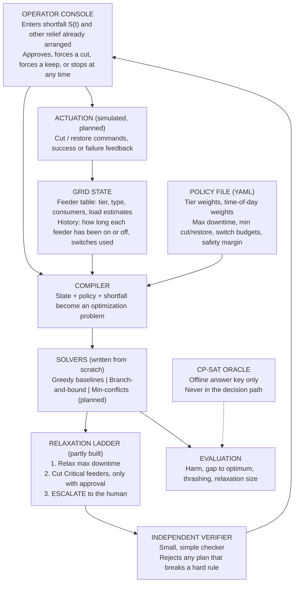

# Urja Niyam: Project Guide

**An intelligent load-shedding scheduler for power grids. A living document.**

| | |
|---|---|
| **Purpose of this file** | One place where anyone (a teammate, a professor, an engineer, a first-time reader) can understand *what* we are doing, *why*, *how*, and *how far we have got*. |
| **Last updated** | 22 October 2026 |
| **Document version** | 0.1 (first full draft) |
| **Project status** | Core model, verifier, simulator, two baselines, an exact solver and an answer-key oracle are built and tested (243 automated tests pass). Local search, relaxation ladder, rolling-horizon loop and large-scale evaluation are still to come. |
| **How this file grows** | Sections marked **[LIVE]** are updated as results arrive. Sections marked **[TO BE FILLED]** are empty on purpose. Add to them when the work is done. |

> **Honesty rule for this document.** Every number in it comes from something we built and ran. Where something is an assumption, a placeholder, or something we have not verified, it says so. Nothing here is a claim about the real Indian grid that we have not marked as "needs validation".

---

## Contents

**Part A: Understanding the problem**
1. [The problem in a few words](#1-the-problem-in-a-few-words)
2. [Which layer of the problem we are solving](#2-which-layer-of-the-problem-we-are-solving)
3. [How load shedding happens (background knowledge)](#3-how-load-shedding-happens-background-knowledge)

**Part B: The project**
4. [Our idea in one picture](#4-our-idea-in-one-picture)
5. [The problem written precisely (the model)](#5-the-problem-written-precisely-the-model)
6. [The data we use, and what the EDA told us](#6-the-data-we-use-and-what-the-eda-told-us)
7. [Resources and tools used](#7-resources-and-tools-used)
8. [Repository map](#8-repository-map)

**Part C: The approach**
9. [Why exact algorithms instead of the common ones](#9-why-exact-algorithms-instead-of-the-common-ones)
10. [How each algorithm works under the hood](#10-how-each-algorithm-works-under-the-hood)
11. [How we know the code is correct](#11-how-we-know-the-code-is-correct)

**Part D: Where we are**
12. [Results so far **[LIVE]**](#12-results-so-far-live)
13. [Progress tracker **[LIVE]**](#13-progress-tracker-live)
14. [Decision log](#14-decision-log)
15. [Assumptions, placeholders and honest limitations](#15-assumptions-placeholders-and-honest-limitations)

**Part E: Alignment and reference**
16. [How this project maps to the AI course](#16-how-this-project-maps-to-the-ai-course)
17. [Glossary](#17-glossary)
18. [How to run everything](#18-how-to-run-everything)

**Part F: Future sections [TO BE FILLED]**
19. Weighted min-conflicts local search: design and results
20. Relaxation ladder and ESCALATE: design and results
21. Rolling-horizon replanning loop: design and results
22. Scale sweep to 500 feeders and the scalability wall
23. Robustness tests (load error, thrashing, operator-override cost)
24. Optional plain-language explainer
25. Field validation (operator interviews)
26. Final conclusions and future work

[Change log](#change-log)

---

# Part A: Understanding the problem

## 1. The problem in a few words

Sometimes a power grid cannot supply everything people want to use. When that happens, the utility **deliberately switches off the power to some areas for a while** so that the whole grid does not collapse. This is called **load shedding**.

In most of India, the person in the control room decides *which areas to switch off, in what order, and for how long* mostly by hand and under time pressure. There is no systematic way to make that decision while balancing:

- **Safety:** hospitals and water pumping should be the last to lose power.
- **Fairness of pain:** an area should not sit in the dark for six hours when others could share the burden.
- **Practicality:** the staff who flip the switches can only do so many operations per shift.
- **Minimum total disruption.**

**Our project builds a tool that helps the control-room person make that decision:** given "we are short by X kilowatts for the next few hours", it recommends which feeders to cut and when, checks that the plan obeys every rule, and explains why. A human always keeps the final say.

---

## 2. Which layer of the problem we are solving

Power systems are managed at several time scales. Our project works at one of them.

| Layer | Time scale | Question | Who does it | Our project? |
|---|---|---|---|---|
| Long-term planning | years | How much power plant capacity do we build? | Planners | No |
| **Demand/shortfall forecasting** | days to hours | How short will we be tomorrow? | Forecasting teams (a well-studied machine-learning problem) | **No.** We take the shortfall as an *input*. |
| **Rotational load shedding** | **hours (15-minute steps)** | **Given a shortfall, which feeders do we cut, in what order, for how long?** | **Control-room dispatcher** | **Yes. This is our layer.** |
| Emergency under-frequency shedding | seconds | Automatic relays trip when frequency drops | Protection relays | No |
| Network physics (line flows, voltage) | milliseconds to seconds | Will the network stay stable? | Network engineers | No |

**In plain words:** we do not predict the shortfall and we do not model the electrical network. We take the sentence *"we must reduce 40 MW for the next four hours"* and turn it into *"cut feeders A, C and F now; swap A for D after two hours; here is why"*.

**Who the tool is for.**
- **Primary user: the dispatcher** (control-room engineer at a distribution company or state load dispatch centre). This person decides and instructs. Our tool makes that instruction more precise and faster.
- **Secondary: the field operator** (substation staff who flip the breakers). The plan reaches them as a clear table. Their real limits (how many operations they can do per shift) are built into the model so the plan can actually be carried out.
- **Later, only if results justify it:** automate the field operator's step, with a human confirmation.

---

## 3. How load shedding happens (background knowledge)

> **Source note.** This section is general background plus our reading of public material. It is **not** from interviews with grid staff (we could not reach any yet). Every item is listed in `docs/field-constraints.md` as "needs validation by an operator". Treat details as plausible, not confirmed.

**3.1 The grid in one paragraph.**
Electricity cannot be stored cheaply at large scale, so at every moment, the power produced must equal the power consumed. Power plants feed a high-voltage network; that network feeds **substations**; each substation feeds several **feeders** (typically 11 kV lines); each feeder serves hundreds or thousands of consumers (homes, shops, farms, factories, hospitals). A feeder is the smallest unit a dispatcher normally switches on or off: cut the feeder and everyone on it loses power.

**3.2 Why a shortfall happens.**
Common triggers are heatwaves (air conditioners), festival or harvest-season peaks, coal or gas supply problems, equipment failure, and transmission limits. When there is not enough supply, frequency starts to fall, and the utility must reduce consumption quickly.

**3.3 What operators try first.**
Shedding is a last resort. Typical earlier steps include buying extra power on the exchange, backing down or re-scheduling generation, asking industries on *interruptible tariffs* to reduce, and voluntary demand response. Our tool therefore takes the **remaining** shortfall *after* those steps and tells the operator what to shed. (Often, buying 50 MW for two hours is cheaper and kinder than cutting homes, and a good tool should help show that.)

**3.4 How the cut is carried out in practice.**
The dispatcher tells a division or substation: "reduce this much". Staff trip the chosen feeders' breakers. Many rural breakers are **manual**, so the number of operations per shift is limited.

**3.5 Real-world details that shape our model.**

| Real-world fact | What we do in the model |
|---|---|
| Hospitals, water pumping, emergency services should be shed last. | **Critical tier**: shed last and **only with explicit operator approval**. |
| Farm feeders often have promised supply hours (for example 8 hours a day). | **Promised supply windows** are a hard rule. |
| Industries on interruptible tariffs can be asked to cut first. | **Flexible tier**: shed first. |
| Restoring a feeder after a long cut brings a **load surge** (motors, ACs and pumps start together). | **Restoration surge**: restored load is larger than normal, so the plan must cover it. |
| Breakers cannot be flipped every 15 minutes, and staff do few operations per shift. | **Minimum cut/restore durations** and **switching budgets** (per feeder and system-wide). |
| Meter readings are rough or late. | **Safety margin** on the shortfall, and (planned) tests with 10-20% load error. |
| Hospitals sit on feeders shared with thousands of homes. | **Mixed feeders** are tagged with their highest tier. |
| Politics, exams, festivals: operators override plans. | **The human can always force a cut, force a keep, or overrule the tool.** The tool re-plans around it. |
| Utilities sometimes cut high-loss (theft, non-payment) feeders more. | Not decided by us: tier and harm weights are **policy inputs** set by the operator. |

---

# Part B: The project

## 4. Our idea in one picture

The tool is a pipeline with a **human at the centre** and an **independent checker** before anything reaches the operator.



**The control loop (partly built, to be completed).** The system does not run once. It replans every few simulated minutes, or whenever the shortfall changes. Each replan reads the history, so a feeder just cut is not casually cut again. Only the **first 15-minute slot** of a plan is committed; the rest is tentative and gets recomputed.

**Five design rules that never change.**
1. **The human is always in control.** Nothing is executed without the operator; the operator can override anything.
2. **The solver is untrusted.** Every plan passes an independent verifier before it is shown.
3. **No black boxes.** Every cut should be traceable to a rule and a cost.
4. **We only claim what we measured.** Claims are about the application and the evaluation, not about inventing new algorithms.
5. **Policy is data, not code.** Tier weights, limits and budgets live in `configs/policy.yaml`.

---

## 5. The problem written precisely (the model)

**5.1 Time.** The planning period is split into **15-minute slots**. We plan **16 slots (4 hours)** ahead, commit only the first slot, then replan.

**5.2 Feeders.** Each feeder has:
- a **priority tier**: **Flexible** (shed first), **Normal**, **Critical** (shed last, only with approval);
- a **type**: urban, rural, agricultural, industrial or mixed;
- a number of **consumers**;
- an **estimated load in kW for every slot** (cutting a feeder relieves its *current load*, not its capacity);
- optional **promised supply hours** (farm feeders).

**5.3 The decision.** For every feeder *f* and slot *t*: `x[f,t] = 1` means "cut", `0` means "on". With 50 feeders and 16 slots that is 800 yes/no choices.

**5.4 Hard rules (a plan breaking any of these is rejected).**
1. **Relief:** in every slot, the load we cut must cover the shortfall (plus a 5% safety margin) **plus the surge** from feeders being restored in that slot.
2. **Minimum cut duration and minimum restore duration:** no flicking on and off (2 slots = 30 minutes each, placeholder).
3. **Switching budgets:** at most 3 operations per feeder per shift and 20 system-wide per shift (placeholders; the benchmark scales the system budget with grid size).
4. **Operator overrides:** forced cuts and forced keeps are obeyed.
5. **Promised supply hours** on farm feeders.
6. **Critical feeders** are never cut without explicit operator approval.

Rules 2 and 3 use each feeder's **history** (how long it has been in its current state, how many switches it has used this shift), so the rules hold across replans, not just inside one plan.

**5.5 One soft rule.** **Maximum consecutive downtime** (12 slots = 3 hours, placeholder). "Soft" means it is relaxed only if there is no other way, and the relaxation is reported with a size.

**5.6 The goal: minimum total "harm".** Harm is how much disruption the plan causes:

```
harm = sum over every cut (feeder, slot) of
         tier_weight  x  time_of_day_weight  x  consumers  x  (1 + 0.5 x (r - 1))
       + 0.02 x (kW of relief beyond what was needed)
       + 1.0 x (number of breaker operations)
```
where `r` is how many slots in a row the feeder has already been off, counting this one.

**Worked example (why rotation appears by itself).** A Normal feeder (weight 5) with 1,000 consumers at time-of-day weight 1.0:

| Slot of the outage (r) | Factor 1 + 0.5(r-1) | Harm that slot |
|---|---|---|
| 1st | 1.0 | 5,000 |
| 2nd | 1.5 | 7,500 |
| 3rd | 2.0 | 10,000 |
| 4th | 2.5 | 12,500 |

One continuous 4-slot outage costs 35,000. Two separate 2-slot outages cost 2 x 12,500 = 25,000. Because harm grows with outage length, the optimizer prefers to **spread** a long need across feeders. We did **not** add a fairness rule to achieve this (see the decision log): rotation is a side effect of the cost, not a promise.

**5.7 The relaxation ladder.** If no plan satisfies every rule, the tool relaxes rules in a fixed order and reports what it relaxed and by how much:
1. relax **maximum downtime** (built into the exact solver and the oracle);
2. cut **Critical** feeders, **only with explicit operator approval** (the approval mechanism is built; the full ladder logic is planned);
3. **ESCALATE**: report the remaining shortfall to the human and do nothing automatically (planned).

**5.8 Problem class (course terms).** This is a **weighted constraint satisfaction / constraint optimization problem**: variables (the 800 yes/no choices), domains ({0,1}), hard constraints (the rules), soft constraints (max downtime) and an objective (harm). It looks like a covering/knapsack-style problem with extra rules, which is known to be NP-hard in general, so exact methods get slow as the grid grows. That is a **finding we expect and will report**, not something to hide.

---

## 6. The data we use, and what the EDA told us

**6.1 What data exists, and what does not.**
Real feeder-level cut/restore histories are not public. So:
- **Real data** is used only to make the **size and frequency of shortfalls** realistic.
- **Everything about feeders** (tiers, loads, types, histories) is **synthetic**, with documented placeholder assumptions.

**6.2 The real dataset.** Hunt and Bloomfield, *Daily electricity demand data for Indian states (2014-2024)*, Zenodo, licence CC BY 4.0 (the exact DOI is to be added to `docs/data-sources.md`).

| Folder | Files | One row is | Unit | Used for |
|---|---|---|---|---|
| `zenodo_electricity_MW` | `peak_unmet_MW`, `corrected_peak_met_MW` (also raw `peak_met_MW`) | one day; one column per state | MW | **Shortfall size and frequency** |
| `zenodo_electricity_MU` | `corrected_daily_energy_met_MU` (also raw) | one day; one column per state | MU (1 MU = 1 GWh) | Context only |
| `zenodo_state` | 36 per-state weather files | one day of weather | wind, temperature, solar, heat-stress index | **Parked** (not needed; using it would push us toward forecasting) |
| `zenodo_derived` | `weighted_daily_mean_utci_india` | one day, national heat-stress | UTCI | Parked |

**6.3 What the EDA told us (only what matters).**

| Finding | Detail | What we do about it |
|---|---|---|
| Size | 3,955 rows x 39 columns per file, 1 Jan 2013 to 28 Apr 2024 | Use as is |
| Columns | 36 states/UTs plus **Total**, **AMNSIL**, **DVC** | Exclude the three non-state columns |
| Missing | about 6% of cells; about 240 missing days; 55 duplicate dates | Keep the first of any duplicate date |
| Raw data has errors | The "corrected" files change about 200 cells per file; one raw peak-met value was off by about 100,000 MW | **Always use the corrected files** |
| No corrected unmet file | Unmet demand has only the raw version | Cap suspect ratios (above 0.5) and count them (only 3 dropped) |
| Unmet demand fell steeply | mean unmet fell by about 95% from 2013 to 2024 | Early years dominate "crisis" days |
| Zero-heavy | 130,777 state-days have data; only 35,499 (27.1%) have unmet demand above zero | Take percentiles over **non-zero days only** |
| A few states dominate | Jammu and Kashmir (median unmet about 20% of demand), and the north-east states (Assam, Manipur, Nagaland, Arunachal, Mizoram, Tripura) have unmet demand on most days | Be aware: pooled percentiles describe these chronic small states more than big grids |

**6.4 How we turn data into scenarios.**
We use a **ratio**, not raw MW, so it scales to any synthetic grid of any size:

```
shortfall ratio = unmet MW / (met MW + unmet MW)       on days when unmet > 0
```
Percentiles of that ratio over all non-zero state-days:

| Percentile | P10 | P25 | P50 | P75 | P90 | P95 | P99 | P99.9 |
|---|---|---|---|---|---|---|---|---|
| Ratio | 0.46% | 1.09% | 2.96% | 6.84% | 15.5% | 20.0% | 23.1% | 31.6% |

**Our three scenario tiers** (percentiles 50, 75, 95): **mild = 3.0%**, **moderate = 6.8%**, **crisis = 20.0%** of demand unserved. We moved from the first plan (50/90/99) because P90 and P99 were too close together (the upper tail is dominated by J&K's normal level near 20%).

A second set of tiers using only 2019 onwards (`tiers_2019.json`) has been built; **its comparison with the all-years tiers has not been analysed yet** **[TO BE FILLED]**.

**6.5 The shape of a shortfall inside a day.** The data is daily, so it cannot tell us how a shortfall rises and falls within a day. We use a documented synthetic **trapezoid** (ramp up over 4 slots, hold, ramp down) multiplied by the grid's demand at each slot. This is stated as an assumption, not a data-driven result.

**6.6 What is synthetic, in one list.**
- the feeders: 5% Critical, 15% Flexible, 80% Normal; types and sizes by tier (urban, rural, agricultural, industrial, mixed);
- the hourly load shapes (evening peak for homes, flat for industry, supply blocks for farms);
- the agricultural supply blocks (06-14, 14-22, 22-06) and a 75% promise rule;
- the feeder histories and the shortfall's shape inside a day.
All are **placeholders** to be calibrated from tariff orders and discom documents (`docs/field-constraints.md`).

**6.7 Literature on file.** Two papers are in `Literature/`: *A Fast Load-shedding Algorithm for Power System based on Artificial Neural Network* (IEEE, 2019) and *Building and explaining data-driven energy demand models for Indian states* (2025). **Summaries and how they relate to our approach are still to be written** **[TO BE FILLED]**. The 2019 paper is an example of the machine-learning route to load shedding; see section 9.

---

## 7. Resources and tools used

| Resource | What for |
|---|---|
| **Python 3.11+** (tested on 3.12 and 3.13) | Everything |
| **PyYAML** | Reading the policy file |
| **NumPy** | Arrays in the solvers (not needed by the verifier) |
| **pandas** | Reading the Zenodo CSVs (optional "data" extras) |
| **Google OR-Tools CP-SAT (v9.15)** | **Offline answer key only** (the oracle). Never imported by the project code in `src/` |
| **pytest** | 243 automated tests |
| **VS Code, Git/GitHub** | Development and version control |
| **Zenodo dataset** (CC BY 4.0) | Real shortfall statistics |
| **CEA / Grid-India reports** (planned) | To cross-check Zenodo and look for hourly shape |
| **Public tariff orders and discom documents** (planned) | To calibrate feeder realism (`docs/field-constraints.md`) |

---

## 8. Repository map

```
Urja_Niyam/
├── README.md                    short intro and run commands
├── pyproject.toml               dependencies; extras: dev, data, oracle
├── configs/
│   └── policy.yaml              EVERY tunable number (tiers, limits, budgets, margins, harm weights)
├── src/loadshed/                the project code
│   ├── model.py                 data types: Feeder, FeederHistory, Problem, Schedule
│   ├── policy.py                loads and validates policy.yaml
│   ├── verify.py                INDEPENDENT VERIFIER (plain loops, no solver code)
│   ├── metrics.py               the harm objective + reporting numbers
│   ├── sim/
│   │   ├── grid.py              synthetic grid generator and problem builder
│   │   ├── scenarios.py         shortfall scenarios (ratio + shape)
│   │   └── zenodo.py            turns Zenodo files into shortfall ratios
│   └── solvers/
│       ├── greedy.py            plain greedy + sticky greedy baselines
│       ├── patterns.py          every valid 16-slot on/off pattern of a feeder
│       └── bnb.py               branch-and-bound with bounds propagation
├── evaluation/                  OFFLINE benchmarking only
│   ├── oracle_cpsat.py          CP-SAT answer key
│   └── run_gap.py               benchmark: baselines and our solver vs the oracle
├── scripts/
│   └── build_scenario_tiers.py  Zenodo files -> mild/moderate/crisis ratios
├── tests/                       243 tests (one file per module)
├── notebooks/                   EDA notebook
├── data/                        raw Zenodo files; processed EDA outputs, tiers, benchmark CSVs
├── docs/                        this guide, field-constraints.md, data-sources.md
├── literature/                  papers
└── project-plan/                the original project proposal
```

---

# Part C: The approach

## 9. Why exact algorithms instead of the common ones

**9.1 What "the common ones" are.**

| Common approach | What it is |
|---|---|
| **Manual rotation** | An operator picks feeders by experience or a fixed rotational timetable. |
| **Simple greedy rules** | "Cut the biggest non-critical loads until the gap is closed." Fast and simple. |
| **Machine learning** | Train a model (for example a neural network) to decide or to speed up decisions, as in the 2019 paper in our `Literature` folder. |
| **Commercial optimizers** | Proprietary systems whose internal logic we cannot inspect. |

**9.2 What we chose.** We treat the decision as a **constraint optimization problem** and solve it with **search with proofs**: a **branch-and-bound** search with **bounds propagation** and a **Lagrangian lower bound**, plus **local search** (planned), plus a **verifier**. A mature solver (CP-SAT) is used **only as an answer key** to check ours.

**9.3 Why. The reasons, in order of importance.**

1. **Hard rules must be guaranteed, not "usually followed".** "Never cut a hospital without approval" and "never exceed the switching budget" are not preferences. A learned model gives probabilities; a constraint solver plus a verifier gives a yes/no we can audit.
2. **There is no training data.** Machine learning needs examples of correct decisions. Nobody has published labelled "optimal shedding schedules" for Indian feeders. We would have to generate them with the very solver we are building.
3. **Transparency.** A cut can be traced to a rule and a cost: "feeder 7 was cut because it had the lowest harm per kW and was last cut 6 hours ago". A neural network cannot say that.
4. **We can say how good the answer is.** An exact method gives either the proven optimum or a proven **lower bound**, so we can state "within X% of optimal". Heuristics and learned models cannot.
5. **New rules are edits, not retraining.** Change a number in `policy.yaml` and the system adapts.
6. **Human control fits naturally.** Operator overrides are just "fix this variable" in a constraint model.

**9.4 How the families differ.**

| | Manual / simple greedy | Machine learning | **Our approach** |
|---|---|---|---|
| Guarantees hard rules | Only if the human is careful | No (statistical) | **Yes (verified)** |
| Needs training data | No | **Yes, and none exists** | No |
| Can explain a decision | Only the human can | Hard | **Yes (constraints and costs)** |
| Knows how far from the best | No | No | **Yes (optimality gap, lower bounds)** |
| Speed | Instant | Fast once trained | Slower; slows more as the grid grows |
| Adapts to a new rule | Re-train people | Re-train model | **Edit the policy** |
| Handles replanning with history | By hand | Must be built in | **Built into the model** |

**9.5 What the exact approach actually bought us (measured, synthetic grid).**
On 10-feeder instances where we can compute the true optimum (section 12):
- The plain greedy baseline spends **130-165% more harm** than the optimum (median).
- The better baseline (sticky greedy, which mimics manual rotation) still spends about **34-41% more** (median).
- Our branch-and-bound and the CP-SAT answer key agree on the optimum on every instance both finished.

So "just use a simple rule" leaves roughly a third of the harm on the table in our test grids. **Caveat:** the grid is synthetic, so this shows the *potential*, not a real-world saving.

**9.6 The price we pay, honestly.** Exact search slows down as grids grow. At 50 feeders, neither CP-SAT nor our solver proved optimality in 20-60 seconds on our machine, and our solver found worse solutions than CP-SAT. That is why **local search** is the next solver: it gives up proof in exchange for speed, and our lower bound lets us still measure how close it gets.

---

## 10. How each algorithm works under the hood

### 10.1 The model as a constraint problem
- **Variables:** one yes/no per (feeder, slot).
- **Domain:** {0 = on, 1 = cut}.
- **Hard constraints:** the six rules in section 5.4.
- **Soft constraint:** maximum downtime.
- **Objective:** minimize harm.

A **search** explores combinations of values; **propagation** removes values that cannot be part of any solution; a **bound** says "no completion of this partial plan can beat the best plan we already have", letting us skip whole regions.

### 10.2 The independent verifier (`verify.py`)
The verifier is deliberately small and does not import any solver. For a candidate plan it:
1. checks the shape (every feeder present, 16 values of 0 or 1);
2. **walks each feeder through time**, starting from its history, counting how long it has been in each state. At each state change it checks the minimum cut/restore duration and counts switches (resetting the counter at shift boundaries), and notes restores to compute the surge;
3. checks the **system-wide switching budget** by counting every feeder's switches in order;
4. checks **relief** slot by slot: relief must be at least shortfall x 1.05 plus surge;
5. checks overrides, critical approval, and promised supply windows;
6. reports **maximum downtime** only as a soft violation, and only if the *plan itself* extended the outage (a feeder already over the limit in its history and restored immediately is not blamed on the plan).

It returns three lists: **hard** violations (plan rejected), **soft** violations (with a size), and **waived** violations (a rule broken at a slot the operator forced; the operator's order wins and it is logged). **Relief is never waived.** Because every solver's output goes through this one small checker, even a fast, unproven heuristic cannot hand the operator an illegal plan.

### 10.3 The greedy baselines (`solvers/greedy.py`)
**Plain greedy** goes slot by slot:
1. **Lock** feeders the rules decide: forced cuts/keeps, critical feeders without approval, feeders still inside their minimum cut or restore time.
2. For the rest, compute the **harm of cutting this feeder this slot** (including its current run length) and rank candidates by **harm per kW that actually counts toward the remaining need** (a feeder bigger than the remaining need is credited only for the remainder; without this the greedy wastes huge feeders on small shortfalls, a flaw we found and fixed).
3. Add candidates until the slot's need (shortfall x margin + surge) is covered.
4. Respect switching budgets, keep a switch in reserve for farm feeders that will need a restore to honour their promised hours, and if there is no budget to restore a feeder, leave it cut.

**Sticky greedy** is the same but treats an already-cut feeder as free to keep, so it holds the same feeders until the downtime limit and then rotates, which is plain manual rotational practice. The two baselines fail in different situations, so we report both and the better of the two. Greedy is **myopic**: it never looks ahead, so it can burn the switching budget early and get stuck.

### 10.4 Patterns (`solvers/patterns.py`)
Only two things couple feeders together: the per-slot relief sums and the system switching budget. Every other rule involves one feeder alone. So, for each feeder, we **list every valid 16-slot on/off row** (depth-first search over slots, tracking state, run length and switches; pruning rows that break a rule), and the search then **chooses one row per feeder**. Each pattern carries:
- its **cost** (harm + switch cost + overshoot cost),
- its **net relief** per slot (relief minus the restoration surge),
- its **switch events** per slot (for the system budget).

The total objective is just the **sum of the chosen patterns' costs** plus a constant, which makes the problem *separable* and the bounds easy. We also drop **dominated** patterns (one that is no cheaper and no better in every slot than another pattern). A test checks that, for every possible row of random feeders, the enumeration includes **exactly** the rows the verifier accepts.

### 10.5 Branch-and-bound with bounds propagation (`solvers/bnb.py`)
Think of a tree. Each level decides the pattern of one feeder. A **node** is a partial plan.

**Step 1: Propagate (bounds propagation).** For each slot, the feeders together must supply at least `need`. Each feeder can supply at most the best relief among its remaining patterns. *Example:* slot needs 1,000 kW; feeder A can give at most 600, B at most 300, C at most 200 (total 1,100). If C gives nothing, A+B reach only 900 < 1,000. So any C pattern that gives less than 100 kW in that slot is impossible, and is **deleted** from C's options. Deleting options can make other deletions possible, so we repeat until nothing changes. If any feeder runs out of options or a slot can no longer be covered, the node is dead. The switching budget is checked the same way, using only the switches that are unavoidable.

**Step 2: Bound (Lagrangian lower bound).** We want a number that no completion of this node can beat. Trick: **put a price** (per kW of relief, per slot) on the relief rule and let each feeder decide **alone** whether cutting is worth it at that price, ignoring the coupling. At any non-negative price this gives a valid lower bound (relaxing a rule can only make things cheaper). At a node the bound is:

```
price x need  +  constant  +  sum over feeders of ( cheapest remaining pattern, where relief is paid for at the price )
```
We tune the prices **once at the root** with the subgradient method: raise the price of a slot whose relief falls short, lower it when relief overshoots, shrinking the step over time. Two lessons made this bound strong enough to use:
- *First version too weak:* the bound could "cut" a huge feeder **fractionally** to cover a small shortfall. Fix: for the bound only, a pattern is credited with **at most `need` per slot** (relief beyond the need cannot help cover it).
- *Second version invalid:* with negative relief (restoration surge) the cap argument broke and the bound exceeded the true optimum. Fix: clip relief to `[0, need]`. A test now checks the bound never exceeds the optimum.

**Step 3: Prune.** If the node's bound is not better than the best plan found so far (the **incumbent**), discard the whole subtree.

**Step 4: Branch.** Pick the feeder where the best and second-best choices differ most (largest **regret**), and try its patterns **cheapest first** (by reduced cost). Starting incumbent: the better of the two greedy baselines. A quick "dive" at each node also tries everyone's cheapest pattern in case that happens to be valid.

**Relaxation ladder, rung 1.** If the strict problem is proven infeasible, the solver reruns with the maximum-downtime rule relaxed and reports `mode = relaxed_downtime`.

**What it returns:** a verified plan, a status (OPTIMAL = proven, FEASIBLE = stopped by a limit, INFEASIBLE = proven impossible), an objective and a **proven lower bound**.

**Where it struggles:** the tree grows very fast with feeders. At 10 feeders we prove optimality in about one second for most instances; at 50 feeders the search does not finish within a minute, which is the **scalability wall** we plan to measure.

### 10.6 Weighted min-conflicts local search **[PLANNED]**
Idea (to be built next): start from a complete plan (for example from the greedy), and repeatedly pick a **violated or costly spot** and change one choice to the value that reduces a weighted score (violations plus harm). When the search gets stuck, **increase the weights of constraints that stay violated** so it escapes. It is fast and scales, but it **cannot prove** a plan is optimal or that none exists. So we pair it with (a) a cheap exact feasibility check first and (b) the verifier on every result. Our lower bound from section 10.5 lets us measure its gap even when no solver can prove optimality. **[TO BE FILLED: implementation and results, section 19.]**

### 10.7 The CP-SAT oracle (`evaluation/oracle_cpsat.py`)
CP-SAT is Google's industrial solver that combines constraint programming with **SAT-style clause learning** (it learns from every dead end), linear-programming bounds, and many parallel search strategies. We use it as an **answer key**, never in the decision path:
- it encodes **exactly** the verifier's rules and the same harm objective (yes/no variables, run-length integer variables, "element" tables for the surge, conditional constraints for budgets and durations);
- numbers are scaled to integers, with loads rounded down and requirements rounded up, so every oracle answer is also accepted by the verifier;
- if the strict problem is infeasible it retries with maximum downtime relaxed.

Why bother? Without a known optimum, "solution quality" means nothing. The oracle lets us say "our baseline spends 35% more harm than the proven optimum".

### 10.8 Relaxation ladder and ESCALATE **[PLANNED: partly built]**
Rung 1 exists inside the exact solver and the oracle. The full ladder (rung 2: Critical cuts with approval; rung 3: ESCALATE with the remaining shortfall reported; relaxation measured as a **magnitude**, not on/off) will be built as its own module. **[TO BE FILLED: section 20.]**

### 10.9 Rolling-horizon replanning loop **[PLANNED]**
Plan 16 slots, commit the first, advance one slot, update the history (who has been off how long, switches used), accept new shortfall values and operator overrides, and plan again. Measures to add: **thrashing rate** (feeders flipped between replans for no real reason), **cost of operator override**, and **robustness to load-estimate error**. **[TO BE FILLED: section 21.]**

---

## 11. How we know the code is correct

For a safety-related tool, "it ran" is not enough. We use four checks.

1. **Hand-computed tests.** For example, the harm of a small known plan is worked out on paper and the test demands the exact number.
2. **The verifier as referee.** Pattern enumeration is checked against the verifier on **every possible row** of random single-feeder problems (50 random cases, both strict and relaxed modes).
3. **Brute force.** On tiny problems we enumerate **every possible schedule**, keep the ones the verifier accepts, and take the cheapest. The oracle and the branch-and-bound must match that number exactly. They matched on all 50+ random problems, including strict, relaxed and infeasible outcomes, and including operator overrides.
4. **Mutation testing.** We deliberately break the code in several places (ignore a rule, drop the surge, inflate the bound) and confirm the tests **fail**. A test that cannot fail proves nothing.

**Bugs found by these checks (a record of what the tests are worth):**

| # | Bug | Found by |
|---|---|---|
| 1 | The data loader kept empty cells in one pandas version, turning every percentile into NaN | a unit test on fake data |
| 2 | Greedy let farm feeders break their promised hours when the switching budget ran out | benchmark against the verifier |
| 3 | The greedy cut huge feeders for small shortfalls (a strawman baseline) | inspecting the worst gap by hand |
| 4 | The verifier blamed the plan for an outage already over the limit in history | random brute-force comparison with the oracle |
| 5 | The first oracle treated the system switching budget conservatively | same random comparison |
| 6 | The first Lagrangian bound was too weak (about 180 vs an optimum of 3,394) | comparing the bound to known optima |
| 7 | The "fixed" bound was **invalid** (above the optimum) when relief was negative | comparing the bound to known optima |

Current status: **243 tests pass.**

---

# Part D: Where we are

## 12. Results so far [LIVE]

**How to read the numbers.** *Gap* = how much **more harm** a plan has than the best known plan, in percent. A gap of 100% means twice the harm. Results use our **synthetic grid**, our three tiers (3%, 7%, 20%), starting times 10:00 and 17:00, and the placeholder policy. System switching budget = max(20, 0.6 x feeders). All figures are **medians** over instances unless stated.

**12.1 Ten feeders (the optimum is known).** 6 instances per tier.

| Tier | Oracle proved optimal | Our B&B proved optimal | Plain greedy gap | Sticky greedy gap | Best of the two |
|---|---|---|---|---|---|
| Mild (3%) | 6/6 | 6/6 | 130% | 34% | **34%** |
| Moderate (7%) | 6/6 | 6/6 | 136% | 35% | **35%** |
| Crisis (20%) | 6/6 | 4/6 | 165% | 107% | **41%** |

Our branch-and-bound returned **the same optimum as the oracle** on every instance it finished (median difference 0.0%); on the two unfinished crisis cases the largest difference was 11.3% worse. The oracle takes about 1.3-2.9 s per instance.

**12.2 Fifty feeders (nobody can prove the optimum).** 4 instances per tier; oracle limit 20 s; our B&B limit 60 s; both on one machine.

| Tier | Proven optimal (either solver) | Plain greedy gap | Sticky greedy gap | Best of the two | Our B&B vs CP-SAT (harm, median) | True gap of the best baseline lies between |
|---|---|---|---|---|---|---|
| Mild | 0/4 | 422% | 92% | 92% | 34% worse | **92% and 127%** |
| Moderate | 0/4 | 336% | 98% | 98% | 88% worse | **98% and 175%** |
| Crisis | 0/4 | 93% | 1,386% | 93% | 5% worse | **93% and 138%** |

The last column uses both the best solution anyone found (gap at least this large) and the best proven lower bound (gap at most this large), so the true gap is inside the interval.

**12.3 What these results mean.**
1. **Simple rules waste a lot.** Even the better baseline leaves 34-41% extra harm at 10 feeders and about 90-175% at 50 feeders (synthetic data).
2. **Our exact solver is correct.** It agrees with the independent oracle wherever both finish.
3. **At 50 feeders, exact search hits a wall** (neither solver proves optimality in 20-60 s on one machine), and our solver's solutions are worse than CP-SAT's. This motivates local search.
4. **Sticky greedy breaks down in a crisis** (a gap near 1,400% at 50 feeders): holding feeders cut exhausts the switching budget and leaves feeders stuck cut. The plain greedy is the better baseline there, which is why we report the best of the two.
5. **Our lower bound is competitive.** On one 50-feeder instance we measured earlier, our proven lower bound (1,715) was higher than CP-SAT's (1,261) even though CP-SAT found the better solution (2,401 vs 3,636). We plan to repeat this systematically.

**Caveats:** one machine, short time limits, synthetic grid, placeholder parameters, and only two start times. These numbers show the method works and where it strains. They are **not** predictions for a real grid.

---

## 13. Progress tracker [LIVE]

| # | Phase | Status | Notes |
|---|---|---|---|
| 1 | Problem formalization, literature, data selection | **Mostly done** | Proposal rewritten after review; Zenodo selected and analysed. Citation list and `docs/field-constraints.md` still to be completed |
| 2 | Model, verifier, metrics | **Done** | Full rule set checked from history; 28 verifier tests plus metrics tests |
| 3 | Grid simulation and data pipeline | **Done** | Generator, tier script; parameters are placeholders |
| 4 | Thin slice: greedy baselines + CP-SAT oracle | **Done** | First optimality gaps measured |
| 5 | Branch-and-bound with bounds propagation | **Done (first version)** | Exact at 10 feeders; hits a wall at 50 |
| 6 | Weighted min-conflicts and full solver comparison | **Next** | |
| 7 | Relaxation ladder and ESCALATE | Planned | Rung 1 exists in the exact solver and oracle |
| 8 | Rolling-horizon loop, operator control, actuation failure | Planned | |
| 9 | Evaluation harness (scale to 500, thrashing, load error, override cost) | Partial | Gap benchmark done; rest pending |
| 10 | Optional plain-language explainer | Planned (optional) | LLM, if used, is read-only |
| 11 | Report, polish, demo, viva preparation | Planned | |

---

## 14. Decision log

| Decision | Why |
|---|---|
| **Dispatcher is the primary user, field operator secondary** | The dispatcher's judgment is the hard part; a recommender is easier to trust and test than an actuator |
| **We take the shortfall as input (no forecasting)** | Forecasting is a separate, well-studied problem; mixing them would drift the project toward machine learning |
| **Shedding is the residual after cheaper options** | Buying power or asking industry to cut may be better than cutting homes |
| **Critical feeders are "last priority with approval", not "never cut"** | Matches common practice and keeps the human in charge; the tool never auto-cuts Critical |
| **Fairness rule, Gini and fairness curves dropped** | Fairness is hard to define; the harm of an outage differs by place and person. The convex outage cost spreads cuts within an episode, but **we do not claim equity over days or weeks** |
| **Network topology dropped** | It added modelling weight without changing the decision; may return in a later extension |
| **A* baseline dropped** | It answered no research question; replaced by a stronger one (CP-SAT as oracle) |
| **LLM layer optional and read-only** | The system must not be a black box; the solver computes the explanation, an LLM could only rephrase it |
| **CP-SAT is an oracle only, never in the decision path** | Our solvers are written from scratch so we can explain them; the oracle gives the answer key |
| **The solver is untrusted; the verifier decides** | Makes fast heuristic solvers safe to use |
| **Harm is convex in outage length** | Rotation emerges without a fairness rule |
| **Percentiles 50/75/95 for tiers** | 50/90/99 produced two nearly identical upper tiers |
| **Two greedy baselines, report the better** | The first was a strawman; the second mimics manual rotation; neither wins everywhere |
| **System switching budget scaled with grid size in benchmarks** | A fixed 20 operations is unrealistically tight for 200+ feeders (assumption, to be documented) |
| **Max downtime counts only what the plan extends** | A past violation cannot be undone by the plan |

---

## 15. Assumptions, placeholders and honest limitations

**15.1 Placeholder numbers (all in `configs/policy.yaml` or the grid generator; none are measured).**

| Item | Current value |
|---|---|
| Slot / horizon / committed slots | 15 min / 16 slots / 1 |
| Shift length | 32 slots (8 h) |
| Tier weights (Flexible / Normal / Critical) | 1 / 5 / 1000 |
| Min cut / min restore / max downtime | 2 / 2 / 12 slots |
| Switch budget per feeder / system | 3 / 20 per shift (scaled with size in benchmarks) |
| Safety margin | 5% |
| Restoration surge | 5% + 1% per outage slot, capped at 30% |
| Harm: outage growth / overshoot cost / switch cost | 0.5 / 0.02 per kW / 1.0 |
| Time-of-day weights | night 1.3, day 1.0, evening peak 1.5 |
| Feeder mix | 5% Critical, 15% Flexible, 80% Normal |
| Farm promise | at least 75% of supply-block slots on |

**15.2 What we do not claim.**
- We do **not** predict shortfalls.
- We do **not** guarantee fairness across days or weeks.
- We do **not** model the electrical network, nor under-frequency shedding.
- We do **not** claim new algorithms. We claim an application, a field-informed model, a verified implementation and an honest evaluation.
- We do **not** claim any result on the real grid: feeders are synthetic, and field constraints are not yet validated by operators.

**15.3 Known limitations.**
- Exact search does not scale to hundreds of feeders; this is a finding to report.
- Harm weights are value judgments; the tool leaves them to the operator.
- Load estimates are rough in reality; robustness tests are planned, not done.
- Replanning stability (thrashing) has not been measured yet.
- Penalty weights for overshoot and switching are tiny next to harm, so they act as tie-breakers; the hard switching budgets and minimum durations do the real anti-thrashing work.
- The Zenodo ratio distribution is dominated by a few small chronic states.

---

# Part E: Alignment and reference

## 16. How this project maps to the AI course

> **Note.** The course unit list is not yet attached to this repository. The table below maps topics typical of an introductory AI course. **Replace the left column with the exact unit names from the syllabus** **[TO BE FILLED]**.

| AI course topic | Where it appears in this project |
|---|---|
| **Intelligent agents (PEAS)** | The dispatcher-assistant agent: *performance* = minimum weighted harm under the rules; *environment* = grid state, shortfall, feeder history; *actuators* = recommended cut/restore instructions; *sensors* = shortfall, feeder states, elapsed downtime, confirmations |
| **Problem formulation, state spaces** | Plans as assignments of 800 yes/no variables; the model in section 5 |
| **Uninformed and informed search** | Depth-first branch-and-bound over feeders; greedy as a heuristic search |
| **Heuristics, admissibility** | The Lagrangian lower bound is an **admissible** (never over-estimating) heuristic for the best completion |
| **Constraint satisfaction problems** | Hard and soft constraints, domains, the verifier |
| **Constraint propagation and consistency** | **Bounds propagation** on the relief sums (pattern deletion until a fixpoint) |
| **Backtracking and search heuristics** | Branch-and-bound with regret-based variable choice and cheapest-first value ordering |
| **Local search** | Weighted min-conflicts (**planned**) |
| **Optimization and soft constraints** | Weighted constraint optimization, the harm objective, the relaxation ladder |
| **Knowledge representation** | Tiers, feeder types, rules and costs expressed as data in a policy file |
| **Planning and replanning under uncertainty** | Rolling-horizon loop and history ledger (**planned**) |
| **Explainable and trustworthy AI** | Independent verifier, reason codes, human override, no black box |
| **Evaluation methodology** | Optimality gaps against an oracle, lower bounds, scale sweeps, mutation testing |
| **Generative AI (optional)** | Read-only plain-language explainer (**planned, optional**) |
| **Machine learning (deliberately kept at the edge)** | Forecasting is an *input* and not our contribution; an ML forecaster or reinforcement-learning comparison is a stretch goal |

---

## 17. Glossary

| Term | Plain meaning |
|---|---|
| **Load shedding** | Deliberately cutting power to some areas to protect the grid |
| **Shortfall (S)** | How many kW (or MW) short the grid is; our input |
| **Feeder** | A power line from a substation to many consumers; the unit we switch |
| **Tier** | Priority class: Flexible (cut first), Normal, Critical (cut last) |
| **Slot** | A 15-minute time step |
| **Horizon** | How far ahead we plan (16 slots, 4 hours) |
| **Commit** | Actually act on the first slot of a plan; the rest is tentative |
| **Replan / rolling horizon** | Recompute the plan as new information arrives |
| **Switching budget** | The maximum breaker operations allowed per shift |
| **Restoration surge** | The extra load when a long-off feeder comes back |
| **Promised supply hours** | Hours of supply a farm feeder is guaranteed |
| **Harm** | Our measure of disruption (consumers x outage length x weights) |
| **Convex cost** | Each extra hour of outage hurts more than the last |
| **Hard / soft constraint** | A rule that must hold / a rule that may be relaxed, with a reported size |
| **Relaxation ladder** | The fixed order in which rules are relaxed if no plan satisfies all |
| **ESCALATE** | Stop and hand the remaining shortfall to the human |
| **CSP / COP** | Constraint satisfaction / constraint optimization problem |
| **Propagation** | Deleting choices that cannot be part of any solution |
| **Branch-and-bound** | Search that skips regions proven unable to beat the best plan found |
| **Incumbent** | The best valid plan found so far |
| **Lower bound** | A number no plan can beat |
| **Lagrangian relaxation** | Replace a coupling rule by a price and solve the pieces separately |
| **Optimality gap** | How far a plan is from the best possible, in percent |
| **Oracle** | The trusted answer key (CP-SAT); used offline only |
| **Verifier** | The small independent checker that approves or rejects plans |
| **Greedy / sticky greedy** | Simple step-by-step rules used as baselines |
| **Local search / min-conflicts** | Improve a complete plan by repairing violated spots one at a time |
| **Thrashing** | Flipping feeders on and off between replans for no real reason |
| **Dispatcher / SLDC / discom** | Control-room engineer / state load dispatch centre / distribution company |
| **DSM** | Deviation settlement mechanism: penalties for drawing more or less than scheduled |
| **UTCI** | A heat-stress index (parked data) |
| **MW, MU, kW** | Power (1 MW = 1,000 kW) / energy (1 MU = 1 GWh) / power |

---

## 18. How to run everything

From the repository root.

```powershell
# one-time setup
pip install -e ".[dev,data,oracle]"

# run all tests (expect 243 passed)
pytest

# build scenario tiers from the Zenodo files (needs data/raw/...)
python scripts/build_scenario_tiers.py --percentiles 50 75 95
python scripts/build_scenario_tiers.py --year-from 2019 --percentiles 50 75 95 --out data/processed/scenarios/tiers_2019.json

# benchmark: baselines and our solver against the CP-SAT oracle
python -m evaluation.run_gap --sizes 10 --seeds 3 --hours 10 17
python -m evaluation.run_gap --sizes 50 --seeds 2 --hours 10 17 --bnb-time 60 --out data/processed/benchmarks/gap_50.csv
```

---

# Part F: Future sections [TO BE FILLED]

*These sections are intentionally empty. Add them as the work is completed. Keep the same style: plain words first, technical detail second, numbers only from runs we actually did.*

### 19. Weighted min-conflicts local search: design and results
*(to be filled)*

### 20. Relaxation ladder and ESCALATE: design and results
*(to be filled)*

### 21. Rolling-horizon replanning loop: design and results
*(to be filled)*

### 22. Scale sweep to 500 feeders and the scalability wall
*(to be filled)*

### 23. Robustness tests (load error, thrashing, operator-override cost)
*(to be filled)*

### 24. Optional plain-language explainer
*(to be filled)*

### 25. Field validation (operator interviews)
*(to be filled)*

### 26. Final conclusions and future work
*(to be filled)*

---

## Change log

| Date | Version | Change |
|---|---|---|
| 22 Oct 2026 | 0.1 | First full draft. Covers problem, layer, data and EDA, model, approach, algorithms, verification, results to date (10 and 50 feeders), decisions and limits. Parts F sections left empty on purpose |