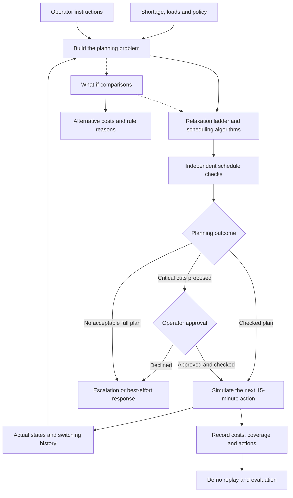

# Urja Niyam: How We Planned Power Cuts and What We Learned

## 1. What we built and what it achieved

We built **Urja Niyam**, a decision-support mechanism that plans temporary power cuts when electricity supply falls short of demand. It suggests which areas to disconnect, when to restore them, and how to respond when the usual rules can not produce an acceptable schedule.

The main result is that **looking ahead produced better schedules than making only immediate choices** in the reviewed experiments. Local search found strong schedules across the tested sizes. Exact search helped establish optimal answers on smaller problems, but became harder to complete as the problem grew.

We also built the parts needed to make those recommendations understandable: a separate schedule checker, explicit relaxation steps, operator approval, comparisons of alternative instructions, and a visual replay.

Our recommendation from the experiments was to use local search for practical scheduling at larger tested sizes, retain branch-and-bound for small problems and lower bounds, and use CP-SAT as an offline comparison. These were conclusions about the simulated problems and configured search budgets, not evidence of readiness to control a real electricity network.

## 2. The situation we started with

When supply could not meet demand, some consumption had to be reduced. The difficult question was who should lose supply and for how long.

Consider a town that needed 100 units of power when only 80 were available. Disconnecting 20 units sounded straightforward. But one area might contain a hospital, another might already have been disconnected for an hour, and a third might have a promised supply period. A decision that worked immediately could create a worse problem later.

We treated those connected decisions as a **constraint optimization problem**. The system first asked whether a schedule followed the represented rules. Among acceptable schedules, it searched for one with a lower modeled cost.

The unit of control was a shared supply line serving a group of consumers, called a **feeder** in the code. We used “supply group” or “area” when explaining it. The system could disconnect the whole group, not select individual houses within it.

This made the choices uneven. If the remaining shortage was 200 kW and a suitable group used 300 kW, disconnecting it removed more demand than necessary. That excess was part of the scheduling trade-off.

### Where the system operated

We worked at the **rotational load-shedding planning layer**, using 15-minute decisions over the coming hours.

The shortage was supplied as an input. We did not build demand forecasting, emergency protection relays, voltage control, or a physical power-flow simulation. We did not connect the prototype to real switching equipment.

The intended role was to assist a control-room operator. The software proposed and checked schedules, while approval and execution were represented through callbacks and simulation.

## 3. The architecture: how the parts worked together

The architecture followed a repeated cycle: describe the current situation, search for a schedule, check it, apply one simulated step, and record what actually happened.

We separated these responsibilities so that finding a low-cost answer was not confused with checking whether it followed the rules.



The ledger connected one planning cycle to the next. If a command failed, the next problem used the actual state rather than assuming that the intended action had happened.

The what-if tool reused the planning process with an additional instruction, such as keeping one area supplied. CP-SAT remained outside this operational cycle and was used separately for evaluation.

### How this appeared in the code

`model.py` defined the shared objects: supply groups, histories, problems, and schedules. `policy.py` loaded and validated operating settings from `configs/policy.yaml`. `metrics.py` kept cost and reporting calculations consistent.

The `sim/` package generated the experimental grids and shortage profiles. The `solvers/` package searched for schedules. `verify.py` checked schedules without importing the search algorithms.

`ladder.py` managed relaxation and approval steps. `loop.py` managed replanning and simulated execution. `whatif.py` compared instructions and produced basic explanations. Experiments, plotting, and demo export lived in `evaluation/`, while automated checks lived in `tests/`.

We used **Python**, **NumPy**, and **PyYAML** for the core implementation, **Pytest** for testing, and **Matplotlib** for plots. **Google OR-Tools CP-SAT** supplied an offline comparison model. The browser demo used HTML and JavaScript with exported JSON.

No trained neural network or language model was required to produce schedules or explanations.

## 4. How we represented a schedule

Each decision stated whether a supply group was on or disconnected in a particular slot:

```text
x[group, slot] = 0 when supplied
x[group, slot] = 1 when disconnected
```

The default horizon contained sixteen 15-minute slots, or four hours. With 50 groups, that created 800 basic on/off decisions.

Each group carried an estimated load for every slot, a consumer count, a priority, a type, and any promised supply requirements. Priorities were Flexible, Normal, and Critical.

We also carried history into the problem: the current state, time spent in that state, and switching operations already used during the shift. Otherwise, a new plan could incorrectly treat a continuing outage as a fresh one.

### Constraints: what a schedule had to respect

The disconnected load had to cover the estimated shortage with the configured safety margin. The model also accounted for **restoration surge**, the temporary increase in demand when supply returned.

Minimum outage and restoration durations prevented rapid switching. Individual and system-wide switching budgets limited operations during a shift. Promised supply requirements protected designated supply periods. Critical cuts required approval.

Maximum consecutive downtime was enforced in strict search. It could be relaxed later through an explicit process rather than silently ignored.

Operator instructions could force a group on or off. Specific conflicts caused by forced actions were recorded as waivers where the model allowed them. Required relief was not waived merely to make a proposed full-coverage schedule pass.

### The objective: what made one valid schedule preferable

We called the objective **harm**. It was a policy-based score, not money or a direct measurement of human suffering.

The outage cost depended on priority, time of day, number of consumers, and uninterrupted outage length:

```text
outage cost =
    priority weight × time weight × consumers
    × (1 + growth factor × (consecutive outage slots − 1))
```

The planning objective also penalized excess relief and switching operations.

For example, with a priority weight of 5, time weight of 1, and 1,000 consumers, the default settings produced outage costs of 5,000, 7,500, 10,000, and 12,500 across four consecutive slots.

A continuous four-slot outage therefore accumulated more outage cost than two separate two-slot outages. But splitting the outage also required extra switching and restoration, so the algorithm still had to consider the complete schedule.

This encouraged rotation where feasible. It did not guarantee fairness across households or across weeks.

### The defaults were assumptions

The default minimum cut and restoration durations were thirty minutes each. Maximum downtime was three hours. The default shift lasted eight hours.

Priority weights were 1, 5, and 1,000. The safety margin was 5%. Restoration surge started at 5%, increased with outage length, and was capped at 30%.

The default switching allowance was three operations per group and twenty system-wide per shift. Scale experiments increased the system allowance with grid size.

These settings defined the experimental problem. They were not presented as confirmed operating standards for a real electricity utility.

## 5. Where the experimental inputs came from

Historical state-level met and unmet demand data informed the shortage levels. We expressed shortage as a proportion so that the same scenario could be applied to different simulated grid sizes:

```text
shortage ratio = unmet demand / (met demand + unmet demand)
```

The preparation handled missing values and duplicate dates, excluded aggregate or non-state columns, and rejected suspect extreme ratios. Percentiles from days with nonzero unmet demand produced scenario levels of approximately **2.96%, 6.84%, and 20%**.

We labeled these mild, moderate, and crisis. They were experimental categories, not predictions of how often a particular town would experience a shortage.

The historical data was daily. It did not provide real 15-minute switching schedules. We therefore generated the within-day shortage shape, individual group loads, consumer counts, agricultural supply blocks, and other grid details synthetically.

A random seed fixed the generated instance so that methods could face the same problem. It did not guarantee identical results from time-limited searches under different computing conditions.

## 6. How the algorithms made decisions

The methods served different purposes. Greedy search supplied quick baselines. Branch-and-bound searched for exact answers and bounds. Local search produced practical schedules without requiring a complete proof. The hybrid connected local search with exact search.

### Greedy: a quick, immediate choice

The greedy methods selected cuts using immediate cost and useful relief while respecting decisions already fixed by constraints.

One version preferred to retain existing cuts. This could reduce switching, but could also extend outages or leave less flexibility later.

We compared against the better valid result from the two baselines. An inexpensive schedule that violated the represented rules did not count as a successful baseline.

Their main limitation was **short-sightedness**. A locally attractive cut could consume a switching opportunity or create a costly situation later in the horizon.

### Patterns: reducing repeated work

Most rules concerned one group’s behavior over time. We used that structure to generate valid **patterns**, where each pattern was a complete on/off row for one group.

The search then selected one pattern per group. Individual duration and history rules were largely handled during pattern construction; total relief and shared switching limits still had to be coordinated across groups.

Patterns carried their costs, net relief, and switching information. Caching reusable structures and using array operations reduced repeated setup work. A simpler reference builder helped check the optimized implementation.

This reduced unnecessary work, but did not remove the underlying difficulty of choosing compatible patterns.

### Branch-and-bound: searching with a proof in mind

Branch-and-bound explored partial combinations of patterns.

It used **constraint propagation** to remove impossible choices. Suppose a slot required 1,000 kW, and two groups could provide at most 900 kW together. A third group then had to contribute at least 100 kW. Patterns unable to provide that contribution could be removed.

The solver also calculated an optimistic **lower bound** using Lagrangian relaxation. This temporarily priced shared relief requirements so that groups could be considered more independently.

If even that optimistic estimate could not improve the best complete schedule already found—the **incumbent**—the branch was skipped. Variable and value ordering guided which decisions were explored first.

Completing the search could establish optimality or infeasibility for the represented problem. Reaching a time limit could instead leave a feasible schedule, a bound, or no found solution. Those were different outcomes.

### Local search: improving a complete candidate

Our **weighted min-conflicts local search** started with a complete pattern assignment and improved it through smaller changes.

Its score combined harm with penalties for unmet relief and switching conflicts. Breakout weights increased pressure on persistent violations. A tabu mechanism discouraged immediate cycling, while restarts explored different choices.

Temporary search states could violate constraints. A returned schedule still had to pass checking before acceptance.

Local search traded proof for practical progress. It could find a strong schedule without demonstrating that no better schedule existed.

### Hybrid and CP-SAT

The hybrid ran local search first and passed its schedule to branch-and-bound as a warm start. A better incumbent could help exact search prune more branches.

That explained the design, but did not guarantee that splitting a budget would outperform either method using the whole budget.

CP-SAT provided an independent implementation for comparison. It used integer-scaled quantities, so its numerical model was not identical to the original one. Its returned schedules were checked against our model, while its optimality claims and bounds referred to its integer formulation.

The revised reports therefore did not pool CP-SAT bounds with B&B bounds as if they certified exactly the same problem.

## 7. How the system handled difficult situations

The **relaxation ladder** made concessions explicit.

It first attempted a strict plan. If that did not succeed, it tried relaxing maximum downtime and reported the excess. A later stage could propose Critical cuts requiring approval. If no acceptable full plan was found, the system escalated and reported a best-effort coverage estimate.

Moving to a higher rung did not automatically prove that the lower rung was impossible. A time-limited search might simply have failed to find an answer. The ladder recorded whether lower-rung failure claims were proven or remained search failures.

Its `proven` field therefore did not mean that the returned schedule had minimum harm. Likewise, best-effort coverage was not necessarily the greatest coverage any possible schedule could achieve.

### Replanning from actual outcomes

The **rolling-horizon loop** planned four hours ahead but committed only the first 15-minute action. It then observed the simulated outcome, updated the ledger, and planned again.

If a restoration command failed, the next cycle treated the group as still disconnected. Recording the intended action as successful would have corrupted future duration and switching decisions.

We simulated command failures, load-estimate errors, changing shortage inputs, and operator instructions. These could leave actual demand uncovered even when the planned schedule satisfied the estimated problem.

Optional meter feedback adjusted estimates using available observations. It did not assume that a continuously disconnected group revealed its hidden demand.

Warm starts reused the previous plan, shifted forward. Stability measurements distinguished changes in future plans from unexpected changes in committed actions. Ordinary rotation was not automatically treated as unstable behavior.

## 8. How we made recommendations understandable

The what-if tool compared the planning result before and after an instruction such as “keep this area supplied.” When suitable objective values were available, it reported the cost difference.

The first-slot explainer examined the alternative of keeping each selected cut group on. Basic rule reasons also identified operator instructions, missing Critical approval, unfinished minimum durations, or exhausted individual switching allowances.

When those rules did not directly identify the decision, the code reported that the optimizer had selected it. It did not invent a detailed explanation.

These comparisons supported inspection, but were not complete causal proofs. Different searches could find different-quality schedules, and different relaxation modes could make a simple subtraction misleading.

The supported interpretation was: **“This alternative produced this cost under the comparison.”** It was not automatically: “This was the only possible or globally best decision.”

The browser demo made the sequence visible. It replayed supply states, shortage, relief, and operator-override cases. It explained computed behavior; it did not operate a live electricity network or solve new requests inside the browser.

## 9. Results: what someone could reasonably conclude

**The clearest result was that planning ahead was useful.** Local search produced strong schedules across the tested sizes, while exact search supplied stronger guarantees mainly on smaller cases.

That led to a practical recommendation: use each method for what the evidence supported. Local search was the practical scheduling method for larger tested instances. Branch-and-bound remained valuable for small-instance proofs and bounds. CP-SAT provided an independent offline comparison.

The scale experiment covered 10, 50, and 200 supply groups, three shortage levels, ten seeds, and four start times. The trends below were interpreted using the retained observations under the agreed exclusions.

### What the different methods achieved

| Method | 10 supply groups | 50 supply groups | 200 supply groups |
|---|---|---|---|
| **Best valid greedy baseline** | Generally produced higher-cost schedules than the stronger search methods | Often left substantial room for improvement | Produced higher-cost schedules than local search in the reported comparisons |
| **Branch-and-bound** | Proved optimality in **103 of 120 cases** | Full search was attempted, but no optimality proofs were recorded within the budget | Returned feasible schedules in **120 of 120 cases**, under a one-node limit |
| **Local search** | Matched the best recorded cost in **115 of 120 cases** | Frequently matched the best recorded schedule, without proving optimality | Returned strict feasible schedules and matched the best recorded cost in **120 of 120 cases** |
| **Hybrid** | Tested separately | Not included in this sweep | Not included in this sweep |
| **CP-SAT** | Reported integer-model optimality in **116 of 120 cases** | Found feasible schedules on most cases, without completing optimality proofs | Not run |

“Best recorded” meant the lowest cost found by the methods actually run on that case, including ties. It did not necessarily mean the true best possible schedule.

### What this meant in ordinary words

For the smaller problems, we could often check whether a schedule was genuinely optimal under the model. Local search frequently reached the same cost without producing that proof itself.

For the medium-sized problems, finding a useful schedule was easier than proving that no better one existed. Local search performed well against the alternatives we tested, but uncertainty remained.

For the largest tested size, local search continued to produce strict feasible schedules. However, CP-SAT was not run there and B&B performed only limited search. We therefore did not interpret the result as proof that local search defeated fully searched alternatives at that size.

The B&B runtime drop at 200 groups reflected this one-node limit. It did not mean that solving larger problems exactly became easier.

The methods also received different budgets. Local search was configured with 30 seconds, of which roughly 21 seconds went to its strict phase. B&B and CP-SAT received 60-second limits where fuller searches were enabled. These results described that experiment, rather than an equal-time competition.

### What the ladder results showed

The retained ladder results contained **2,159 cases**: **1,826 plans, 71 approval requests, and 262 escalations**. Returned plans included both strict and downtime-relaxed outcomes.

This showed that the prototype exercised different responses rather than pretending every situation had an ordinary solution. Sometimes it produced a plan under the original rules. Sometimes it required a concession or approval. Sometimes it handed the problem back with an escalation.

These counts were not a real-world success rate. An escalation could reflect genuine difficulty, restrictive inputs, or the search budget. It did not always prove that a better method could find no acceptable plan.

### What the robustness work established

We implemented experiments for safety margins, meter feedback, operator overrides, command failures, and planning stability.

The central lesson was that **schedule cost and demand coverage had to be read together**. An inexpensive episode could still leave demand uncovered. A schedule that passed checks against estimated inputs could also perform differently when actual loads or command outcomes changed.

The available robustness output showed such unmet demand in some episodes. It supported investigating these trade-offs, but the current full CSV had not been independently reviewed. We therefore did not repeat the old guide’s precise benefit percentages as final verified findings.

### What we recommended from the evidence

We recommended retaining simple baselines because they made the value of optimization measurable. We recommended local search for practical scheduling at the larger tested sizes, while using exact methods where proof or a useful bound justified the effort.

We also recommended reporting feasibility, cost, unmet demand, relaxation, and search status together. A single low harm score could not describe whether the system had done a good job.

## 10. Why the results deserved qualified trust

We checked behavior at several levels.

Hand-calculated examples tested costs and rules. Small exhaustive searches provided reference answers. Pattern tests compared generated schedules with the verifier and compared the fast builder with its simpler reference.

Loop tests examined behavior across replanning boundaries, including durations, approvals, shift changes, overrides, and failures. This mattered because individually acceptable plans could still interact incorrectly over time.

The independent verifier reduced reliance on the search algorithms. It did not prove that the model represented real operations correctly or eliminate the possibility of a verifier bug.

Earlier supplied full-suite output recorded **372 passing tests**. A later focused benchmark check recorded **23 passing tests**. These were separate checkpoints, not a combined final full-suite count.

We also improved experiment tracking. Resumable scale, ladder, and robustness runs recorded source hashes, input hashes, settings, and selected environment details. Incompatible resumes were rejected.

These measures made the work easier to inspect and repeat. They did not turn time-limited search into a deterministic process or establish deployment readiness.

## 11. How to run the implementation

The project used Python 3.11 or newer. From the repository root:

```bash
python -m pip install -e ".[dev,data,oracle]"
python -m pytest -q
```

The demo was generated with:

```bash
python -m evaluation.export_demo
python -c "import json; from pathlib import Path; p=Path('data/processed'); d=json.loads((p/'demo.json').read_text(encoding='utf-8')); (p/'demo_data.js').write_text('window.DEMO='+json.dumps(d, allow_nan=False)+';', encoding='utf-8')"
```

Opening `data/processed/demo.html` displayed the replay.

The scale experiment used:

```bash
python -m evaluation.run_scale --sizes 10 50 200 --seeds 10 --hours 3 10 17 20 --ls-time 30 --bnb-time 60 --bnb-full-max-n 50 --oracle-time 60 --oracle-max-n 50 --workers 1 --tiers data/processed/scenarios/tiers.json --out data/processed/benchmarks/scale_sweep.csv
```

The ladder and robustness experiments used:

```bash
python -m evaluation.run_ladder_stats --families ratio override tight --sizes 20 50 --seeds 10 --hours 3 10 17 20 --time-limit 24 --out data/processed/benchmarks/ladder_stats.csv

python -m evaluation.run_robustness --experiments margin stability override failure feedback --n 10 --stability-n 20 --seeds 10 --episode-slots 16 --time-limit 12 --tiers data/processed/scenarios/tiers.json --out data/processed/benchmarks/robustness.csv
```

These were long experiments. A tracked CSV belonged with its `.meta.json` file. Continuing a run required the same settings with `--resume`; a different experiment required a new output path.

## 12. What we completed

We completed an inspectable prototype that connected operating rules, scheduling algorithms, independent checking, simulated execution, and explanations.

The policy expressed what was allowed. The objective expressed what was preferred. Search produced candidate schedules. Verification checked them. The ledger carried actual outcomes forward. The what-if tool and replay helped people understand the consequences.

The algorithms were established techniques. Our contribution was their implementation, integration, and evaluation for this scheduling problem.

The work supported a clear conclusion: **constraint-based planning could produce useful, explainable schedules for the modeled scenarios, and local search remained practical as the tested problem size grew.** The remaining distance to real deployment concerned the accuracy of the model, validated operating inputs, and integration with an actual electricity utility—not simply whether the program could generate a timetable.