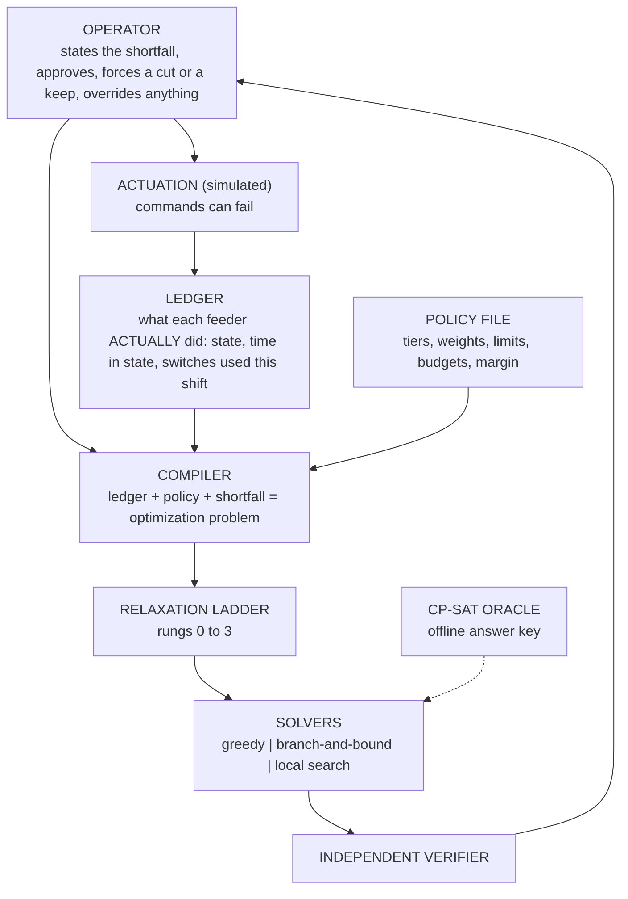

# Urja Niyam: Project Guide

**A load-shedding decision-support system, built as a constraint optimization project for an Artificial Intelligence course.**

| | |
|---|---|
| **What this file is** | The one place that explains *what* we are building, *why* each decision was made, and *how* each algorithm works. |
| **Last updated** | 26 October 2026 (version 0.7) |
| **State of the project** | Model, verifier, simulator, two baselines, an exact solver, a local-search solver, their hybrid, a CP-SAT answer key, the relaxation ladder, the rolling-horizon loop, the scale sweep and the ladder statistics are built and run. 369 automated tests pass. The robustness and stability experiments are done, and the loop has optional meter feedback. A sensitivity run over the calibration ranges, an optional tighter bound, an optional explainer, the rest of the calibration and field validation remain. |
| **Honesty rule** | Every number here comes from something we built and ran. Assumptions and placeholders are labelled as such. Nothing is claimed about the real Indian grid that we have not marked "needs validation". |

Sections marked **[LIVE]** change as results arrive.

---

## In plain words

**What are we doing?** When there is not enough electricity, someone has to choose which areas lose power for a while. Today that choice is mostly made by hand. We are building a helper that suggests the choice, checks that the suggestion follows every rule, and explains it. A person always makes the final call.

**How does it decide?** We write the rules down (never cut a hospital without approval, do not flick a switch every few minutes, do not leave one area dark for hours). We also give every outage a "pain score" that grows the longer people sit without power. Then we look for the plan with the smallest total pain that breaks no rule.

**Why build several solvers?** Because comparing them is how we learn how good our answers are.
- **Simple rules** (greedy) are what a person might do by habit. They are our yardstick for "is this even worth building?".
- **Exact search** (branch-and-bound) tries every sensible option and skips the hopeless ones, so it can *prove* it found the best plan. It only works on small grids.
- **Local search** starts from a plan and keeps making small improvements. It cannot prove anything, but it keeps working on big grids.
- **Hybrid**: local search first, then exact search that starts from the plan local search found, so the exact search wastes no time on bad plans.
- **CP-SAT** is a strong professional solver from Google. We use it only as a judge.

**Why test with 10, 50, 200 and 500 feeders?** A real area has anything from dozens to hundreds of feeders. We need to know where each method stops working.

**What did we find?** (medians over two instances per case; "extra pain" means how much worse than the best plan anyone found)
1. **10 feeders:** local search and CP-SAT find the best plan in every tier. Our exact search does too, except on one hard crisis instance, where it ran out of time. The simple rule wastes 20-41% extra pain.
2. **50 feeders:** nobody can prove which plan is best. CP-SAT with 60 seconds is slightly ahead of our local search with 21 seconds (within 0-1% against 3-7% of the best plan found). The simple rule wastes 56-140%.
3. **200 and 500 feeders:** local search gives the best plans at both sizes. CP-SAT with 60 seconds does find plans at 200 feeders, but they are 28-61% worse than local search. The simple rule wastes 59-90% in mild and moderate shortfalls, but only 8-29% in a crisis, where almost everything has to be cut anyway and there is little to choose.
4. **How close to the best possible?** At 10 feeders, where we can check, local search found the best plan every time. At bigger sizes we cannot prove it, but we can say its plan is at most 17-48% above the best possible.
5. **Exact search runs out of steam at about 20 feeders**, even when it starts from a good plan. The hybrid never does worse than either solver alone and sometimes proves one more instance, but it does not move that wall.
6. **The relaxation ladder** (the part that bends the rules when it must) never had to act for realistic shortfalls: up to 30% of demand every plan satisfied every rule. It starts to act at 40-50% of demand. What triggers it much more easily is constraints: if the operator forces 70% of the ordinary feeders to stay on, it acts even at a 20% shortfall, and halving the maximum downtime halves the shortfall it can absorb.
7. **Robustness.** Protecting against wrong load numbers with a bigger safety margin works but is very expensive: at a 20% load error, a margin big enough to remove the shortfall multiplied the harm by about twelve. Letting the tool learn each feeder's real load from its meter gave the same protection at about a third of the harm, but only with accurate meters. Operator orders are also costly: forcing the cheapest feeder to stay on multiplied the harm by about four, because the cut moves to feeders with many consumers. And a failed breaker made plans noticeably more costly.

**What does this change?**
- Local search is the main solver for big grids. Exact search is for small grids and for proofs. CP-SAT stays a judge, used only up to about 50 feeders.
- Our lower bound is the measuring stick at every size, because it is cheap (a couple of seconds even at 500 feeders).
- The setup step used to take 22-33 seconds at 500 feeders and was repeated every cycle of the rolling-horizon loop. We rewrote it, and it now takes under a second. A 50-feeder loop episode runs at 1.5 seconds per cycle, so the stability and robustness experiments are now practical.
- The ladder statistics and the robustness experiments are done. What remains is to re-run the key results across the calibration ranges, and optionally to tighten the bound and add an explainer.

---

## 1. The problem, and the slice of it we solve

### 1.1 The problem

When a power grid cannot supply everything people want to use, the utility switches off some areas on purpose for a while. This is **load shedding**. Without it, the grid can collapse entirely.

The person in the control room has to decide *which feeders to cut, in what order, and for how long*. In India this is mostly done by hand, under time pressure. Four things have to be balanced at once: protect critical services (hospitals, water pumping), keep any one area from suffering long outages, respect the limits of the field staff who flip the switches, and keep total disruption low.

**Our tool recommends that decision.** The dispatcher gives it the shortfall ("we are short by X kW for the next hours"). It returns a plan that obeys every rule, with the reasons. The human can always override.

### 1.2 Which layer of power-system operation this is

| Layer | Time scale | Ours? |
|---|---|---|
| Demand and shortfall **forecasting** | days to hours | **No.** A separate, well-studied machine-learning problem. We take the shortfall as an *input*. |
| **Rotational load shedding** | **hours, in 15-minute steps** | **Yes.** Given a shortfall, which feeders do we cut and when? |
| Emergency under-frequency shedding | seconds | No. Automatic relays do this. |
| Network physics (line flows, voltage) | milliseconds to seconds | No. We do not model the network. |

**Why this layer.** Forecasting asks "how short will we be?". Nobody has to *decide* anything from a forecast until the shortfall is known. The decision step is the harder half, it can be formulated precisely, and it is exactly where constraint-solving techniques apply. Staying out of forecasting also keeps this a search-and-optimization project rather than a machine-learning one.

### 1.3 Who the tool is for

The **dispatcher** (control-room engineer) is the primary user, because the dispatcher's judgment is the hard part and the field operator only executes it. The tool must still produce plans a field operator can carry out, so the operators' limits are inside the model. Automating the field step comes later, only if the recommendations prove good, and it would keep a human confirmation.

### 1.4 What real-world practice forces into the model

> **Source note.** This is general background plus public material. We could not reach grid staff, so every item is listed in `docs/field-constraints.md` as "needs validation by an operator". Treat these as plausible, not confirmed.

| Real-world fact | How the model handles it | Why |
|---|---|---|
| Shedding is a last resort; operators first buy power, back down generation, or ask interruptible industry to cut | The tool takes the **remaining** shortfall after those steps; industry-like feeders are the cheapest tier | Buying 50 MW for two hours may be kinder than cutting homes |
| Hospitals and water pumping should be shed last | **Critical tier**: shed last, and only with explicit operator approval | Matches practice and keeps the human in charge |
| Farm feeders get promised supply hours | **Promised supply windows** are a hard rule | Cutting them breaks a commitment |
| A feeder restored after a long cut pulls extra load (motors, ACs, pumps start together) | **Restoration surge** is added to the required relief | Without it, "shortfall covered" is false in the slot after a restore |
| Breakers cannot flip every 15 minutes; staff do few operations per shift | **Minimum cut/restore durations** and **switching budgets** | The plan must be executable |
| Meter readings are rough or late | A **safety margin** on the shortfall | Insurance against estimate error (its price is measured in section 8) |
| Hospitals sit on feeders shared with thousands of homes | A feeder is tagged with its **highest tier** | Protection is a property of the whole feeder |
| Operators override plans for reasons the tool cannot see | **Force-cut and force-keep** are inputs; the tool replans around them | The human always has the last word |
| Some discoms cut high-loss feeders more | We do not decide this. Tier and harm weights are **policy inputs** | It is a value judgment, not a computation |

---

## 2. Turning the problem into a constraint optimization problem

### 2.1 The vocabulary we use

A **constraint satisfaction problem (CSP)** has three parts: *variables*, a *domain* of values for each, and *constraints* that rule out combinations. A solution assigns every variable a value without breaking any constraint. A **constraint optimization problem (COP)** adds an *objective* to minimize among the solutions. Constraints that must hold are **hard**; ones that may be given up, at a cost, are **soft**. This is sometimes called a **weighted CSP**.

| CSP idea | In our problem |
|---|---|
| Variables | `x[f,t]`, one per feeder *f* and 15-minute slot *t* (50 feeders x 16 slots = 800) |
| Domain | {0 = on, 1 = cut} |
| Hard constraints | The six rules in 2.2 |
| Soft constraint | Maximum consecutive downtime |
| Objective | Minimize total harm (2.3) |

Two features of our constraints matter later. First, the key ones are **global**: the relief rule is a sum over *all* feeders in a slot, and the duration rules look at *runs* of consecutive slots. Classic arc consistency (AC-3) works on constraints between *pairs* of variables, so it prunes almost nothing here. We use **bounds propagation on the sums** instead (6.4). Second, most rules involve **one feeder only**. That lets us reformulate the problem (6.3).

### 2.2 The model

**Time.** 15-minute slots. We plan 16 slots (4 hours) ahead, **commit only the first**, then replan.

**Feeder data.** A priority **tier** (Flexible = shed first, Normal, Critical = shed last), a **type** (urban, rural, agricultural, industrial, mixed), a consumer count, an **estimated load in kW per slot**, and optional promised supply hours. Cutting a feeder relieves its *current load*, not its capacity, which is why load is per slot.

**History.** For every feeder: is it cut now, how many slots it has been in that state, and how many switches it has used this shift. History is part of the model because the time-based rules mean nothing without it.

**Hard rules** (a plan that breaks one is rejected):

1. **Relief.** In every slot the cut load must cover the shortfall, times a safety margin, plus the restoration surge.
2. **Minimum cut and minimum restore durations.** No flicking on and off.
3. **Switching budgets.** A maximum number of breaker operations per feeder and for the whole system, per shift.
4. **Operator overrides** are obeyed.
5. **Promised supply hours** hold.
6. **Critical feeders** are never cut without approval.

**Soft rule.** **Maximum consecutive downtime**. It is the first thing the ladder gives up (2.4).

### 2.3 The objective: harm

```
harm = sum over cut (feeder, slot) of  tier_weight x time_of_day_weight x consumers x (1 + 0.5 x (r - 1))
     + 0.02 x (kW of relief beyond what was needed)
     + 1.0 x (number of breaker operations)
```
`r` is how many slots in a row the feeder has already been off, counting this slot.

**Worked example.** A Normal feeder (weight 5) with 1,000 consumers at time-of-day weight 1:

| Slot of the outage | Factor | Harm |
|---|---|---|
| 1st | 1.0 | 5,000 |
| 2nd | 1.5 | 7,500 |
| 3rd | 2.0 | 10,000 |
| 4th | 2.5 | 12,500 |

One 4-slot outage costs 35,000. Two separate 2-slot outages cost 25,000.

**Why convex in outage length.** Each extra hour in the dark hurts more than the last. As a side effect the optimizer prefers to **spread** a long need across feeders, so rotation appears without being demanded.

**Why there is no fairness rule.** We started with one (a Gini-coefficient bound) and dropped it. Fairness is hard to define, the harm of an outage differs by place and person, and Gini is a non-local nonlinear measure that does not fit a constraint solver. What we keep is honest and limited: cuts rotate *within an episode* because of the convex cost, and we **do not claim equity over days or weeks**. Who counts more is expressed by the weights, which the operator sets.

**Why the tier weights are 1 / 5 / 1000.** The Critical weight is large enough that a Critical feeder is cut only when nothing else can cover the need. The approval requirement is the actual safeguard; the weight keeps the cost ordering consistent with it. The numbers are placeholders (section 10).

**Why the other two terms are tiny.** Overshoot and switching penalties are small next to harm, so they act as tie-breakers. The hard rules (minimum durations, switching budgets) do the real anti-thrashing work.

### 2.4 The relaxation ladder

If no plan satisfies every rule, we give up rules **in a fixed order**, each rung including the ones before it:

| Rung | What is given up | Outcome |
|---|---|---|
| 0 | Nothing | Executable plan |
| 1 | Maximum downtime (soft rule); the excess is reported | Executable plan |
| 2 | Not cutting Critical feeders: offered as a **proposal** that lists exactly which (feeder, slot) cuts need approval | Not executable until approved |
| 3 | **ESCALATE**: the shortfall cannot be covered within the rules; we report the best coverage reachable without cutting Critical feeders, and the uncovered kW per slot | The human decides |

**Why this design.** A solver that silently drops rules is dangerous, and one that returns "infeasible" is useless during a heatwave. The ladder gives a usable answer while keeping each concession visible, measured and approved. Relaxation hierarchies are an established idea (constraint hierarchies, weighted CSPs); our contribution is applying them with an operator-approval step.

### 2.5 How hard is it

Choosing which items to cut so that their relief just covers a requirement is a **covering knapsack** problem, which is NP-hard, and ours adds rules over time. So exact methods will slow sharply as grids grow. We treat that as a **result to measure** (the scalability wall), not a flaw to hide.

---

## 3. Data

### 3.1 What is real and what is not

Real feeder-level cut histories are not public. So **real data fixes only the size and frequency of shortfalls**. Everything about the feeders (tiers, loads, types, histories) is **synthetic**, built from documented placeholder assumptions.

### 3.2 The real dataset and what the EDA told us

**Source.** Hunt and Bloomfield, *Daily electricity demand data for Indian states (2014-2024)*, Zenodo, CC BY 4.0 (DOI to be added to `docs/data-sources.md`). Daily, state-level, not hourly and not feeder-level.

**Used:** `peak_unmet_MW` and `corrected_peak_met_MW`. **Parked:** the weather files and heat-stress index. Using them would pull the project toward forecasting.

| Finding | Detail | Consequence |
|---|---|---|
| Size and span | 3,955 rows x 39 columns, 1 Jan 2013 to 28 Apr 2024 | |
| Non-state columns | **Total**, **AMNSIL**, **DVC** sit beside the 36 states and UTs | Excluded, to avoid double counting |
| Missing data | about 6% of cells; about 240 missing days; 55 duplicate dates | Keep the first duplicate |
| Raw errors | The "corrected" files change about 200 cells per file; one raw peak value was off by about 100,000 MW | **Always use the corrected files** |
| No corrected unmet file | Only a raw version exists | Drop ratios above 0.5 as suspect (only 3 dropped) |
| Zero-heavy | 130,777 state-days have data; only 35,499 (27.1%) have any unmet demand | Take percentiles over **non-zero days only** |
| Falling trend | Mean unmet fell about 95% from 2013 to 2024 | Early years dominate the severe days |
| Dominated by a few states | J&K (median about 20% of demand unserved) and the north-east states have unmet demand on most days | Pooled percentiles describe chronic small states more than large grids |

### 3.3 From data to scenarios

We use a **ratio**, not raw MW, so the same scenario scales to a grid of any size:

```
shortfall ratio = unmet MW / (met MW + unmet MW)      on days with unmet demand
```

| Percentile | P10 | P25 | P50 | P75 | P90 | P95 | P99 | P99.9 |
|---|---|---|---|---|---|---|---|---|
| Ratio | 0.46% | 1.09% | 2.96% | 6.84% | 15.5% | 20.0% | 23.1% | 31.6% |

**Our tiers use percentiles 50, 75 and 95: mild 3.0%, moderate 6.8%, crisis 20.0%** of demand unserved. The first plan (50/90/99) was dropped because P90 and P99 sit close together (the upper tail is J&K's normal level), which would have made two near-identical tiers. A 2019-onward version (`tiers_2019.json`) exists; **its comparison is not yet analysed**.

**Shape inside a day.** The data is daily, so it cannot say how a shortfall rises and falls. We use a documented synthetic **trapezoid** (ramp up over 4 slots, hold, ramp down), so `S(t) = ratio x shape(t) x demand(t)`. This is an assumption, not a data result.

### 3.4 The synthetic grid

`make_grid(n, seed)` builds feeders: 5% Critical, 15% Flexible, 80% Normal; types and sizes by tier; hourly load shapes (evening peak for homes, flat for industry, supply blocks of 06-14, 14-22 or 22-06 for farms with a 75% promise). The same seed gives the same grid. All numbers are placeholders to be calibrated from tariff orders (`docs/field-constraints.md`).

---

## 4. System design



**Five rules the design never breaks, and why:**

1. **The human is in control.** Nothing runs without the operator, and any decision can be overridden. In a safety setting, a tool that cannot be overruled will not be trusted or adopted.
2. **The solver is untrusted; the verifier decides.** Every plan passes a small independent checker. That is what makes it safe to use fast heuristics that cannot prove anything.
3. **No black boxes.** Each cut traces to a rule and a cost. This is why we chose constraint solving over learned models (section 5).
4. **Policy is data.** Every tunable number lives in `configs/policy.yaml`, so changing practice means editing a file.
5. **We claim only what we measured.** Novelty is claimed for the application and the evaluation, not for the underlying algorithms.

**Repository map.**

```
configs/policy.yaml          every tunable number
src/loadshed/model.py        data types      policy.py  loads and validates the YAML
src/loadshed/verify.py       the independent verifier
src/loadshed/metrics.py      the harm objective and reporting numbers
src/loadshed/sim/            grid generator, scenarios, Zenodo ratios
src/loadshed/solvers/        greedy.py  patterns.py  bnb.py  minconflicts.py
src/loadshed/ladder.py       the relaxation ladder
src/loadshed/loop.py         the rolling-horizon loop
evaluation/                  oracle_cpsat.py (CP-SAT, offline only), run_gap.py (benchmark)
scripts/  tests/  notebooks/  data/  docs/  literature/
```

---

## 5. Approach: why constraint-based search, and why several solvers

### 5.1 Why not the common alternatives

| Alternative | What it is | Why we did not choose it |
|---|---|---|
| **Manual rotation** | Operator experience or a fixed timetable | No way to compare options or know how good a plan is; slow when the shortfall changes |
| **Simple greedy rules** | "Cut the biggest non-critical loads first" | Fast, but ignores outage length, switching limits and the future. We implemented it as a baseline and measured the loss (section 8) |
| **Machine learning** | Train a model (for example a neural network, as in the 2019 load-shedding paper in `Literature/`) to decide or to speed up decisions | Needs labelled optimal decisions, and none exist for Indian feeders; gives no guarantee that hard rules hold; cannot explain a cut. We would have to generate labels using the very solver we are building |
| **Commercial optimizers** | Proprietary distribution-management systems | Their logic is not available to us, so we cannot inspect or compare it |

What constraint solving gives that the others do not: **guaranteed rules** (checked by the verifier), **a measurable distance from the best possible** (lower bounds and optimality gaps), **explanations** (binding constraints and costs), and **adaptation by editing a policy file** instead of retraining.

### 5.2 Why a ladder of solvers instead of one

Each solver answers a different question, and the comparison between them is the evaluation.

| Solver | Question it answers |
|---|---|
| **Greedy baselines** | What does a sensible simple rule achieve? (the bar to beat) |
| **Branch-and-bound** (ours) | What is the proven optimum, or a proven lower bound, and where does exact search stop being practical? |
| **Local search** (ours) | What can we get at sizes where exact search fails? |
| **CP-SAT** | What is the best known answer, from an industrial solver? Used **only** to grade the others |

We wrote the first three from scratch so every step can be explained. CP-SAT is kept out of the decision path on purpose: it is an answer key, not part of the product.

---

## 6. How the algorithms work

### 6.1 The verifier

A deliberately small file that imports no solver. For a plan it:

1. checks the shape (every feeder present, 16 values of 0 or 1);
2. **walks each feeder through time starting from its history**, tracking how long it has been in each state. At every state change it checks the minimum cut or restore duration and counts one switch (counters reset at shift boundaries);
3. counts switches system-wide against the budget;
4. checks relief slot by slot: cut load must be at least `shortfall x margin + surge`;
5. checks overrides, Critical approval and promised hours;
6. reports maximum downtime as a **soft** violation, only if the *plan itself* extended the outage.

It returns **hard** violations (plan rejected), **soft** ones with a size, and **waived** ones (a rule broken at a slot the operator forced; the operator wins, and it is logged). Relief is never waived: physics does not take orders.

### 6.2 Greedy baselines

A **greedy** method builds a solution one step at a time, taking the locally best choice and never undoing it. It is a **heuristic**: fast, but with no guarantee.

**Plain greedy**, slot by slot:
1. **Lock** feeders that the rules decide: forced cuts and keeps, Critical feeders without approval, feeders still inside a minimum duration.
2. For the rest, compute the **harm of cutting this feeder this slot**, including its current outage length.
3. Rank by **harm per kW that actually counts toward the remaining need**, and add feeders until the slot is covered.
4. Respect switching budgets, keep one switch in reserve for farm feeders that will need a restore to honour their promise, and leave a feeder cut if there is no budget to restore it.

Step 3 is the **cost-effectiveness heuristic** known from covering problems. Our first version ranked by harm per *total* kW and cut a 3.5 MW feeder to cover 300 kW, because per kW it looked cheap. Crediting a feeder only for the need still remaining fixed that.

**Sticky greedy** keeps an already-cut feeder cut (it is "free") until it hits the downtime limit, then rotates. This is plain manual rotation. We keep **both**, because they fail differently: plain greedy rotates early and can burn the switching budget; sticky holds feeders until the budget leaves some stuck. We report the better of the two.

Greedy is **myopic**: it never looks ahead, so it cannot plan switches across the horizon. That is exactly the weakness the other solvers exploit.

### 6.3 Reformulating as patterns

Only two things connect feeders: the per-slot relief sums and the system switching budget. Every other rule involves one feeder alone. So we list, once per feeder, **every valid 16-slot on/off row** (a *pattern*) by depth-first search over the slots, carrying the state, the run length and the switch count and discarding rows that break a rule. A search then **chooses one pattern per feeder**.

Each pattern carries its cost, its **net relief** per slot (relief minus restoration surge) and its switch events. The total objective becomes **the sum of the chosen patterns' costs plus a constant**: the problem is *separable*, which makes bounds easy. We also discard **dominated** patterns (no cheaper and no better in any slot than another).

**Why.** The search space is no longer 2^800 raw bits but a choice among a few hundred valid rows per feeder, with every single-feeder rule already satisfied. A test checks that, on random problems, the enumeration contains **exactly** the rows the verifier accepts. **Speed.** Our first builder took about 0.03-0.06 s per feeder (12-33 s at 500 feeders), which mattered because the rolling-horizon loop repeats it every cycle. The fast builder uses three observations. The valid rows depend only on a feeder's history, overrides, promises and tier, not on its load, consumers or weights, so each distinct situation is enumerated once and cached (also across loop cycles). Cost and net relief then follow by array arithmetic. And whether pattern *i* dominates *j* depends only on the structure of the rows (and on which slots carry load), so that yes/no matrix is cached too: after sorting by cost, a pattern is dominated exactly when some cheaper one dominates it. Result: identical patterns, 0.7 s at 500 feeders instead of 12 s. The simple builder is kept as a reference, and the tests demand that the two agree.

### 6.4 Branch-and-bound with bounds propagation

**Search tree.** Each level decides one feeder's pattern. A node is a partial plan. Four steps per node:

**1. Propagate (constraint propagation).** For each slot the feeders together must supply at least `need`. Each feeder can supply at most the best relief among its remaining patterns. *Example:* a slot needs 1,000 kW. Feeder A can give at most 600, B at most 300, C at most 200 (total 1,100). If C gave nothing, A and B reach only 900, so any C pattern that supplies less than 100 kW in that slot is impossible and is **deleted** from C's domain. Deleting values lets other deletions follow, so we repeat until nothing changes (a *fixpoint*). A feeder left with no patterns, or a slot that cannot be covered, kills the node. The system switching budget is checked the same way, using only switches that are unavoidable. This is **bounds propagation on a global sum constraint**.

**2. Bound (an admissible heuristic).** We want a number that no completion of this node can beat, so that hopeless nodes can be skipped. In A* terms this plays the role of an **admissible heuristic**: it never overestimates the best completion, so pruning on it never discards the optimum. We get it with **Lagrangian relaxation**: *put a price on the relief rule* (per kW, per slot) and let each feeder decide alone whether cutting is worth that price. At any non-negative price the result is a valid lower bound. At a node:

```
bound = price x need + constant + sum over feeders of (cheapest remaining pattern, with relief paid for at the price)
```
The prices are tuned once at the root by the **subgradient method**: raise the price of a slot that is under-covered, lower it where relief overshoots, with shrinking steps.

Two bugs taught us what makes this bound work. The first version was weak (about 180 against a true optimum of 3,394) because it could cut a huge feeder *fractionally* to cover a small need. The fix credits each pattern with **at most `need` per slot**, since relief beyond the need cannot help cover it. The second version was **invalid** (above the optimum) because surges give negative relief and the capping argument fails for negatives. Clipping relief to `[0, need]` fixed it. A test now checks the bound never exceeds the known optimum.

**3. Prune.** If the node's bound cannot beat the best complete plan found so far (the **incumbent**), discard the whole subtree.

**4. Branch.** Choose the feeder whose best and second-best choices differ most (**largest regret**), the analogue of "fail-first" variable ordering: decide where a wrong choice costs the most. Try its patterns **cheapest first**, the analogue of best-first value ordering. The incumbent starts as the better greedy plan, and at each node we also try everyone's cheapest pattern in case it happens to be valid.

If the strict problem is proven infeasible, the solver reruns with maximum downtime relaxed (rung 1). Every plan it returns has passed the verifier.

**Where it struggles.** The tree grows very fast. At 10 feeders it proves optimality in about a second for most instances. At 50 feeders it does not finish in a minute. On one 50-feeder instance our **proven lower bound (1,715) was higher than CP-SAT's (1,261)**, though CP-SAT found the better solution.

### 6.5 Local search: weighted min-conflicts

**Local search** starts from a *complete* assignment and improves it by small changes. It gives up proof in exchange for speed. **Min-conflicts** is the classic CSP version: pick a variable involved in a violated constraint and give it the value that leaves the fewest violations.

**Our version.**
- **State:** one pattern per feeder. Patterns already satisfy every single-feeder rule, so the only things that can be violated are the **16 relief sums** and the **system switching budget**.
- **Score:** `harm + sum over slots (weight x relief shortfall) + (weight x budget excess)`.
- **Move:** pick feeders that can help the violated slot (the conflicted variables); give each the pattern with the best score; take the best move found among a small sample.
- **Breakout weights.** At a local minimum with something violated, multiply the weight of the violated constraints by 1.5. A stuck search makes its own obstacles progressively costlier until it moves. Our first version used small additive increments and failed on a case with a cost of 26,000, which would have needed about 80,000 iterations. Geometric growth reaches any scale in a few dozen steps.
- **Strategic oscillation.** While nothing is violated, all weights decay. That lets the search trade a little violation for lower cost, then repair it. Without this it cannot descend below its current cost while staying feasible.
- **Tabu list.** A move back to a pattern left in the last 5-15 iterations is blocked, so it does not cycle.
- **Start and restarts.** It starts from the better greedy plan, so it is **never worse than the baselines**. When stuck, it restarts from the best plan with 10% of the feeders shaken.

It cannot prove optimality or infeasibility (apart from a cheap necessary check). Its results are graded against bounds and the oracle, and every plan is verified.

**The hybrid (local search, then branch-and-bound).** Branch-and-bound skips a subtree only if its bound cannot beat the best plan already known. Its default starting plan is the better greedy plan, which can be 50-150% above the optimum, so it prunes little. Local search reaches a near-optimal plan quickly, so the hybrid runs it first (for at most 30% of the time, and it stops early once it stops improving) and hands that plan to branch-and-bound as the starting plan. The result is never worse than either solver alone, because branch-and-bound only replaces its starting plan with something better. Our first version always spent the full 30%, which made easy instances several times slower; the early stop fixed that.

### 6.6 CP-SAT, the answer key

CP-SAT is Google's industrial solver. It combines **constraint programming**, a **SAT solver** and **linear programming**. The mechanism, roughly:

- **Lazy clause generation.** Integer variables are represented by yes/no literals created on demand, so the whole model can be handled by a SAT engine while constraints still propagate as in constraint programming.
- **Conflict-driven clause learning (CDCL).** When a search path hits a contradiction, the solver analyses *why*, learns a new clause that forbids that whole reason, and **backjumps** past the useless levels. It never repeats a mistake. This is the main source of its strength on tightly constrained problems.
- **LP relaxation and cuts.** In parallel it solves a linear relaxation, which supplies strong lower bounds, and adds cutting planes.
- **Presolve** simplifies the model first.
- **A portfolio of parallel workers** runs different strategies (including large-neighbourhood search, which repeatedly re-solves part of the problem) and shares solutions and bounds.
- **Optimization.** After finding a plan it adds "objective must be better than this" and continues, until the search space is exhausted or the bound meets the best plan, which is a proof.

**How we use it.** Our oracle encodes exactly the verifier's rules and the same harm objective: a yes/no variable per (feeder, slot); an integer run-length variable per (feeder, slot), with conditional equalities; start and restore indicators; a table (`element`) constraint for the surge; and conditional constraints for durations and budgets. Numbers are scaled to integers, with loads rounded down and requirements rounded up, so **every oracle answer also passes the verifier**.

**Why only an oracle.** Without a known optimum "solution quality" means nothing; with it we can say "within X% of optimal". Keeping it offline means the product stays explainable, and the project stays our algorithms, graded against a trusted one. **Its practical limit:** at 200 feeders, on 4 cores with a starting plan as a hint, it found no plan in 30 seconds, and with 60 seconds its plans were 28-61% worse than local search. So we use it to grade grids of up to about 50 feeders and use bounds above that. We also test the oracle itself: on random tiny problems it must equal a **brute-force** enumeration of every schedule (section 7).

### 6.7 The ladder in practice

The ladder tries rung 0, then 1, then 2, then 3, each with the same solver chain: the hybrid (6.5) up to 12 feeders, otherwise local search. Each failure is labelled **proven impossible** (an exact search or the necessary check proved it) or **not found in time** (a heuristic gave up), so the operator knows how far to trust "no plan".

- **Rung 1** reports the excess per feeder ("f03 off 14 slots, limit 12, +2").
- **Rung 2** reruns with every Critical (feeder, slot) allowed, then lists the ones actually used. The result is deliberately **not executable**: the verifier rejects it for a missing approval until the operator approves. Approval is a function call that adds those pairs to the problem.
- **Rung 3** finds the largest fraction of the shortfall the allowed actions can cover, by **bisection** over a scaling factor, and reports the uncovered kW per slot. Covering the same fraction in every slot is simple to explain but not the best possible, which is an open point (section 9.3).

### 6.8 The rolling-horizon loop

This is the standard idea of **receding-horizon (model-predictive) control**: plan ahead, act on the first step, observe, replan. A single plan is never right for long, because shortfalls change, loads are estimates, and breakers fail. Each cycle:

1. **Build the problem** from the *ledger* (what feeders actually did), the shortfall the operator currently states, estimated loads, overrides and earlier approvals.
2. **Solve it through the ladder**, warm-started with last cycle's plan shifted forward.
3. If the ladder proposes Critical cuts, **ask the operator** (a callback; the simulation can approve, decline or do something smarter).
4. **Commit only the first slot** and send commands. Each may fail. Real loads differ from estimates by a per-feeder bias plus noise.
5. **Update the ledger from what happened**, not what was planned. A failed command still costs one switching operation. Counters reset when a new shift starts.

The loop records what was actually suffered (harm, uncovered kW, switches) and three stability measures. All are about *plan thrashing*, a known problem in receding-horizon control. On **quiet** cycles (nothing changed in the world since the last cycle) it records the **plan-revision rate** (how much of the overlap with the previous plan the new plan changes) and the **commit-surprise rate** (how often the action we commit differs from what the previous plan predicted for this slot, which is what a dispatcher would experience as the plan flip-flopping). Over the whole episode it counts **unplanned reversals**: an unpredicted switch that undoes a switch made at most four slots earlier. An older count, **short cycles** (on-off-on within an hour), is kept but is not used as evidence, because rotating feeders at the 30-minute minimum duration produces it legitimately.

**Optional meter feedback.** Real feeders have meters, and the load errors in our model are persistent per feeder, so the loop can learn them. After each slot it compares every feeder's measured load with its estimate and smooths a per-feeder multiplier toward the ratio. Later plans use the corrected loads. This replaces part of the safety margin: instead of insuring against an error, the tool measures it. It depends on meter quality, which the robustness results (8.8) show.

---

## 7. How we know the code is correct

For a safety tool, "it ran" is not evidence. Five checks, each guarding against a different kind of mistake:

1. **Hand-computed tests.** The harm of a small plan is worked out on paper and the test demands that exact value.
2. **The verifier as referee, and a reference implementation.** Pattern enumeration must equal *exactly* the rows the verifier accepts, over every possible row of random single feeders, in both strict and relaxed modes. The fast pattern builder must in turn equal the simple reference builder on random grids with histories, overrides and approvals, with a cold and a warm cache.
3. **Brute force.** On tiny problems we enumerate every possible schedule, keep those the verifier accepts, and take the cheapest. The oracle and the branch-and-bound must match it exactly, including infeasible cases, relaxed cases and operator overrides. They matched on every random problem tried.
4. **Whole-episode verification.** What the loop *actually executed* across all its replans must pass the verifier as **one plan over the whole episode**. That proves minimum durations, switching budgets and shift resets held *between* cycles, not just inside each plan.
5. **Mutation testing.** We deliberately break the code (ignore a rule, drop the surge, inflate the bound, record a failed command as successful, skip the shift reset) and confirm that tests **fail**. A test that cannot fail proves nothing. This exposed two weak tests, which we rewrote.

**Bugs these checks found:**

| Bug | Found by |
|---|---|
| Loader kept empty cells in one pandas version, turning every percentile into NaN | A unit test on fake data |
| Greedy let farm feeders break promised hours when the switching budget ran out | Benchmarking against the verifier |
| Greedy cut huge feeders for small shortfalls (a strawman baseline) | Inspecting the worst gap by hand |
| Verifier blamed the plan for an outage already over the limit in its history | Random brute-force comparison |
| First Lagrangian bound far too weak; its fix was **invalid** (above the optimum) | Comparing bounds to known optima |
| Local search could not find a plan when its penalty weights started tiny | Random comparison against the oracle |

---

## 8. Results so far [LIVE]

**How to read the numbers.** *Gap* is how much **more harm** a plan has than a reference, in percent (100% means twice the harm). Two references are used. The **best plan any solver found** gives a gap that is *at least* this big. The **best proven lower bound** gives a gap that is *at most* this big. The true gap lies between, so we show both as "a .. b". Everything uses the **synthetic grid**, the three tiers (3%, 7%, 20%) and the placeholder policy. The system switching budget is `max(20, 0.6 x feeders)`. Time limits count the **search only**; building the patterns is reported separately as setup. Timings depend on the machine: setting up 500 feeders took 12 s on our test machine and 30 s on the team's 4-core laptop.

### 8.1 Ten feeders (the true optimum is known)

6 instances per tier.

| Tier | Oracle proved optimal | Branch-and-bound proved optimal | Plain greedy gap | Sticky greedy gap | Best of the two | Local search vs best found |
|---|---|---|---|---|---|---|
| Mild | 6/6 | 6/6 | 130% | 34% | **34%** | 0.0% |
| Moderate | 6/6 | 6/6 | 136% | 35% | **35%** | 0.0% |
| Crisis | 6/6 | 4/6 | 165% | 107% | **41%** | 0.0% (max 0.2%) |

Branch-and-bound returned the oracle's optimum wherever it finished. Local search improved on the best greedy plan by 25-29% and matched the best known solution.

### 8.2 Fifty feeders (nobody can prove optimality)

4 instances per tier. Oracle 20 s, branch-and-bound 60 s, local search 7 s.

| Tier | Proved optimal | Best baseline gap, between | Branch-and-bound worse than CP-SAT | **Local search worse than best found** | Local search better than best baseline |
|---|---|---|---|---|---|
| Mild | 0/4 | 89% and 132% | 33% | **6.2%** | 44% |
| Moderate | 0/4 | 97% and 178% | 87% | **4.6%** | 46% |
| Crisis | 0/4 | 100% and 138% | 4.4% | **2.8%** | 45% |

The "between" interval uses the best solution anyone found (the gap is at least this) and the best proven lower bound (the gap is at most this), so the true gap lies inside it. 

### 8.3 The scale sweep, 10 to 500 feeders (2 seeds per case)

Two instances per cell (seeds 0 and 1, 17:00) on the team's 4-core laptop. Limits: local search 20 s (its main phase gets 14 s), branch-and-bound 60 s, CP-SAT 60 s. Above 50 feeders branch-and-bound runs only to its root lower bound, and CP-SAT is skipped at 500. Medians over the two instances; the setup column was measured **before** the fast pattern builder (section 6.3).

**Time (seconds):**

| Feeders | Pattern setup (old) | Greedy baselines | Local search | Branch-and-bound | CP-SAT |
|---|---|---|---|---|---|
| 10 | 0.4-0.7 | under 0.1 | 21 (its budget) | 1.6-2.1 in mild and moderate; one crisis instance hit the limit | 1.4-8, proved all |
| 50 | 2.1-2.6 | under 0.1 | 21 | hit the limit, proved none | hit the limit, proved none |
| 200 | 8.1-9.5 | under 0.1 | 21 | 0.4-0.6 (root bound only) | hit the limit |
| 500 | 21.6-22.5 | 0.1-0.3 | 21 | 1.2-1.7 (root bound only) | not run |

**Quality** (gap in % versus the best plan found .. versus the best proven lower bound):

| Feeders | Tier | Best greedy | Local search | CP-SAT | Window |
|---|---|---|---|---|---|
| 10 | mild | 41 .. 41 | 0 .. 0 | 0 .. 0 | 0 |
| 10 | moderate | 20 .. 20 | 0 .. 0 | 0 .. 0 | 0 |
| 10 | crisis | 20 .. 20 | 0 .. 0 | 0 .. 0 | 0 |
| 50 | mild | 140 .. 187 | 7 .. 27 | 0 .. 19 | 19 |
| 50 | moderate | 109 .. 179 | 4 .. 39 | 1 .. 35 | 34 |
| 50 | crisis | 56 .. 80 | 3 .. 19 | 0 .. 16 | 16 |
| 200 | mild | 77 .. 161 | 0 .. 48 | 61 .. 138 | 48 |
| 200 | moderate | 62 .. 111 | 0 .. 30 | 60 .. 109 | 30 |
| 200 | crisis | 29 .. 50 | 0 .. 17 | 28 .. 49 | 17 |
| 500 | mild | 90 .. 155 | 0 .. 34 | not run | 34 |
| 500 | moderate | 59 .. 98 | 0 .. 25 | not run | 25 |
| 500 | crisis | 8 .. 34 | 0 .. 25 | not run | 25 |

**Window** = (best plan found - best proven bound) / best bound. It measures how tightly *anyone* can pin down the optimum. A window of 0 means the optimum is known.

### 8.4 The hybrid against branch-and-bound alone

Three instances per cell (seeds 0-2, 17:00), 20 s budget each, on the team's laptop. Gap = % above the best plan found by any of the solvers on that instance (median).

| Feeders | Tier | Proved: B&B alone | Proved: hybrid | Time to proof, B&B / hybrid (s) | Plan gap, B&B / hybrid |
|---|---|---|---|---|---|
| 10 | mild | 3/3 | 3/3 | 1.2 / 1.7 | 0 / 0 |
| 10 | moderate | 3/3 | 3/3 | 1.1 / 1.3 | 0 / 0 |
| 10 | crisis | 2/3 | 2/3 | 3.5 / 4.3 | 0 / 0 |
| 20 | mild | 0/3 | 1/3 | none / 6.2 | 0 / 0 |
| 20 | moderate | 0/3 | 0/3 | none | 0 / 0 |
| 20 | crisis | 0/3 | 0/3 | none | 0 / 0 |

On our own test machine an earlier run with two seeds showed more: 2 of 6 proofs for the hybrid against 0 of 6, and a crisis plan 14.9% better than branch-and-bound alone. That did not repeat in the three-seed run above. The honest summary is that the hybrid is never worse and occasionally proves one more instance, and that exact search is effectively exhausted at about 20 feeders either way.

### 8.5 Faster setup, and the loop at 50 feeders

- **Setup:** 2.4 s to 0.15 s at 100 feeders (16 times faster) and about 12 s to 0.7 s at 500 feeders on our test machine, with **identical patterns**. We have not yet re-measured it on the team's laptop.
- **The loop at 50 feeders** (12 slots, one replan per slot, local search): the episode runs in 18 s, which is 1.5 s per cycle. A first look at warm-starting (one episode, so indicative only): plan revision in quiet cycles 0.1% with warm start against 1.7% without, switches 13 against 15, harm 1,060 against 1,066.
- **Thrashing measures.** The first measure, "short cycles", also counted legitimate rotation (5 and 6 in those episodes), so it was replaced by commit surprise and unplanned reversals (6.8). In a first quiet 16-slot episode with 6 feeders, 6.7% of feeder-cycles were surprises and there were no unplanned reversals, while short cycles counted 2. The experiments in 9.2 use the new measures.

### 8.6 The relaxation ladder under stress

Four instances per case (seeds 0-3, 17:00), 20 and 50 feeders, 24 s per ladder call. The data-derived tiers (3-20% of demand) would stay at rung 0, so we push on the ladder in three ways: a **ratio** sweep (shortfall from 3% to 90% of demand), an **override** sweep (a fixed 20% shortfall while the operator forces a growing share of the non-critical feeders to stay ON for the whole horizon) and a **tight** sweep (the ratio sweep again with maximum downtime 6 slots and 2 switches per feeder per shift). Cells show the share of instances ending at rung 0 / 1 / 2 / 3. "Extra slots" is the median total of extra downtime slots over all feeders.

**Ratio sweep** (default policy):

| Shortfall (% of demand) | 20 feeders | 50 feeders | Extra slots, 20 / 50 feeders |
|---|---|---|---|
| 3-30% | 100 / 0 / 0 / 0 | 100 / 0 / 0 / 0 | none |
| 40% | 100 / 0 / 0 / 0 | 25 / 75 / 0 / 0 | none / 40 |
| 50% | 75 / 25 / 0 / 0 | 0 / 100 / 0 / 0 | 28 / 56 |
| 60% | 0 / 100 / 0 / 0 | 0 / 100 / 0 / 0 | 20 / 70 |
| 70% | 0 / 100 / 0 / 0 | 0 / 100 / 0 / 0 | 27 / 99 |
| 80% | 0 / 100 / 0 / 0 | 0 / 25 / 0 / 75 | 44 / 100 |
| 90% | 0 / 0 / 25 / 75 | 0 / 0 / 0 / 100 | ESCALATE covers 95% / 84% |

**Override sweep** (20% shortfall; share of non-critical feeders forced ON):

| Forced on | 20 feeders | 50 feeders |
|---|---|---|
| 0-30% | 100 / 0 / 0 / 0 | 100 / 0 / 0 / 0 |
| 50% | 75 / 25 / 0 / 0 (12 extra slots) | 100 / 0 / 0 / 0 |
| 70% | 25 / 50 / 0 / 25 (8 extra slots; ESCALATE covers 59%) | 75 / 0 / 25 / 0 (1,981 Critical kW-slots to approve) |
| 90% | 0 / 0 / 0 / 100 (covers 29%) | 0 / 0 / 0 / 100 (covers 29%) |

**Tight policy sweep:**

| Shortfall (% of demand) | 20 feeders | 50 feeders | Extra slots, 20 / 50 feeders |
|---|---|---|---|
| 3-10% | 100 / 0 / 0 / 0 | 100 / 0 / 0 / 0 | none |
| 20% | 100 / 0 / 0 / 0 | 25 / 75 / 0 / 0 | none / 56 |
| 30-70% | 0 / 100 / 0 / 0 | 0 / 100 / 0 / 0 | 30 to 91 / 78 to 254 |
| 80% | 0 / 100 / 0 / 0 | 0 / 25 / 0 / 75 | 119 / 257 |
| 90% | 0 / 0 / 25 / 75 | 0 / 0 / 0 / 100 | ESCALATE covers 95% / 84% |

A ladder call took about 1.5 s at rung 0, 3.5 s at rung 1, and 17-26 s when it reached rung 3 (seven solves for the best-effort search).

### 8.7 The rolling-horizon loop

Measured on 6-feeder episodes. These show behaviour; they are not yet a systematic study.

- **Executed history passes the verifier as a single plan**, including with breaker failures, operator overrides, a mid-episode shortfall change and short shifts that force rotation.
- **A failed command is seen and compensated.** The shortfall is unserved in that slot, and the next plan covers it. The failed attempt costs a switching operation.
- **Critical feeders are cut only after approval.** Declining leads to ESCALATE with the shortfall unserved.
- **Safety margin trade-off.** With 20% load-estimate error, a 5% margin left 273 kW-slots unserved while a 40% margin left none, at **2.5 times the harm** (16,880 versus 42,271) on one scenario. The margin is insurance with a measurable price.
- **Plan stability.** In quiet cycles the new plan changed only 4.7% (moderate) and 0.9% (crisis) of the entries it overlapped with the old plan. **Warm-starting made no measurable difference at this size**, because the exact solver finds the same optimum either way. Its value for local search at 50+ feeders is untested.

### 8.8 Robustness and stability experiments

Three seeds per cell. Margin, override, failure and feedback runs use 10 feeders (exact solver) in a 16-slot crisis episode (20% shortfall); the stability runs use 20 feeders (local search) in the three data-derived tiers. The loop replans every slot, commits one, and simulates the actuation. Harm is what was actually suffered. Unserved is the shortfall not covered by real relief.

**Safety margin against load-estimate error** (the load error is a persistent per-feeder bias; plans use estimates, so harm is the same at every error level):

| Margin | Median harm | Harm vs 5% margin | Mean unserved (kW-slots) and episodes with any unserved: 10% error | 20% error | 30% error |
|---|---|---|---|---|---|
| 0% | 4,144 | 0% | 594 (1/3) | 1,736 (2/3) | 3,108 (2/3) |
| 5% | 4,144 | 0% | 594 (1/3) | 1,769 (2/3) | 3,027 (2/3) |
| 15% | 13,395 | +223% | 0 (0/3) | 822 (2/3) | 2,163 (2/3) |
| 30% | 48,371 | +1,067% | 0 (0/3) | 0 (0/3) | 721 (3/3) |
| 50% | 166,469 | +3,917% | 0 (0/3) | 0 (0/3) | 43 (2/3) |

**Meter feedback instead of a big margin** (20% load error, 5% margin unless stated; our own run of the same script):

| Variant | Median harm | Mean unserved (kW-slots) | Episodes with any unserved |
|---|---|---|---|
| No feedback, margin 5% | 4,144 | 1,701 | 2 of 3 |
| No feedback, margin 30% | 48,371 | 0 | 0 of 3 |
| Feedback, exact meter (alpha 0.7) | 17,080 | 0 | 0 of 3 |
| Feedback, meter noise 10% (alpha 0.3) | 54,981 | 18 | 1 of 3 |

**Stability on quiet cycles** (nothing changed in the world since the last cycle):

| Tier | Warm start | Plan revision | Commit surprise | Unplanned reversals | Switches | Median harm |
|---|---|---|---|---|---|---|
| mild | on | 0.5% | 0.0% | 0.0 | 5.0 | 2,135 |
| mild | off | 1.2% | 0.7% | 0.0 | 5.0 | 2,147 |
| moderate | on | 0.8% | 0.0% | 0.0 | 5.0 | 2,237 |
| moderate | off | 1.1% | 1.3% | 0.0 | 5.0 | 2,183 |
| crisis | on | 1.8% | 0.0% | 0.3 | 8.7 | 6,498 |
| crisis | off | 2.1% | 0.7% | 0.3 | 8.7 | 6,352 |

**Operator overrides** (the same episode with and without; "keep k" forces the k most-cut feeders to stay on in slots 4-11, "cut k" forces k idle feeders to be cut in slots 4-7; k is capped by what the baseline actually did):

| Override | Median extra harm | Median harm ratio | Unserved |
|---|---|---|---|
| keep 1 | 42,756 | 4.2x | 0 |
| keep 2 | 424,128 | 64.7x | 0 |
| keep 3 | 364,611 | 64.7x | 0 |
| cut 1 | 132,722 | 5.7x | 0 |
| cut 2 | 200,726 | 26.9x | 0 |

**Breaker failures** (probability that a switching command fails):

| Failure probability | Failed commands | Extra switches | Median harm | Mean unserved | Cycles at rung 1 or higher |
|---|---|---|---|---|---|
| 0% | 0.0 | 0.0 | 4,144 | 0 | 0.0 |
| 5% | 0.0 | 0.0 | 4,144 | 0 | 0.0 |
| 10% | 0.7 | 0.7 | 7,085 | 0 | 3.3 |
| 20% | 1.0 | 2.0 | 16,952 | 191 | 3.3 |
| 30% | 1.7 | 2.7 | 20,050 | 191 | 3.3 |

One run took 98 minutes of wall time while all others took about 15 seconds. That is almost certainly the laptop sleeping and is not a solver effect (the row's mean solve time confirms it).

### 8.9 What this means

1. **Local search is the workhorse beyond about 20 feeders.** It found a plan at every size and matched the proven optimum at 10 feeders in all three tiers. At 50 feeders CP-SAT with 60 s is a little ahead (0-1% against 3-7% above the best plan found), and from 200 feeders up local search leads clearly.
2. **CP-SAT has a practical limit.** At 200 feeders its plans are 28-61% worse than local search even with 60 s and a starting plan. We use it to grade grids up to about 50 feeders, and above that we grade against our own lower bound.
3. **Exact search is for small grids and for proofs, and it runs out at about 20 feeders.** The hybrid removes the weak starting plan as a reason, and the wall stays. What is left is the bound itself: in tight (crisis) cases the root bound is weak.
4. **The cheap lower bound is the measuring stick at every size.** It costs 0.4-1.7 seconds at 200-500 feeders. The window does not grow steadily with size (16-34% at 50 feeders, 17-48% at 200, 25-34% at 500), so we cannot certify a local-search plan tighter than that, but we can always say how far it could be from the best possible.
5. **How much optimizing helps depends on the scenario.** In mild and moderate shortfalls there are many ways to cover the need, and the simple rule wastes 59-140% at 50-500 feeders. In a crisis at 200-500 feeders almost everything has to be cut and there is less choice, so the simple rule is 8-29% worse.
6. **Setup used to be the largest fixed cost and no longer is.** The loop can now run 50+ feeders at about a second and a half per cycle, which makes the robustness and stability experiments practical.
7. **The ladder is insurance, not a daily feature.** Every realistic shortfall (up to 30% of demand; the data's 99.9th percentile is 32%) stayed at rung 0 at both sizes. The first relaxation appears at 40-50% of demand and escalation at 80-90%.
8. **Constraints stress the ladder more than the size of the shortfall.** Forcing 70% of the non-critical feeders on triggers relaxation at only a 20% shortfall, and halving the maximum downtime (with fewer switches) moves the first relaxation from 40-50% down to 20-30%. Relaxation is mostly rung 1; Critical approvals are rare; and when the tool escalates it still covers 84-95% (ratio sweep) or 29-59% (override sweep) of the shortfall without cutting any Critical feeder.
9. **Limits of these ladder numbers.** Above 12 feeders local search cannot prove that a strict plan does not exist, so rung 1 and 2 outcomes are labelled "not found" rather than "proven impossible", and the relaxation sizes are upper bounds (a better search might need less). Sizes are totals over feeders, not normalised per feeder.
10. **A flat safety margin is lumpy, expensive insurance.** To remove all unserved shortfall, a 10% load error needed a 15% margin (+223% harm), 20% error needed 30% (+1,067%), and at 30% error even 50% margin left shortfall in two of three episodes. Raising the required relief by a few percent forces another, costly feeder to be cut, so the cost jumps instead of growing smoothly.
11. **Learning from meters can replace most of the margin, if the meters are good.** With an exact meter, feedback removed the unserved shortfall at about a third of the big margin's median harm (17,080 against 48,371). With 10% meter noise the advantage disappeared. Meter quality, which the operators we have in mind describe as rough and late, decides whether to measure or to insure.
12. **Warm start makes the committed actions predictable and costs nothing consistent.** The commit surprise was 0.0% in every tier with it, and 0.7-1.3% without. Plans changed very little either way (0.5-2.1% on quiet cycles) and there were almost no unplanned reversals, so there is no thrashing problem at 20 feeders. Harm differed by -0.6% to +2.5% with no consistent direction.
13. **Operator overrides are expensive, and the tool should say so before they are applied.** Forcing the cheapest feeder to stay on multiplied harm by 4.2 times, and forcing two by 65 times, because the cut moves to feeders with many consumers. Coverage was never at risk. A preview of the extra harm would let the operator decide with the cost in view (9.2, step 2).
14. **A failed breaker is costly.** At a 10% failure probability the median harm rose 71%, the ladder relaxed downtime in about three cycles, and shortfall went unserved at 20%. Each failed command forces the plan to compensate with other, more expensive feeders for a few slots.
15. **A solver caveat.** Under heavy constraints our local search is not always optimal: in one episode forcing three feeders on gave lower harm than forcing two, which cannot happen with an optimal solver. The constrained cases are where a better search would matter most.
16. **Honest caveats.** Two instances per cell (three or four for the experiments) and one start time; synthetic grid; placeholder parameters; one machine; small grids for the loop experiments. These results show where each method works and where it strains, not what a real grid would do.

---

## 9. Progress tracker and plan [LIVE]

### 9.1 What is done, and why in this order

| # | Step | Status | Why it came here |
|---|---|---|---|
| 1 | Problem framing, proposal review, scope decisions | Done | Fixed the spine first: model, rules and claims. Later work depends on it |
| 2 | Data selection and EDA; scenario tiers | Done | Gave realistic shortfall sizes before building anything that uses them |
| 3 | Model, policy file, **verifier**, metrics | Done | The referee had to exist before any solver, so every solver could be checked against the same rules |
| 4 | Synthetic grid and scenario generator | Done | Needed inputs for every later experiment |
| 5 | Greedy baselines and **CP-SAT oracle** | Done | The first end-to-end slice: a baseline, an answer key and a measured gap. It exposed that the first baseline was a strawman |
| 6 | **Branch-and-bound** with bounds propagation | Done | The core exact method; its bound is also the yardstick at sizes where nothing can prove optimality |
| 7 | **Weighted min-conflicts** local search | Done | Exact search stops at about 20-50 feeders; this continues beyond |
| 8 | **Relaxation ladder** with operator approval and ESCALATE | Done | Needed before the loop, so every cycle always returns a usable, honest answer |
| 9 | **Rolling-horizon loop** | Done | Turns the solvers into a working system and makes history-based rules real |
| 10 | Scale-sweep tooling and the sweep itself (10 to 500 feeders, 2 seeds) | Done | The proposal's second deliverable. It showed where each method works and drove steps 11-12 |
| 11 | **Hybrid solver** (local search, then branch-and-bound from its plan) | Done | The sweep showed the exact solver failing to improve on a weak starting plan in a crisis |
| 12 | **Fast pattern setup** (cached rows, bulk arithmetic, cached dominance) | Done | Setup was the largest fixed cost (22-33 s at 500 feeders) and the loop repeats it every cycle |
| 13 | **Ladder statistics** (three stress families, 20 and 50 feeders, 4 seeds) | Done | The third deliverable. Realistic shortfalls never needed it, so we stressed it with overrides and stricter rules |
| 14 | Refined stability measures and the **robustness experiments** (margin, stability, override, failure) | Done | The fourth deliverable. The old thrashing count also counted legitimate rotation, so it was replaced first |
| 15 | Optional **meter feedback** in the loop | Done | The margin results showed that insuring against load error is expensive, and the errors in our model are persistent per feeder, so they can be learned |
| 16 | **First calibration pass** of the placeholders from public sources (`docs/field-constraints.md`) | Done; public sources only, no operator validation | Our results are only as credible as the parameters. The ladder results showed which ones matter most, so the search started with those |
| 17 | This guide | Done, kept current | |

### 9.2 What is planned, and why

| # | Step | Why | Exit criterion |
|---|---|---|---|
| 1 | **Sensitivity run across the calibration ranges.** Re-run the ladder statistics and the loop experiments while varying one assumption at a time: restoration surge cap (30, 50, 100%), farm promise share (60, 75, 100%), maximum downtime (2, 3, 6 h), switching budget (2, 3, 6), a daytime farm block, and a loss-weighted harm policy | The calibration pass found the placeholders that matter most have no solid public number. The report should say which conclusions hold across the range, instead of resting on one value | A table showing, for each key conclusion, whether it holds across the range and where it changes |
| 2 | **Operator what-if** (small, optional): show the extra harm of an override before it is applied | Overrides cost 4 to 65 times the baseline harm. The operator keeps the final say, but should see the price | A function that returns the plan with and without the override and the difference, plus a ladder message |
| 3 | **Tighter lower bound** (optional, time-boxed) | The window is 16-48% at 50+ feeders, so we cannot certify a plan more tightly, and the crisis bound is weak. It comes after the experiments, which were the promised deliverables | A smaller window at 50-500 feeders and a test that the bound never exceeds a known optimum. If it fails, the report states the window honestly |
| 4 | **Finish calibration**: numeric limits from state regulations, inspect the candidate feeder-load dataset, operator validation when possible | Our results are only as credible as the grid parameters | `docs/field-constraints.md` filled, each value sourced |
| 5 | **Optional explainer**: reason codes and the cost of the best alternative | The project must not be a black box. The solver computes the explanation; an LLM, if used, only rewrites it | Every explanation traceable to a logged reason |
| 6 | **Report, demo, viva preparation** | Everything above feeds it | Repo runs clean from a fresh clone |

**Why this order.** The four promised deliverables are now measured. What is left makes them trustworthy (the sensitivity run, then calibration), adds the one feature the results asked for (the override preview), and then the optional extras, with the explainer last so it cannot delay the core.

### 9.3 Open questions

- Rung 2 always keeps the downtime relaxation of rung 1. We may want to show the operator a plan with Critical cuts and strict downtime as well.
- Rung 3 covers the same fraction of the shortfall in every slot. A per-slot best effort could cover more in total.
- The 2019-onward tier set is built but not compared with the all-years set.
- Two papers in `Literature/` still need summaries and a note on how they relate to our approach.
- The fast setup is measured on our test machine only; re-measure on the team's laptop.
- The meter feedback assumes every feeder's load is measured each slot. Real meters are late or rough, and the results show that 10% meter noise removes the benefit. How good are the real meters? This needs an operator.
- A failed breaker is handled by replanning around it. A realistic tool might offer to retry the command or send a crew. Not modelled.
- Under heavy constraints our local search is not always optimal (8.9, point 15). Is that worth a better search, or just a stated caveat?
- A candidate source of real feeder loads and feeder categories (MSEDCL's weekly feeder-wise load PDFs) was found but not inspected. It must not be listed in `docs/data-sources.md` until its columns, units, resolution and licence are recorded.
- Ladder follow-ups (optional): normalise relaxation sizes per feeder; certify rung failures above 12 feeders (a dual bound that proves a strict plan cannot exist would turn "not found" into "proven impossible").
- The ladder stays at rung 0 for realistic shortfalls under our placeholder policy. Whether real downtime limits and switching budgets are tighter than ours is exactly what field validation should tell us.
- Is it worth making CP-SAT work better at 200 feeders? Current answer: no. It would only serve as a judge there, and our bound already does that job.

---

## 10. Assumptions and limits

**Placeholder values** (in `configs/policy.yaml` or the grid generator; none measured).

| Item | Value |
|---|---|
| Slot / horizon / committed slots / shift | 15 min / 16 slots / 1 slot / 32 slots (8 h) |
| Tier weights (Flexible / Normal / Critical) | 1 / 5 / 1000 |
| Min cut / min restore / max downtime | 2 / 2 / 12 slots |
| Switch budget per feeder / system per shift | 3 / 20 (scaled with grid size in benchmarks) |
| Safety margin | 5% |
| Restoration surge | 5% + 1% per outage slot, capped at 30% |
| Harm: outage growth / overshoot / switch | 0.5 / 0.02 per kW / 1.0 |
| Time-of-day weights | night 1.3, day 1.0, evening peak 1.5 |
| Feeder mix | 5% Critical, 15% Flexible, 80% Normal |
| Farm promise | at least 75% of supply-block slots on |
| Loop | a failed command costs one operation; load error is Gaussian (per-feeder bias plus per-slot noise) |

**Evidence check on the placeholders.** `docs/field-constraints.md` compares them with public sources. In short: consumers per feeder and 8-hour farm blocks are consistent with the sources; the 75% farm promise is plausible but rests on one episode; the restoration surge cap (30%) is probably low for hot evenings; and maximum downtime, minimum durations and switching budgets have no public numeric source, which is why section 8.6 shows that they matter and why they need operator input.

**What we do not claim.** We do not predict shortfalls. We do not guarantee fairness across days or weeks. We do not model the network or under-frequency shedding. We do not claim new algorithms. We do not claim any result about the real grid: the feeders are synthetic and the field constraints are not yet validated by operators.

**Known limits.** Exact search does not reach hundreds of feeders. Harm weights are value judgments left to the operator. Real load estimates are rougher than our Gaussian model. The scale sweep, systematic robustness study and field validation are not done yet. The Zenodo ratio distribution is dominated by a few small chronic states.

---

## 11. Course map and how to run

> The syllabus is not attached to the repository. **Replace the left column with the exact unit names** once it is.

| AI course topic | Where it appears |
|---|---|
| Intelligent agents (PEAS) | The dispatcher-assistant: *performance* = minimum harm under the rules; *environment* = grid, shortfall, ledger; *actuators* = recommended cut and restore commands; *sensors* = shortfall, states, confirmations |
| Problem formulation | Section 2: variables, domains, constraints, objective |
| Uninformed and informed search | Depth-first branch-and-bound; greedy as heuristic search |
| Heuristics and admissibility | The Lagrangian bound (admissible); cost-effectiveness greedy; regret-based branching |
| Constraint satisfaction, propagation | Hard and soft constraints; bounds propagation to a fixpoint; why AC-3 does not fit global sums |
| Backtracking search heuristics | Variable ordering by regret, value ordering by cost |
| Local search | Weighted min-conflicts, breakout weights, tabu list, strategic oscillation |
| Optimization, soft constraints | Weighted CSP, harm objective, the relaxation ladder |
| Knowledge representation | Tiers, types, rules and costs as data in a policy file |
| Planning and replanning under uncertainty | Receding-horizon loop with a ledger and actuation failures |
| Explainable and trustworthy AI | Independent verifier, human override, ladder transparency, planned reason codes |
| Evaluation | Optimality gaps against an oracle, lower bounds, brute-force and mutation testing |
| Machine learning (deliberately at the edge) | Forecasting is an input, not our contribution; reinforcement learning is a possible later comparison |

**Run everything** (from the repository root):

```powershell
pip install -e ".[dev,data,oracle]"
pytest                                            # expect 369 passed (a few minutes in total)
python scripts/build_scenario_tiers.py --percentiles 50 75 95
python -m evaluation.run_gap --sizes 10 --seeds 3 --hours 10 17
python -m evaluation.run_gap --sizes 50 --seeds 2 --hours 10 17 --bnb-time 60 --out data/processed/benchmarks/gap_50.csv
python -m evaluation.run_hybrid --sizes 10 20 --seeds 3 --time 20                       # branch-and-bound alone vs the hybrid
python -m evaluation.run_scale --seeds 1 --ls-time 20 --bnb-time 30 --oracle-time 30   # scale sweep, about 15 min
python -m evaluation.run_scale --seeds 2 --resume                                         # longer sweep, about 40 min; resumable
python -m evaluation.plot_scale                                                           # figures from the sweep CSV
python -m evaluation.run_ladder_stats --seeds 4 --time-limit 24                           # ladder under stress (about 30 min)
python -m evaluation.run_robustness                                                       # margin, stability, override, failure (about 25 min)
```

---

## Change log

| Date | Version | Change |
|---|---|---|
| 22 Oct 2026 | 0.1 | First full draft |
| 23 Oct 2026 | 0.2 | Rewritten: deeper methodology and algorithm mechanics, decisions explained where made, glossary and duplicate sections removed, loop and ladder added, tracker with reasons and a plan |
| 24 Oct 2026 | 0.3 | Added the plain-words overview; the scale-sweep results (10 to 500 feeders) and what they mean; the tracker and plan now say which finding led to which step; run commands refreshed |
| 25 Oct 2026 | 0.4 | Two-seed scale sweep, hybrid solver and fast pattern setup added (results, mechanics, tracker and plan updated); plain-words overview refreshed; thrashing-measure caveat recorded |
| 26 Oct 2026 | 0.5 | Ladder statistics results added (three stress families); stability measures refined (commit surprise, unplanned reversals) and the robustness script described; tracker and plan updated |
| 26 Oct 2026 | 0.6 | First calibration pass from public sources recorded (tracker, plan, placeholder section); candidate feeder-load dataset noted as not yet inspected |
| 26 Oct 2026 | 0.7 | Robustness and stability results added (margin, feedback, stability, overrides, failures); optional meter feedback added to the loop; tracker and plan updated |
