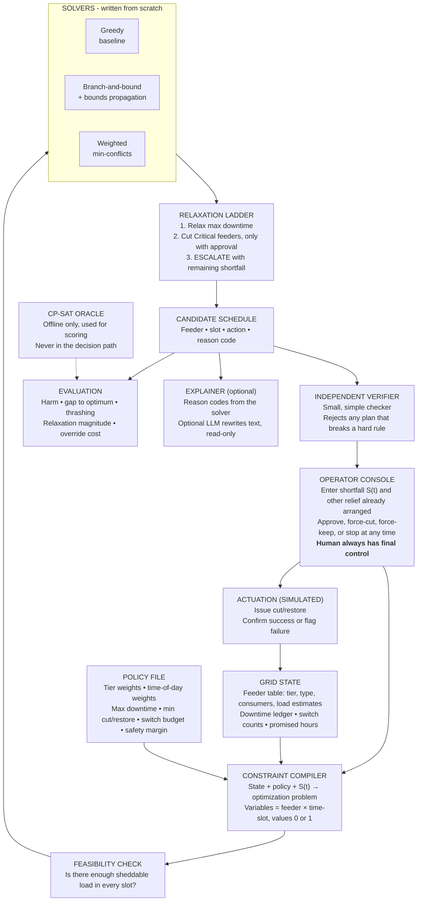

# Intelligent Load-Shedding Scheduler for Power Grids

# Executive Brief

When a power grid cannot meet demand, utilities cut power to some areas on purpose. This is called **load shedding**. It happens during heatwaves (air conditioners running), festival-season demand spikes, or equipment failure. The goal is to avoid a total blackout. In most of India today this is done reactively and by hand: an operator picks which feeders to cut, often under time pressure, with no clear method to balance safety, disruption, and practicality.

We build in that gap. We do not build a forecaster that predicts a shortfall. We build a **decision-support tool for the control-room dispatcher**: given a shortfall and a list of feeders (with loads and priority levels), it recommends which feeders to cut, in what order, and for how long. We treat this as a **weighted constraint optimization problem**. The tool also checks that the plan can actually be carried out by field staff (limited switching, minimum cut and restore times).

The tool is built to be understood, not trusted blindly:

- Every recommendation comes with a plain reason.
- An independent checker verifies every plan before it is shown.
- The human operator can always override any decision.
- Shedding is treated as the **last resort**, after cheaper options such as buying power or asking interruptible industry to cut.

An optional layer can turn the solver's reasons into plain-language text. It never makes decisions.

The project uses search, constraint solving, optimization, and (optionally) generative AI.

---

# 1. Problem Statement

## 1.1 Who this is for

- **Primary user: the dispatcher.** This is the control-room engineer (discom or SLDC) who decides how much load to shed, which feeders to cut, and for how long, and then issues the instruction. The tool helps this person make a more precise instruction, faster.
- **Secondary user: the field operator (substation operator or lineman).** This person receives the instruction and flips the switch. In this project, the field operator receives a clear printable table. Their real limits (few switch operations per shift, manual breakers) are built into the model so that plans are executable.
- **Later, only if results justify it:** automate the field operator's task. This is a stretch goal, and a human confirmation step stays in place.

## 1.2 Scope

- **S is an input, not an output.** The shortfall is a value the scheduler receives. It may come from a human operator's estimate (for example, "reduce 40 MW now") or, later, from a forecasting module (Section 10). The scheduler is never responsible for predicting it.
- **S is a vector.** S(t) gives the required relief for each time slot in the horizon. The scheduler receives a new S(t) at each replan.
- **Shedding is the residual.** Before shedding, the dispatcher has other options: buying power, backing down generation, asking interruptible industry to cut, voluntary demand response. The tool takes the shortfall that remains after those options. It shows the operator the amount of other relief it assumed.
- **What this is:** scheduled, rotational load shedding at hour scale (15-minute slots).
- **What this is not:** under-frequency load shedding (which acts in seconds), and it does not model network limits (line flows, voltages). Both are out of scope.

## 1.3 The model

**Time.** Slots t = 1..H (for example, 15 minutes each). We plan the whole horizon but commit only the first k slots, then replan.

**Feeders.** Each feeder f has:

- a **priority tier**:
  - **Flexible (F):** shed first. Example: interruptible industry.
  - **Normal (N):** standard homes and shops.
  - **Critical (C):** hospitals, water pumping, emergency services. Shed **last**, and only with explicit operator approval.
- a **feeder type**: urban, rural, agricultural, industrial, or mixed (a mixed feeder carries a critical consumer and is tagged with its highest tier)
- consumer count n_f
- estimated load L_f(t) in each slot (cutting a feeder relieves its **current load**, not its capacity)
- for agricultural feeders, any **promised supply hours**

**Decision.** x[f,t] = 1 if feeder f is cut in slot t, else 0.

**Hard constraints (must hold in any plan):**

1. **Relief.** Total relief in each slot must cover the shortfall: Σ L_f(t)·x[f,t] ≥ S(t) + safety margin + restoration surge (see below).
2. **Minimum cut duration and minimum restore duration.** A feeder cannot flip on and off every slot. This is the anti-thrashing rule.
3. **Switching budget.** A maximum number of breaker operations per feeder and in total per shift.
4. **Operator overrides.** Any feeder the operator forces to cut or to stay on is fixed.
5. **Promised supply hours.** Agricultural feeders keep their promised hours on.
6. **Critical tier.** No Critical feeder is cut without explicit operator approval.

**Soft constraint (can be relaxed in a stated order):**

- **Maximum consecutive downtime** per feeder (for example, no feeder off more than 3 hours in a row).

**Restoration surge.** When a feeder comes back after an outage, its load is higher than before (motors, ACs, and pumps start together). Load in the first slot after restore is L_f(t) × (1 + r_f), where r_f grows with outage length. This is added to the required relief in that slot.

**Uncertain load.** L_f(t) is an estimate. We add a safety margin to S(t) and test what happens when real load differs by 10-20%.

**Objective (what we minimize):**

```
total harm  =  Σ over feeders and slots  [ tier_weight × time_of_day_weight × consumers × (1 + β × (r − 1)) ]
             +  λ × overshoot        (cutting more than needed)
             +  μ × switch operations
```

- r is how many slots in a row the feeder has already been off. Each extra hour of continuous outage hurts more than the previous one (convex harm). This makes cuts rotate across feeders without a fairness rule.
- Tier weights are policy inputs set by the operator. Critical weights are very large. The tool does not decide whose pain counts more.
- Time-of-day weights let a night cut cost more than a noon cut. Exam and irrigation hours can be added.

**What the tool reports (no fairness claim):**

- total harm
- shed energy (kWh)
- cut-hours per feeder (mean and maximum, shown as plain numbers)
- longest outage
- number of switch operations
- overshoot
- thrashing rate
- relaxation magnitude
- optimality gap
- solve time

In plain terms: this is a resource-allocation-under-constraints problem, in the same family as exam scheduling, hospital bed allocation, or airline crew scheduling, but applied to something with immediate public consequences and a failure people experience every summer.

---

# 2. Why It Matters

- **The decision step is often manual.** Forecasting shortfalls is widely studied. Deciding what to cut, in what order, under switching limits is commonly done by hand under time pressure in Indian discoms. (Citations from regulator documents and news reports to be added in Phase 1.)
- **Mistakes under pressure are plausible.** Rotation that repeats on the same areas, and critical feeders cut by error, are reported problems. (To be supported with citations before submission.)
- **A shortfall tool can also say "don't shed."** Because it works on the residual after cheaper options, it can show the operator when buying power or asking industry to cut is the better move.

---

# 3. Existing Approaches and Their Limitations

| **Approach** | **How it's used today** | **Limitation (for our purpose)** |
|---|---|---|
| Manual rotational schedules | Discoms publish fixed cut schedules by area, adjusted by hand in a crisis | Slow to adapt when the shortfall changes; no systematic way to compare options |
| Forecasting systems (regression, ensembles) | Predict demand or shortfall | Stop at prediction; the allocation decision is left to a human |
| Greedy heuristic shedding | Cut the largest non-critical loads first until the shortfall is covered | Simple and fast, but ignores outage length, switching limits, and future slots |
| Commercial DERMS/ADMS platforms | Some advanced distribution systems include optimization | We have not evaluated them; their internal logic is not available to us, so we cannot compare against it |
| Optimal load shedding in power-systems research | Mathematical optimization, usually network-based (power-flow) formulations | Network-focused and mathematically heavy; not built for a readable, operator-facing feeder schedule |
| Constraint-based scheduling (exam timetabling, bed allocation, crew scheduling), constraint hierarchies, weighted CSPs, dynamic CSPs, rolling-horizon (MPC-style) scheduling | Established methods for hard/soft constraints, ordered relaxation, and repeated replanning | General methods. We **use** them. We do not claim to have invented them |

**The gap we address:** an open, readable, feeder-level scheduler for hour-scale rotational shedding that (a) includes real field limits, (b) is checked by an independent verifier, (c) is measured against an exact optimum, and (d) keeps the human in control.

*Note: key references to be added and verified in Phase 1 (for example Dechter, "Constraint Processing"; Borning et al. on constraint hierarchies; Bistarelli et al. on semiring-based and weighted CSPs; literature on optimal load shedding and rolling-horizon control; CERC/SLDC material on the deviation settlement mechanism).*

---

# 4. Our Contribution

We build the decision layer between "we know we're short by X kW" and "here is a safe, executable, explainable plan." We claim the **application, the field-informed model, and the evaluation**. We do not claim novelty of the underlying mechanisms.

**Four deliverables, each independently demo-able:**

1. **Model, simulator, verifier, and metrics.**
   A formal model in code (feeders, tiers, slots, constraints, harm), a synthetic grid generator, a scenario generator grounded in public data, an **independent verifier** that checks every schedule against the hard constraints, and a metrics module. Evaluation exists from day one.

2. **Solver benchmark with optimality gaps and a scale sweep.**
   Three solvers, all written from scratch:
   - a **greedy baseline** (rank feeders by harm per kW of relief, cut down the list, respecting the same rules)
   - **branch-and-bound with bounds propagation** (an exact method; bounds propagation tightens limits on the relief sum and the outage-length rules)
   - **weighted min-conflicts local search** (fast and approximate)

   **CP-SAT (Google OR-Tools) is used only as an "answer key"** to compute the best known solution, so we can say "our solver is within X% of optimal." Our solvers do not use it. A cheap **feasibility check** runs first (is there enough sheddable load to meet S(t) in every slot?). Local search only runs on feasible cases. We test feeder counts 10 → 50 → 200 → 500 and report where each solver starts to struggle.

3. **Relaxation ladder with measured severity.**
   When no plan satisfies everything, the tool relaxes rules in a fixed order and reports what it relaxed and by how much:
   1. relax **maximum consecutive downtime**
   2. cut **Critical** feeders, **only with explicit operator approval**
   3. **ESCALATE**: report the remaining shortfall to the human; do nothing automatically

   Severity is measured as a **magnitude** (for example, how many extra hours beyond the downtime limit), not just on/off.

4. **Rolling-horizon replanning with human control.**
   The scheduler replans on a fixed cadence or when the shortfall changes by more than a threshold. It uses the downtime ledger from earlier cycles, the switching budget, and restoration surge. The **operator can force-cut or force-keep any feeder at any time**, and the tool replans around that and logs it. If a feeder fails to trip, that becomes new input and the tool replans. We measure plan **thrashing** and the **cost of operator overrides** (extra harm caused by forcing a decision).

**Optional (not one of the four):** a plain-language explanation layer.
- The **solver** computes the reason for each cut (which constraints were binding, and the cost of the best alternative). For example: "Feeder 12 was cut because it had the lowest harm per kW and was last cut 6 hours ago."
- An LLM may optionally rewrite those reasons as sentences. It never sees or influences decisions, and it can say nothing that is not in the solver's reason log.
- The project works fully without any LLM.

**What we do not claim:**

- We do not predict shortfalls.
- We do not claim a fairness guarantee (see Section 9).
- We do not claim novelty of relaxation hierarchies, constraint optimization, or rolling-horizon planning.
- We do not build a production SCADA integration. Actuation is a simulation with success and failure states.

---

# 5. System Architecture



**Control loop, stated plainly.** The system does not run once. It replans every 5-15 simulated minutes, or whenever the shortfall changes by more than a threshold. Each replan reads the downtime ledger, so a feeder just cut is not casually cut again. Every plan passes the independent verifier before the operator sees it. The operator can approve, change, or override it. Actuation results (including failures) feed back into the grid state.

**Why the verifier matters.** The solvers are treated as untrusted. A small, simple checker validates every schedule. This is what makes it safe to use fast heuristic solvers.

## Agent framing (PEAS)

- **Performance measure:** minimize weighted harm subject to the hard constraints; minimize relaxation when relaxation is needed.
- **Environment:** the grid's current state, the shortfall vector S(t), feeder history, field limits.
- **Actuators:** recommended cut/restore instructions to the dispatcher (executed by simulated field operators).
- **Sensors:** shortfall magnitude, feeder states and load estimates, elapsed downtime per feeder, actuation confirmations.

---

# 6. Data and Simulation Plan

Real feeder-level cut and restore histories are not available in the selected public sources. We use public data to ground demand and shortfall assumptions. Feeder topology, priorities, downtime histories, and shedding decisions are synthetic.

## Primary dataset: Indian state electricity demand (2014-2024)

- **Source:** Hunt and Bloomfield, *Daily electricity demand data for Indian states (2014-2024)*, Zenodo. License: CC BY 4.0. Cite the dataset and keep attribution.
- **Files to download from the record's Files section:**
  - `corrected_peak_unmet_MW.csv` to calibrate shortfall **size and frequency**
  - `corrected_peak_met_MW.csv` to cross-check peak supply
  - `corrected_daily_energy_met_MU.csv` for daily energy context
- These are **daily, state-level** data. They cannot give the shape of S(t) within a day, and they are not feeder-level.

## Intra-day shape (a known gap)

The Zenodo data cannot tell us how a shortfall rises and falls through a day. Check whether Grid-India daily reports or the National Power Portal export give hourly or 15-minute demand. If not, we use a **documented synthetic evening-peak profile** and say so clearly.

## Feeder realism

- Consumer mix and consumers-per-feeder: from a state regulator tariff order or discom documents.
- Load profiles by class (residential, commercial, industrial, agricultural, essential): synthetic and documented.
- Field constraints (switching limits, supply-hour commitments, reliability standards): collected from public sources into `docs/field-constraints.md`. Each entry records its source, and is marked "to be validated by an operator interview when access is possible."

## Official validation and optional context

- **CEA Power Supply Position (Peak):** download one monthly report and cross-check selected state figures against Zenodo.
- **National Power Portal, Demand Met dashboard:** optional. Use only after checking columns, units, time resolution, and geographic coverage.
- **CEA Load Generation Balance Reports:** supplementary planning context only.

## Simulation method

1. Store original CSVs in `data/raw/zenodo_indian_state_demand/`. Do not edit raw files.
2. Inspect columns, dates, units, missing values, and the distribution of zero and non-zero unmet demand.
3. Define **mild, moderate, and crisis** shortfall scenarios from observed values using documented percentiles. Scale them to the synthetic grid's total load rather than assigning state-level MW values directly to a 10-500 feeder model. Convert units explicitly (1 MW = 1,000 kW).
4. Generate synthetic feeder loads, types, tiers, downtime histories, and changing shortfall inputs. At each replan the scheduler receives the current S(t). It does not forecast it.
5. Add realism tests: load-estimate error (±10-20%), restoration surge, and actuation failures.

Do not list a Kaggle compilation or hourly state-demand dataset as a confirmed input unless a specific accessible file has been downloaded, inspected, and its license and provenance recorded. Keep `data-sources.md` limited to sources actually verified, including download date, filename, relevant fields, units, resolution, license, and purpose.

---

# 7. Implementation Plan and Timeline

Team of three: **Person A** leads solver implementation, **Person B** leads model, simulation, and replanning, **Person C** leads literature, data, and evaluation. Cross-support is noted where a phase needs more than one person. Each phase has a named owner and a checkable exit criterion.

**Build order principle:** build a thin end-to-end slice first (model, verifier, metrics, greedy, oracle), then add the harder solvers. Evaluation is built from the start, not at the end.

| Phase | Owner | Deliverable | Exit criteria |
|---|---|---|---|
| 1. Problem formalization, literature, data selection | C (with A, B) | Formal model write-up; related-work table with real citations; `docs/field-constraints.md` from public sources | Formal spec approved by all 3; `data-sources.md` lists ≥4 verified, accessible sources; every citation checked |
| 2. Model, verifier, metrics in code | B (A supports) | Data classes (feeder, tier, slot, schedule), `verify(schedule)`, metrics module | Verifier passes hand-made valid cases and rejects hand-made invalid cases for every hard constraint |
| 3. Grid simulation and data pipeline | B, C | Synthetic grid generator; shortfall scenario generator | Valid tagged grids at 10/50/200/500 feeders; scenarios validated against Phase 1 data ranges |
| 4. Thin slice: greedy baseline + CP-SAT oracle | A | Greedy solver; CP-SAT oracle; first optimality gap | Gap computed on 10 and 50 feeder grids; every greedy output passes the verifier |
| 5. Branch-and-bound with bounds propagation | A | Exact solver with feasibility check | Matches the oracle's optimum on all small grids (≤50 feeders); solve times logged |
| 6. Weighted min-conflicts and solver comparison | A, C | Local search solver; comparison table | Table of solve time, harm, and optimality gap across 10/50/200 feeders for all solvers; verifier passes on all outputs |
| 7. Relaxation ladder and ESCALATE | B | Ladder implemented and logged | Ladder fires only when infeasible; order verified; Critical feeders never cut without approval in any test; ESCALATE reports the remaining shortfall; every step logged with magnitude |
| 8. Rolling-horizon loop with field limits and operator control | B (A supports) | Replan loop with ledger, switching budget, restoration surge, force-cut/force-keep, actuation-failure feedback | Replans correctly on cadence and on shortfall change; passes a scripted multi-cycle test; override and failure cases handled and logged |
| 9. Evaluation harness | C (A, B support) | Scale sweep, thrashing test, load-error test, override-cost test, relaxation severity report | Sweep run 10 → 500 feeders; thrashing, relaxation severity, and override cost reported per scenario tier |
| 10. Optional: explainer | A or B | Solver-side reason codes; optional LLM rewrite | Every explanation traces to a logged reason; boundary test shows the LLM cannot produce statements outside the log |
| 11. Report, buffer, demo | All | Full write-up, repo, presentation | Report covers all 4 deliverables with data from Phases 4-9; repo runs clean from a fresh clone; each member can defend any section in the viva |

---

# 8. Evaluation Methodology

- **Correctness.** Every schedule is checked by the independent verifier against all hard constraints. Report a 100% pass rate as a sanity check, not a headline result.
- **Solution quality.** Compare harm across solvers on identical scenarios, and report the **optimality gap** against the CP-SAT oracle.
- **Scalability.** Runtime and gap as feeder count grows (10 → 50 → 200 → 500). Identify where branch-and-bound stops being practical and where local search stays useful. Reaching this limit is a finding, not a failure.
- **Relaxation ladder.** For each scenario tier (mild, moderate, crisis): how often each rung fires, and the magnitude (for example, hours beyond the downtime limit, kW of Critical load cut, residual shortfall at ESCALATE).
- **Replanning stability.** Count feeder on/off flips between consecutive replans with no real change in shortfall or ledger (thrashing). Report a rate per scenario tier and check whether it clusters at planning-window boundaries.
- **Robustness to bad data.** Re-run scenarios with ±10-20% load error. Report how often the plan fails to cover the real shortfall, and how the safety margin changes that.
- **Cost of operator override.** Force cuts or keeps and measure the extra harm and the extra switching needed.
- **Harm-weight sensitivity (optional).** Run the same scenarios with different tier or feeder weights (for example, a loss-weighted policy that cuts high-loss feeders more) and show how schedules change. The point is to show the effect of a policy choice. We do not claim to know which choice is right.
- **Explanation quality (if built).** Check a sample of explanations against the solver's reason log.

---

# 9. Risks and Honest Limitations

- **Synthetic data risk.** Results are only as credible as the synthetic grid. Mitigation: ground parameters in public documents and state all assumptions.
- **No access to field staff.** Field constraints come from public sources. Mitigation: record every constraint with its source in `docs/field-constraints.md`, and flag each as "needs validation."
- **Solver scalability wall.** Exact solving will likely become impractical well before 500 feeders. This is expected and reported.
- **No fairness guarantee.** We removed fairness constraints and fairness metrics. Fairness is hard to define and measure, and the harm of an outage differs by place and person. The convex outage-length cost makes cuts rotate within an episode, but **we do not guarantee equal treatment over days or weeks**, and we do not claim to. The operator sets the weights; the tool does not decide whose outage matters more.
- **Plan thrashing.** Rolling-horizon replanning can flip a feeder on and off between cycles. Minimum cut and restore durations are built into the model, and thrashing is measured directly.
- **Rough load data.** Real feeder readings can be late or wrong. We use a safety margin and test against error.
- **Restoration surge.** Restoring a feeder adds load. Ignoring it makes the plan wrong in the slot after a restore. It is modeled, but surge values are assumptions.
- **Tool recommending shedding when it isn't needed.** Mitigated by taking the residual shortfall after other relief and showing that assumption to the operator.
- **Scope creep on the explainer.** It explains. It never decides. Expanding its role would weaken the core contribution.
- **Overclaiming.** Any claim of novelty or documented failure needs a citation, or it is removed.

---

# 10. Possible Extensions (Stretch Goals, Not Core Scope)

- **Automate the field operator's task**, with human confirmation, once the recommendation layer performs well.
- **A pluggable forecasting layer** as an input for S(t), without hard-coupling to the scheduler.
- **Interconnected zones and network structure**: reason across zones with shared shortfall limits (this brings topology back in).
- **Cross-day equity analysis**: if the project later needs it, study how cuts spread over many days, with a clearly justified definition.
- **Reinforcement-learning policy** as an extra comparison point against the optimization-based solvers.
- **Operator-interview validation** of the field constraints, when access is possible.
