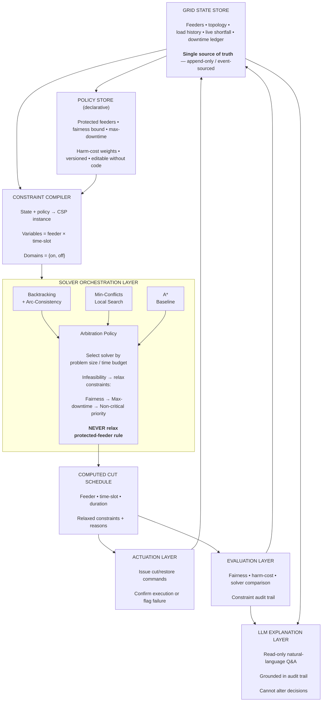

**Intelligent Load-Shedding Scheduler for Power Grids**

# **Executive Brief**

When a power grid can't meet demand - during a heatwavewhere air conditions are running, festival-season spiking, or equipment failure happens, utilities deliberately cut off power to specific areas (commonly known as "load shedding") to avoid risking a total blackout. In most of India today, this is done reactively and manually: an operator picks which feeders to cut, often under time pressure, with no principled way to balance fairness, safety, and minimal disruption.

Here we try building something in that gap, not a forecaster that predicts a suppy shortfall, but a scheduler that decides what to do about one. Given a shortfall size and a grid's feeders (with their loads and priority levels), the system computes which feeders to cut, in what order, and for how long - treating this as a Constraint Satisfaction Problem, such that hospitals and water systems aren't cut, no single area is unfairly targeted, and the total disruption is minimized. A secondary layer uses an LLM strictly for explaining the schedule in plain language, not for making the decision itself. The result is a decision-support system whose logic is transparent, auditable, and demonstrably fairer than ad hoc manual scheduling - built using search, CSP-solving, knowledge representation, and generative AI, which together cover nearly the entire AI course syllabus.

# **1. Problem Statement**

We are given a power shortfall S (kW) that must be resolved over a time horizon T, and a grid modelled as a set of feeders F = {f1, f2, ..., fn}, each with a load capacity, a priority class, and shedding history - determine an assignment of on/off states to each feeder across each time slot in T such that:

- the shortfall is resolved in every time slot (total shed load ≥ required cut at that time),
- hard-protected feeders (hospitals, water pumping, emergency services) are last priority to shed,
- no feeder exceeds a maximum allowed consecutive downtime,
- the distribution of cuts across feeders satisfies a fairness bound over a rolling window,
- the total "harm" (a weighted cost function over disruption, duration, and priority) is minimized.

In plain terms: this is a resource-allocation-under-hard-constraints problem, the same family as exam scheduling, hospital bed allocation, or airline crew scheduling, just applied to something with immediate public-safety consequences and a recognizable failure mode people experience every summer.

**Scope note (S is an input, not an output):** S is a live value the scheduler consumes, not something the scheduler computes. It may arrive from a human operator's estimate or, later, from a pluggable forecasting module (Section 11) - either way, the CSP layer treats S as given at each replan cycle and is never responsible for predicting it. If someone asks, "are you also forecasting shortfalls?" - no, forecasting is a separate, well-studied problem we deliberately scope out, and every claim in this document is about the decision layer that runs after S is known.

# **2. Why It Matters**

- It's unsolved at the deployment layer, not the modelling layer. Forecasting demand shortfalls is a well-studied problem (time-series regression, ensemble methods). Deciding what to do about a shortfall - fairly, safely, automatically - is not commonly built, especially not by students, because it requires CSP/search competency rather than just a trained model.
- The failure modes are real and documented. Manual/rotational load-shedding schedules in Indian discoms are known to produce inequitable outcomes (the same localities repeatedly losing power) and occasionally shed critical infrastructure due to human error under time pressure.

# **3. Existing Approaches and Their Limitations**

| **Approach** | **How it's used today** | **Limitation** |
|---|---|---|
| Manual rotational schedules | Discoms publish fixed rotational cut schedules by area/zone, adjusted manually during crises | No optimization, no fairness guarantee, slow to adapt to real-time shortfall changes |
| Pure ML forecasting systems | Predict demand/shortfall using regression/ensemble models | Stops at prediction — leaves the actual allocation decision to a human, which is the harder and more consequential half of the problem |
| Greedy heuristic shedding (used in some SCADA systems) | Cut largest non-critical loads first until shortfall resolved | Ignores fairness over time, can systematically over-target a few large feeders, doesn't reason about future shortfalls in the same episode |
| Commercial DERMS/ADMS platforms | Some advanced distribution management systems do use optimization | Proprietary, expensive, opaque — not something available for utilities in constrained-resource settings, and not something whose internal logic is publicly documented or explainable |
| Academic CSP-scheduling literature (exam timetabling, hospital bed allocation, airline crew scheduling) | Establishes the constraint-modeling patterns — hard/soft constraints, fairness bounds, relaxation ordering — this project draws on | Solves for a fixed resource set over a fixed horizon; none of the classic formulations assume a live, updating input (a shortfall that changes mid-episode) or require rolling-horizon replanning, which is the gap our system's control loop is built to cover |

The gap: a transparent, constraint-based, fairness-aware scheduler that can be built, explained, and reasoned about with off-the-shelf CSP-solving techniques - this is exactly what's missing between "we have a forecast" and "we have a fair, safe, automated response."

# **4. Our Contribution**

We are building the decision layer that sits between "we know we're short by X kW" and "here is a fair, safe, auditable plan to fix it" - the layer that manual scheduling and commercial DERMS platforms either skip or hide. 

Four deliverables, each independently gradable and independently demo-able:

1. A working CSP-based scheduler with two solving strategies, benchmarked against each other. Backtracking + arc-consistency and min-conflicts local search, both implemented from scratch (not via an off-the-shelf CSP library, so the constraint-propagation logic is ours to explain). Evaluated on synthetic grid topologies at increasing scale (feeder count × time horizon), reporting solve time, solution quality, and - critically - how each behaves as the problem becomes infeasible.
2. A defined, tested constraint-relaxation policy for infeasible shortfalls. When the shortfall is too large to resolve without violating a soft constraint, the system relaxes constraints in a stated order (fairness bound first, then max-downtime, never the protected-feeder rule) and reports exactly what was relaxed and why. This is the piece that turns "solves the textbook version of the problem" into "handles the version that actually happens during a heatwave," and it's original - none of the reference systems in our related-work review expose this.
3. A fairness metric reported as a first-class output, not a footnote. Gini coefficient or max-to-mean ratio of cut-time across feeders over a rolling window, computed automatically every replan cycle and logged alongside the schedule - so fairness is something we can plot over a semester of simulated operation, not a claim we make once.
4. A rolling-horizon replanning loop, not a single-shot solve. The scheduler re-solves as shortfall data updates, using the downtime ledger from prior cycles as a live constraint input. This is what makes the fairness-over-time and max-consecutive-downtime constraints real rather than theoretical, and it's the architectural piece that separates this from a homework-scale CSP demo.
5. An LLM explanation layer (optional) that is read-only and evidence-grounded. It answers operator queries ("why was Sector 12 cut before Sector 9?") strictly by querying the solver's constraint trace and the relaxation log - it never sees or influences the decision. We will demonstrate this boundary explicitly (e.g., by showing the LLM cannot produce an answer that isn't traceable to a logged constraint), which is the actual interpretability contribution, not just "we added a chat interface."

What we are explicitly not claiming: we are not predicting shortfalls (that's a separate, well-studied forecasting problem we treat as an input), and we are not building a production-grade SCADA integration - the actuation layer is a realistic simulation with confirmable success/failure states, not a live grid connection.

# **5. System Architecture**

Control loop, stated explicitly (this is the part the original diagram omits entirely): the system doesn't run once. It replans on a fixed cadence (e.g., every 5-15 simulated minutes) or whenever the shortfall changes by more than a threshold. Each replan reads the current downtime ledger from the Grid State Store, so a feeder that was just cut isn't immediately eligible to be cut again unless the constraint allows it - this is what actually enforces the fairness-over-a-rolling-window requirement, and it can't be enforced by a single-shot pipeline.

## Agent framing (PEAS):

- Performance measure: minimize weighted harm (disruption × priority × duration) subject to fairness and safety constraints
- Environment: the grid's current state, live shortfall size, feeder history
- Actuators: issue cut/restore commands per feeder per time slot
- Sensors: shortfall magnitude, feeder states, elapsed downtime per feeder

# **6. Data and Simulation Plan**

Real feeder-level cut/restore histories are not available in the selected public sources. Use public data to ground demand and shortfall assumptions; keep feeder topology, priorities, downtime histories, and shedding decisions synthetic.

Primary dataset — Indian state electricity demand (2014–2024)
- Source: Hunt and Bloomfield, Daily electricity demand data for Indian states (2014–2024), Zenodo. Dataset and downloads · DOI · License: CC BY 4.0.
- Download these corrected CSVs from the record’s Files section:
  - corrected_peak_unmet_MW.csv — calibrate shortfall magnitudes.
  - corrected_peak_met_MW.csv — cross-check peak supply.
  - corrected_daily_energy_met_MU.csv — daily energy context.
- These are daily, state-level data, not hourly or feeder-level records. Cite the dataset and retain attribution.

Official validation and optional context
- CEA Power Supply Position — Peak: monthly report archive. Download a relevant report and cross-check selected state-level figures against Zenodo.
- National Power Portal: Demand Met dashboard. Optional: try a previous-date Excel export, and use it only after checking its columns, units, time resolution, and geographic coverage.
- CEA Load Generation Balance Reports: CEA reports archive. Use only for supplementary planning context.

Simulation method
1. Store original CSVs in data/raw/zenodo_indian_state_demand/; do not edit raw files.
2. Inspect columns, dates, units, missing values, and the distribution of zero/non-zero unmet demand.
3. Define mild, moderate, and crisis shortfall scenarios from observed values using documented thresholds or percentiles. Scale them to the synthetic grid’s total load rather than assigning state-level MW values directly to a 10–500-feeder model. Convert units explicitly (1 MW = 1,000 kW).
4. Generate synthetic feeder loads, topology, priority/protection tags, downtime history, and changing shortfall inputs. At each replan, the CSP receives the current shortfall; it does not forecast it.

Do not list a Kaggle compilation or hourly state-demand dataset as a confirmed input unless a specific accessible file has been downloaded, inspected, and its license and provenance recorded. Keep data-sources.md limited to sources actually verified, including download date, filename, relevant fields, units, resolution, license, and purpose.
# **7. Implementation Plan and Timeline**

Revised to fix the structural gap in the original plan: every phase now has a named owner and a concrete, checkable exit criterion, not just a one-line deliverable. Team of three - Person A leads CSP solver implementation, Person B leads architecture/simulation/replanning, Person C leads literature, data, and evaluation - with cross-support noted where a phase leans on more than one person. This reshapes the original 9 rows into 11, since the rolling-horizon loop and the relaxation cascade are now full phases in their own right rather than folded into "fairness metrics."

<table>
  <colgroup>
    <col style="width: 25%">
    <col style="width: 35%">
    <col style="width: 40%">
  </colgroup>
  <thead>
    <tr>
      <th>Phase</th>
      <th>Deliverable</th>
      <th>Exit Criteria</th>
    </tr>
  </thead>
  <tbody>
    <tr>
      <td>1. Problem formalization &amp; literature review</td>
      <td>Formal CSP definition; related-work table (industry + academic CSP-scheduling lineage); dataset selection</td>
      <td>Formal spec reviewed and approved by all 3; <code>data-sources.md</code> lists ≥4 verified, accessible sources</td>
    </tr>
    <tr>
      <td>2. Grid simulation &amp; data pipeline</td>
      <td>Synthetic grid topology generator; demand/shortfall scenario generator</td>
      <td>Generator produces valid, protected-feeder-tagged topologies at 10/50/200/500 feeders; scenarios validated against Phase 1 data ranges</td>
    </tr>
    <tr>
      <td>3. CSP solver: baseline (backtracking + AC-3)</td>
      <td>Solver working end-to-end on small grids</td>
      <td>100% constraint satisfaction at ≤50 feeders on all test scenarios; solve times logged</td>
    </tr>
    <tr>
      <td>4. CSP solver: local search + comparison</td>
      <td>Min-conflicts solver, greedy baseline, first runtime/quality comparison</td>
      <td>Comparison table (solve time + harm-cost) complete across 10/50/200 feeders for all 3 solvers</td>
    </tr>
    <tr>
      <td>5. Rolling-horizon replanning loop</td>
      <td>Replan loop wired to live downtime ledger, cadence + threshold triggers</td>
      <td>Replans correctly on both cadence and shortfall-delta threshold; passes a scripted multi-cycle test sequence</td>
    </tr>
    <tr>
      <td>6. Constraint-relaxation cascade</td>
      <td>Relaxation policy implemented and logged</td>
      <td>Relaxation fires only when infeasible; order verified (fairness → downtime → priority); protected-feeder rule never relaxed in any test case; every relaxation logged with reason</td>
    </tr>
    <tr>
      <td>7. A* baseline &amp; fairness metric</td>
      <td>A* single-slot implementation + scope note; fairness metric wired into replan loop</td>
      <td>A* results labeled explicitly as non-comparable per Section 6; Gini/max-to-mean metric logged automatically every replan cycle</td>
    </tr>
    <tr>
      <td>8. Evaluation harness: scale, thrashing, relaxation</td>
      <td>Scalability sweep; replanning-stability (thrashing) test; relaxation frequency/severity report</td>
      <td>Sweep run at 10→500 feeders; thrashing rate measured and reported per scenario tier; relaxation frequency/severity reported per scenario tier</td>
    </tr>
    <tr>
      <td>9. LLM explanation layer</td>
      <td>Natural-language Q&amp;A grounded in constraint trace</td>
      <td>LLM answers verified against trace for a sample query set; boundary test shows it cannot answer beyond the logged trace</td>
    </tr>
    <tr>
      <td>10. Scaling analysis &amp; report writing</td>
      <td>Full comparative write-up; scaling limits documented</td>
      <td>Draft report covers all 4 deliverables with data from Phases 3–9; reviewed by all 3</td>
    </tr>
    <tr>
      <td>11. Buffer, polish, demo prep</td>
      <td>GitHub repo finalized, presentation, viva prep</td>
      <td>Repo runs clean from a fresh clone; presentation rehearsed; each member can defend any section in viva</td>
    </tr>
  </tbody>
</table>

# **8. Evaluation Methodology**

- Correctness: every produced schedule must be validated against all hard constraints (protected loads, shortfall resolution) - report a 100% constraint-satisfaction rate as a baseline sanity check, not a headline result.
- Solution quality: compare harm-cost across solving strategies for identical scenarios.
- Fairness: report the chosen fairness metric across strategies and scenarios; explicitly show cases where the "cheapest" schedule is also the least fair, to make the tradeoff visible.
- Scalability: runtime and solution quality as feeder count increases (10 → 50 → 200 → 500), to identify where backtracking degrades and where local search remains viable.
- Relaxation-cascade frequency and severity: for each scenario tier (mild/moderate/crisis), report how often the relaxation cascade fires, which constraint tier gets relaxed, and by how much (e.g., how far the schedule falls below the fairness bound when fairness is relaxed). This is now a first-class contribution (Section 4, deliverable #2) and needs its own reported metric, not a passing mention.
- Replanning stability: measure how often a feeder's on/off state flips between consecutive replan cycles with no corresponding change in shortfall or downtime ledger (plan thrashing) - a documented failure mode in rolling-horizon / MPC-style controllers. Report a thrashing rate per scenario tier and check whether it clusters around planning-window boundaries.
- Explanation quality (LLM layer, if built): manually verify a sample of explanations against the actual constraint trace to confirm the LLM is not hallucinating justifications.

# **9. Risks and Honest Limitations**

- Synthetic data risk: results are only as credible as the grid topology's realism - mitigate by grounding parameters in public discom documentation and stating assumptions explicitly.
- CSP scalability wall: backtracking-based exact solving will likely become impractical well before 500+ feeders - this is expected and should be reported as a finding, not hidden.
- Replanning instability (plan thrashing): rolling-horizon replanning is a new architectural decision with its own failure mode - a feeder can be toggled on then off across consecutive replan cycles due to boundary effects between planning windows, even when the underlying shortfall hasn't meaningfully changed. Mitigate with hysteresis (e.g., a minimum-state-duration constraint on toggles) and measure it directly via the thrashing metric in Section 9, rather than discovering it during the Week 12 evaluation pass.
- Scope creep on the LLM layer: it's tempting to expand the LLM component into a bigger feature; resist this - its job is explanation, not decision-making, and expanding its role would undercut the project's core CSP/search contribution.
- Fairness metric choice is a modeling decision, not a neutral fact - be prepared to justify why you chose Gini coefficient (or whichever metric) over alternatives in the viva.

# **10. Possible Extensions (Stretch Goals, Not Core Scope)**

- Incorporate a real (even simple) forecasting layer from the ML course as a pluggable input, demonstrating the two-course thematic connection without hard-coupling deadlines.
- Multi-region coordination: extend the CSP to reason across multiple interconnected grid zones with shared shortfall constraints.
- Reinforcement-learning-based policy as an additional comparison point against the CSP solvers, directly using the ML course's intro-RL unit.
